# BharatContract AI — Complete Project Dossier

> **Single-source project knowledge base.** Built by direct investigation of the repository at
> branch `feature/nextjs-frontend`, HEAD `77e9504`, on 2026-11-03. Every important statement
> carries an evidence tag (`[EVIDENCE]`, `[TEST]`, `[GIT]`, `[SOURCE]`) or a status label
> (`VERIFIED FACT`, `EXPERIMENTAL RESULT`, `KNOWN LIMITATION`, …). See §0.4 and §27.

## Table of Contents

- **0. Document Control** — identifiers, revision history, module system, status labels
- **1. Executive Summary** — short / one-paragraph / one-minute / five-minute
- **2. Project Identity and Vision** — scope, non-goals
- **3. Problem Definition** — ten problems, each with the system's answer and residual gap
- **4. Research Foundation and Related Work** — real literature, implemented vs not
- **5. Objectives and Requirements** — FR / NFR / SEC / PRIV / RES registers with status
- **6. System Scope and Boundaries** — I/O, context diagram, trust boundaries
- **7. System Architecture (arc42, all 12 sections)** — constraints, strategy, building blocks, runtime, deployment, crosscutting, ADRs, quality, risks, glossary
- **8. Complete Functional Workflow** — 16 stages + end-to-end pipeline diagram
- **9. NLP and Machine-Learning Methodology** — model register, thresholds, abstention, provenance
- **10. Risk Detection Methodology** — complete 18-rule inventory, negation, cross-references, FP/FN evidence
- **11. Obligation Intelligence** — extraction logic, condition-awareness, limitations
- **12. Legal Knowledge and Grounding** — the exact integrated source set; unverified-by-design
- **13. Dataset and Data Engineering** — CUAD/MAUD/processed artefacts, leakage, lineage diagram
- **14. Database and Data Models** — PostgreSQL ER + Neo4j graph models
- **15. API and Frontend Documentation** — complete endpoint inventory, Streamlit + Next.js
- **16. Security, Privacy, and Responsible AI** — protections present and missing
- **17. Testing and Quality Assurance** — 560-test suite map; what tests prove and do not
- **18. Evaluation Methodology and Experimental Design** — metric formulas, gold, splits, validity threats
- **19. Experimental Results** — every verifiable number with provenance (measured vs target)
- **20. Installation and Reproducibility Guide** — commands, env vars, troubleshooting
- **21. Known Limitations and Failure Analysis** — resolved history vs 20 open limitations
- **22. Research Contribution and Novelty Assessment** — six candidates, each graded
- **23. Research Paper Preparation Kit** — titles, abstract, RQs, methodology, results table with placeholders
- **24. Demonstration and Presentation Guide** — 30 s → 10 min scripts, faculty Q&A
- **25. Development Roadmap** — completed / in progress / prioritized open items
- **26. Complete Traceability Matrix** — requirement → component → test → result → claim, with broken links
- **27. Master Evidence Register** — 32 auditable evidence entries
- **28. Master Glossary and Abbreviations**
- **29. References and External Resources** — 12 verified references
- **30. Final Project State Snapshot** — state at investigation + top five next actions

---

## 0. Document Control

| Field | Value |
|---|---|
| **Document title** | BharatContract AI — Complete Project Dossier |
| **Project name** | BharatContract AI — Legal Contract Intelligence: Risk-Aware Clause Extraction & Obligation Tracker |
| **Document identifier** | `BC-DOC-DOSSIER-001` |
| **Document revision** | 1.0 (initial investigation release) |
| **Software version** | 0.1.0 (per `pyproject.toml`, `app/main.py`) — **independent of this document's revision** |
| **Creation date** | 2026-11-03 |
| **Last verified date** | 2026-11-03 (all runtime verifications performed on this date) |
| **Repository location** | `/marimo/nlp` (local git repository) |
| **Git branch at investigation** | `feature/nextjs-frontend` |
| **Git HEAD commit at investigation** | `77e950427be48342f822b61e50e06efa91d9c9c6` — "fix(frontend): /v1 API path, login Suspense boundary, drop jsdiff, capability matrix" |
| **Working-tree state** | Clean (0 uncommitted changes at investigation time) |
| **Relation to `main`** | 7 commits ahead, 0 behind (`main` at `cb7b4f0`) |
| **Documentation status** | Complete single-source dossier; every major claim carries an evidence tag or status label |
| **Intended audience** | College research-paper author; faculty evaluator; maintaining engineer; continuing AI coding agent; architecture reviewer; new project reader |
| **Scope** | Complete current-state documentation of the repository: architecture, NLP/ML methodology, risk engine, obligation extraction, legal grounding, datasets, evaluation, tests, security, deployment, research-paper kit. Covers both the Streamlit dashboard (on `main`) and the Next.js frontend (on this branch). |
| **Out of scope** | Future feature design; legal advice; claims about real-world legal accuracy (none can be supported by in-repo evidence); upstream dataset authenticity beyond internal hash pinning |
| **Confidentiality** | No credentials, tokens, or private contract content are reproduced. All six sample contracts in `data/raw/` are synthetic with fictional parties (explicit banners in each file). Dataset license status is **unverified in-repo** — see §13 and §29. |
| **How to use this document** | Each numbered section is a self-contained information module (§0.2). Use the master module index (§0.3) to locate topics. Every important technical statement carries an evidence tag `[EVIDENCE: …]`, `[TEST: …]`, `[GIT: …]`, `[SOURCE: n]`, or a status label (`VERIFIED FACT`, `REPOSITORY OBSERVATION`, etc. — see §0.4). The evidence register (§27) maps each numbered evidence item to what it does and does not prove. |

### 0.1 Revision history

| Rev | Date | Author | Description |
|---|---|---|---|
| 1.0 | 2026-11-03 | AI documentation agent (investigation session) | Initial complete dossier. Built from direct repository inspection, 5 parallel investigation workstreams, independent re-verification, and live execution of the test suite, demo, evaluation harness, and provenance verifier on HEAD `77e9504`. |

### 0.2 Information-module system (S1000D-inspired, not S1000D-compliant)

This dossier uses a lightweight information-module scheme inspired by S1000D principles: modular units, unique identifiers, explicit metadata, traceable references. It does **not** claim S1000D compliance. Module identifiers follow the scheme `BC-DM-NNN` (BharatContract Documentation Module). Each numbered section of this dossier is one module. Module metadata:

- **Identifier / title:** the section number and heading.
- **Version:** dossier revision 1.0 (all modules share it; per-module revisions tracked in revision notes where they differ from the rest).
- **Status:** each module states `VERIFIED` (claims backed by executed evidence), `PARTIALLY VERIFIED`, or `RECONSTRUCTED` where appropriate.
- **Purpose / applicability / prerequisites:** stated in the first paragraph of each module.
- **Related modules / evidence references / revision notes:** cross-references are given inline; the master evidence register (§27) is the single audit index.

### 0.3 Master module index

| ID | Section | Title | Status |
|---|---|---|---|
| BC-DM-001 | §0 | Document Control | VERIFIED |
| BC-DM-002 | §1 | Executive Summary | VERIFIED |
| BC-DM-003 | §2 | Project Identity and Vision | PARTIALLY VERIFIED (vision items are from charter, not code) |
| BC-DM-004 | §3 | Problem Definition | VERIFIED (implementation-demonstrated parts); general industry parts labelled INFERENCE |
| BC-DM-005 | §4 | Research Foundation and Related Work | VERIFIED (literature is real, primary sources only) |
| BC-DM-006 | §5 | Objectives and Requirements | VERIFIED (requirements derived from code; status per requirement) |
| BC-DM-007 | §6 | System Scope and Boundaries | VERIFIED |
| BC-DM-008 | §7 | System Architecture (arc42, 12 sections) | VERIFIED |
| BC-DM-009 | §8 | Complete Functional Workflow | VERIFIED |
| BC-DM-010 | §9 | NLP and Machine-Learning Methodology | VERIFIED |
| BC-DM-011 | §10 | Risk Detection Methodology | VERIFIED |
| BC-DM-012 | §11 | Obligation Intelligence | VERIFIED |
| BC-DM-013 | §12 | Legal Knowledge and Grounding | VERIFIED (what is integrated) / explicitly unverified (statute text) |
| BC-DM-014 | §13 | Dataset and Data Engineering | VERIFIED (counts executed) |
| BC-DM-015 | §14 | Database and Data Models | VERIFIED |
| BC-DM-016 | §15 | API and Frontend Documentation | VERIFIED |
| BC-DM-017 | §16 | Security, Privacy, and Responsible AI | VERIFIED |
| BC-DM-018 | §17 | Testing and Quality Assurance | VERIFIED (560 tests executed at investigation) |
| BC-DM-019 | §18 | Evaluation Methodology and Experimental Design | VERIFIED |
| BC-DM-020 | §19 | Experimental Results | VERIFIED (all numbers re-executed or sourced from dated reports) |
| BC-DM-021 | §20 | Installation and Reproducibility Guide | PARTIALLY VERIFIED (setup commands verified on this machine; full docker stack not booted at investigation) |
| BC-DM-022 | §21 | Known Limitations and Failure Analysis | VERIFIED |
| BC-DM-023 | §22 | Research Contribution and Novelty Assessment | VERIFIED (novelty judgements explicitly graded) |
| BC-DM-024 | §23 | Research Paper Preparation Kit | PROPOSED (paper material; placeholders explicit) |
| BC-DM-025 | §24 | Demonstration and Presentation Guide | PROPOSED (uses only verified-working features) |
| BC-DM-026 | §25 | Development Roadmap | PROPOSED (derived from verified open items) |
| BC-DM-027 | §26 | Complete Traceability Matrix | VERIFIED (broken links explicitly identified) |
| BC-DM-028 | §27 | Master Evidence Register | VERIFIED |
| BC-DM-029 | §28 | Master Glossary and Abbreviations | VERIFIED |
| BC-DM-030 | §29 | References and External Resources | VERIFIED (URLs accessed 2026-11-03) |
| BC-DM-031 | §30 | Final Project State Snapshot | VERIFIED |

### 0.4 Status labels used in this dossier

| Label | Meaning |
|---|---|
| `VERIFIED FACT` | Statement re-verified during this investigation (code read and/or executed). |
| `REPOSITORY OBSERVATION` | Directly observable in the repository; not independently re-executed by this dossier. |
| `EXPERIMENTAL RESULT` | Measured value with full provenance (date, commit, command, dataset). |
| `HISTORICAL FACT` | True of a past commit/report; may have been superseded (supersession stated). |
| `INFERENCE` | Reasoned from evidence; not directly stated in the repo. |
| `PROPOSED APPROACH` | Recommendation or plan; not implemented. |
| `UNVERIFIED` | Claimed somewhere but not verifiable from this checkout. |
| `KNOWN LIMITATION` | Documented constraint of the current implementation. |
| `NOT IMPLEMENTED` | Does not exist in code. |
| `REQUIRES HUMAN REVIEW` | Output or decision that must not be taken as final. |

Evidence tags: `[EVIDENCE: path — symbol]`, `[TEST: tests/file.py::test_name]`, `[GIT: short_hash — message]`, `[SOURCE: n]` (reference number from §29).

---

## 1. Executive Summary (BC-DM-002)

**Status: VERIFIED.**

### 1.1 Short executive summary

BharatContract AI is a rule-first, evidence-grounded contract-intelligence system for the Indian legal context. It ingests a contract (PDF, DOCX, TXT, MD), segments it into clauses, classifies each clause against a 26-label taxonomy, extracts entities (parties, CIN/PAN/GSTIN, INR amounts, dates, notice periods, governing law, arbitration seat), extracts structured obligations (subject, action, object, condition, deadline, frequency), and scores risk using 18 deterministic rules (11 per-clause, 7 contract-level) plus an optional weakly-supervised ML recall booster. Every risk finding carries an evidence span bound to source text and, where curated, a statutory or case-law pointer explicitly marked as *unverified until confirmed*. Results persist to Neo4j (graph) and PostgreSQL (metadata) and are served by a FastAPI backend consumed by a Streamlit dashboard (baseline) and a new Next.js frontend (current branch). The system is engineered to degrade gracefully: it runs with zero external infrastructure. **VERIFIED FACT:** the full test suite passes 560/560 at HEAD `77e9504`; the CLI demo, synthetic evaluation harness (17/17 cases), and provenance verifier (0 failures) all execute successfully on this checkout.

### 1.2 One-paragraph project description

BharatContract AI is a Python 3.10–3.12 system that analyzes legal contracts before signature. Given a document, it produces a machine-readable model of the contract — clauses with types, entities, obligations, and risk findings — where each risk finding is traceable to an exact span of source text and each legal citation is labelled as a curated pointer that has *not* been independently verified against primary legal text. The detection layer is deliberately rule-first and explainable (18 named rules with statutory/case-law pointers for Indian law: Indian Stamp Act 1899 ss. 33/35, Indian Contract Act 1872 ss. 27/124–125, Arbitration and Conciliation Act 1996, BALCO and BGS SGS Soma, Income Tax Act 1961 TDS provisions, DPDP Act 2023 s. 8(6)); a weakly-supervised TF-IDF + logistic-regression classifier adds `ML_RISK_001` findings only for clauses the rules missed, and every model finding is marked `evidence_status="unverified"`. Training data comes from the CUAD and MAUD datasets (US commercial contracts) — the project states explicitly that no number in the repository supports an Indian-law accuracy claim. `[EVIDENCE: README.md — Provenance section; nlp/taxonomy.py — INTERNAL_LABELS]`

### 1.3 One-minute explanation

A lawyer reviewing a 50-page contract must read every clause, decide what each party must do, notice missing protections (no liability cap, no governing law), and check whether statutory requirements are met (is the instrument stamped? will TDS apply?). BharatContract AI automates the *detection and triage* layer of that work. You upload a contract; the system segments it into clauses (regex heading detection), classifies each clause (keyword rules + a bundled TF-IDF model), extracts named entities with regex patterns tuned for Indian identifiers (CIN, PAN, GSTIN, INR amounts in lakh/crore), extracts obligations from modal-verb patterns ("Party A shall notify Party B within 30 days" → subject/action/object/deadline), and runs 18 risk rules that encode specific, named commercial and statutory concerns — for example, "arbitration seat is foreign while venue is in India" (the BALCO/BGS SGS Soma problem) and "indemnity may not cover direct losses under s. 124 of the Indian Contract Act". Each finding quotes the exact clause span that triggered it and links to the relevant statute or case as a *pointer to be verified*. The system is honest about what it is: it never claims legal advice, it marks model output as unverified, it says "not found — verify" instead of "compliant", and it is allowed to abstain. It runs with no infrastructure, and it degrades gracefully when databases or ML libraries are missing.

### 1.4 Five-minute technical explanation

**Pipeline.** The pipeline is fixed-order: parse → segment → classify → NER → obligations → risk rules → ML augmentation → score. It is orchestrated by `app/services/analyzer.py::_analyse`. `[EVIDENCE: app/services/analyzer.py — _analyse]`

1. **Parsing** (`app/services/parser.py`): pdfplumber first, PyMuPDF second, per-page tesseract OCR as fallback for PDFs with <50 chars/page; python-docx (including table cells) for DOCX; encoding ladder + binary-garbage gate for TXT/MD. Hard limits: 2,000,000 chars total (truncation warns), minimum-meaningful-content checks that *reject* empty or garbage documents with 400-class errors. `VERIFIED FACT`: 22 realistic-fixture tests (PDF/DOCX/OCR/corrupt/oversize) pass. `[TEST: tests/test_realistic_fixtures.py]`
2. **Segmentation** (`app/services/segmenter.py`): paragraph spans are grouped into clauses at detected headings (section numbers, all-caps lines, annexure keywords, title-case hint words). A source-integrity invariant holds: every `Clause.text` is an exact slice `cleaned[char_start:char_end]`. Clauses >2,500 chars are split in three stages (paragraph → sentence → fixed-char). `[TEST: tests/test_segmenter.py, tests/test_long_clauses.py]`
3. **Context resolution** (`nlp/context/resolver.py`): deterministic cross-reference resolution (clause/section/schedule/exhibit/annexure + number), defined-term indexing, and precedence/override *candidate* detection. It is deliberately narrow: it records `resolved` / `missing` / `ambiguous` statuses and never decides legal meaning. A rule may use a resolved cross-reference to suppress a missing-cap finding only when the reference is unambiguously resolved *and* the referenced clause states a verifiably applicable cap (fail-closed design; 15 tests). `[TEST: tests/test_p4_cap_resolution.py]`
4. **Clause classification** (`nlp/clause_classification/`): hybrid of (a) 26 keyword-rule lists + a CUAD-derived keyword bank (letter-boundary regexes; weighted scoring; abstains to "Miscellaneous" with confidence 0.3 when nothing matches) and (b) a bundled TF-IDF + linear classifier (joblib, extracted on first use from `models/tfidf_classifier.7z`; 14 of 26 labels supported; per-class probability threshold 0.15; top-5 labels). Optional DeBERTa-v3-base enrichment exists but requires the `[ml]` extra and is a silent no-op without it. `VERIFIED FACT`: family-disjoint CUAD held-out evaluation gives Acc@1 of 0.184 (rule-only) vs 0.401 (hybrid) — the only legitimate generalization estimate in the repo, and it is for US contracts only. `[EVIDENCE: reports/evaluations/heldout_family_disjoint_20261103.md]`
5. **NER** (`nlp/ner/ner.py`): regex-first; ~15 entity families including Indian identifiers (CIN, LLPIN, PAN, GSTIN, TAN), INR/USD/EUR/GBP amounts (with lakh/crore), 8 date formats, notice periods (deontic-prefix required — a fix for a confirmed deep-audit defect), durations, term/cure periods, ~46 Indian cities, Indian states, and 18 foreign arbitration seats. Special detectors for governing law, arbitration seat (explicit-phrase-first to fix the "any city mention" defect), and negation-aware stamp-duty/TDS/GSTIN mention detection. `[TEST: tests/test_regressions.py, tests/test_negation_and_context.py]`
6. **Obligation extraction** (`nlp/obligation_extraction/extractor.py`): modal-verb pattern matching (prohibition/right/obligation with base confidences 0.8/0.7/0.85), passive-voice agent recovery ("shall be encrypted *by the Processor*"), condition masking (if/unless/provided that/subject to), written-number deadline normalization ("twenty-four (24) hours" → "24 hours"), explicit-recipient-only counterparty detection (never inferred), frequency extraction (rejects "periodically"), per-clause dedup, and a content-based severity table with a bounded urgency boost. `VERIFIED FACT`: 59 tests pass. `[TEST: tests/test_obligation_extraction.py]`
7. **Risk rules** (`nlp/risk_scoring/rules.py`): 11 per-clause rules + 7 contract-level rules, each with `rule_id`, severity, score, trigger logic, negation guard, and case-law enrichment. Indian-statutory rules (stamp duty, TDS, s. 124 indemnity, post-employment non-compete, missing dispute resolution) gate on `jurisdiction == India`. Findings are de-duplicated by `rule_id` (highest severity wins), enriched with case-law pointers, and bound to evidence spans (clause-level: exact trigger sentence offsets; contract-level: `unverified` + search scope). `[TEST: tests/test_risk_rules.py — 43 tests]`
8. **ML risk booster** (`nlp/risk_scoring/risk_model.py`): TF-IDF (1–2 grams) + logistic regression, weakly supervised by the rule engine itself (labels are rule outputs + mild clause-type priors, capped at MEDIUM). Applied *only* to clauses with no rule hit; emits `ML_RISK_001` with uncalibrated fallback scores (45/60/75) and `evidence_status="unverified"`. No-ops when the artefact is missing. `VERIFIED FACT`: on a 300-document in-distribution CUAD train sample it added 63 findings, 0 redundant, changing the overall score of 60/300 documents. `[EVIDENCE: reports/evaluations/risk_booster_delta_20261103.md]`
9. **Scoring** (`nlp/risk_scoring/scorer.py`): `score = min(100, top_finding + min(20, (n−1)·2) + min(10, Σseverity_weights/100))`; levels at 76/51/26. The score is documented as "a prioritization aid … not a probability and not a legal assessment", and every summary carries that caveat plus a machine-readable breakdown. `[EVIDENCE: nlp/risk_scoring/scorer.py — SCORE_CAVEAT]`
10. **Persistence**: Neo4j graph (Contract→Clause→Obligation→Risk, `HAS_CLAUSE`/`IMPOSES`/`TRIGGERS`/`HAS_PARTY`) and PostgreSQL (contracts, jobs tables; owner columns for row-level security). Both are optional: absent databases are probed, failures cached, and all writes no-op with warnings; the in-memory job store (200-cap, size-based eviction) keeps the API functional. `[EVIDENCE: app/db/neo4j.py, app/db/postgres.py]`

**Evaluation posture.** The project distinguishes three things it insists on keeping separate: *artifact provenance* (where bytes came from — hash-pinned, fail-closed), *evaluation* (metrics on held-out, family-grouped sets), and *predictive validity* (real-world correctness — **not established by anything in the repo**). `VERIFIED FACT`: the deep audit of 2026-11-03 found the original Phase 2B gold annotations partially fabricated and the regression gate a tautology (findings C1/C2); both were fixed the same day (gold regenerated from real case text with manual adjudication; self-comparison now forces exit 1), and the fix is re-verified in this dossier.

**What is not in the system.** No LLM is used anywhere (no RAG, no generative redlines). No real Indian contracts exist in the repo (all six samples are synthetic with fictional parties). No Indian-law accuracy has been measured. The Streamlit UI does not send bearer tokens (documented deferral). OCR is graceful-failure only when tesseract is absent.

---

## 2. Project Identity and Vision (BC-DM-003)

**Status: PARTIALLY VERIFIED** — identity facts are verified from code/config; vision items are `REPOSITORY OBSERVATION` from the project charter (agreed direction, not implementation).

| Field | Value | Evidence |
|---|---|---|
| Official project title | "BharatContract AI — Legal Contract Intelligence: Risk-Aware Clause Extraction & Obligation Tracker" | `[EVIDENCE: pyproject.toml — description]` |
| Repository name | `bharatcontract-ai` (project name in `pyproject.toml`); directory `nlp` | `[EVIDENCE: pyproject.toml — name]` |
| Project category | College research project + software system (hybrid) | `[EVIDENCE: BharatContract_AI_Project_Charter.md — "College project; constrained time and budget"]` |
| Application domain | Legal contract analysis; commercial contracts | `[EVIDENCE: README.md]` |
| Primary jurisdictional focus | India (default `DEFAULT_JURISDICTION="India"`); global rules run on all jurisdictions | `[EVIDENCE: app/core/config.py — default_jurisdiction; nlp/risk_scoring/rules.py — requires_indian]` |
| Intended users | Contract reviewers, legal/compliance analysts, business users triaging agreements | `[EVIDENCE: BharatContract_AI_Project_Charter.md]` REPOSITORY OBSERVATION |
| Stakeholders | Project team (college students), faculty, future maintainers | RECONSTRUCTED from charter + commit history |
| Core objectives | Evidence integrity first; reliable parsing; useful clause/obligation understanding; controlled false alarms; trustworthy legal grounding; explainable prioritization | `[EVIDENCE: BharatContract_AI_Project_Charter.md — priority order 1–7]` |
| Product vision | Automated *pre-signature* detection of dangerous clauses, missing stamp duties, arbitration risks, and hidden obligations | `[EVIDENCE: README.md — title tagline]` |
| Research motivation | Demonstrate an evidence-grounded, explainable, rule-first legal-NLP pipeline with honest evaluation; Indian-context gap in public datasets (CUAD/MAUD are US corpora) | `[EVIDENCE: reports/evaluations/dataset_provenance_20261103.md — "What neither supports: Indian-law compliance"]` |
| Explicit non-goals | No legal advice; no exhaustive Indian-law coverage; no LLM/redline generation; no frontend expansion as a research goal ("Spend project time expanding the dashboard" is an explicit non-goal in the charter — the Next.js frontend on this branch post-dates that principle and is treated as an engineering deliverable, not a research contribution) | `[EVIDENCE: BharatContract_AI_Project_Charter.md; README.md — Disclaimer]` |

**Supported scope (actual, not assumed).**
- Contract types: the taxonomy covers 26 clause categories; the six bundled samples exercise MSA, one-way NDA, vendor procurement, consulting, employment, and data-processing agreements. `VERIFIED FACT` (files read): all six exist in `data/raw/` and are synthetic. `[EVIDENCE: data/raw/*.txt]`
- Contract types *not* covered by any sample or rule: loan agreements, JV agreements, licenses, franchises, leases, real-estate, government procurement, revenue-share (inventory: 10 of 15 scenarios only partially covered). `[EVIDENCE: reports/evaluations/indian_coverage_20261103.md]`
- Languages: English only. `[EVIDENCE: nlp/ner/ner.py — English regexes; plan.md §9 — "Indic languages" deferred]`
- Formats: `.pdf` (digital + OCR fallback for scanned), `.docx` (incl. tables), `.txt`, `.md`. `[EVIDENCE: app/services/parser.py — SUPPORTED_EXTENSIONS]`

---

## 3. Problem Definition (BC-DM-004)

**Status: VERIFIED for implementation-demonstrated problems; INFERENCE for general industry characterizations.**

### 3.1 The manual contract-review problem

| # | Problem | Why it matters | Existing approaches | Their limitation | How BharatContract addresses it | Remaining limitation |
|---|---|---|---|---|---|---|
| P1 | Clause identification in long documents | Reviewers must locate every relevant provision; missing one clause can miss a critical protection | Manual reading; generic PDF search | Linear in document length; no type awareness | Regex heading segmentation + 26-label classification | Heading detection is rule-based; unconventional layouts degrade (KNOWN LIMITATION, §21) |
| P2 | Risk identification | Dangerous terms (uncapped liability, auto-renewal, one-sided termination) are phrased many ways | Checklists; reviewer expertise | Checklists are static; expertise does not scale | 18 named rules with negation guards + ML recall booster | Phrase-list coverage is finite; 12 taxonomy labels have zero training data (US datasets) |
| P3 | Missing protections | Absence (no liability cap, no governing law, no dispute mechanism) is invisible to text search | Human review | Exhaustiveness depends on reviewer | 7 contract-level rules including `MISSING_CLAUSE_*` and `RISK_DISPUTE_001` | Absence detection is keyword/label based; a present-but-defective clause is not detected as defective |
| P4 | Conditional obligations | "Shall pay within 30 days *unless* the invoice is disputed" — the condition changes who owes what | Human reading | Error-prone | Condition masking in obligation extraction (if/unless/provided that/subject to, clause-initial only) | Only clause-initial conditions are parsed; nested/complex conditions are NOT handled (KNOWN LIMITATION) |
| P5 | Deadlines and exceptions | Missing a notice deadline can terminate protections | Calendar management from manual extraction | Manual | Deadline extraction incl. written numbers ("twenty-four (24) hours"); iCalendar export in the Next.js UI | Expression-level only; relative deadlines ("within 30 days of termination") are not converted to calendar dates (documented in UI) |
| P6 | Cross-references | "The cap in Clause 14 applies here" — analysis must resolve the reference or abstain | Human reading | Ambiguity is easy to miss | `nlp/context/resolver.py` resolves/flags missing/ambiguous references; cap suppression only on unambiguous resolution (fail-closed, 15 tests) | Only numeric section keys and defined-terms in `"Term" means` form; Markdown headings not parsed (stated limitation) |
| P7 | Party responsibility | Who must do what? Passive voice hides the obligor | Human reading | Passive constructions are common in Indian contracts | Passive-voice agent recovery from "by …" phrases; explicit-recipient-only counterparty detection | Obligor left `None` when recoverable agent is absent — by design ("never invent"); no-comma leading conditions leave party `None` (documented open item) |
| P8 | Legal-source verification | A rule citing a statute is only as good as the citation | Manual citation checking | Slow; requires expertise | Every case-law entry carries `verified_on=None` and an explicit "not independently verified against primary text" note | All citations are pointers, not verified propositions (KNOWN LIMITATION by design; deep-audit C18 found and fixed several citation errors) |
| P9 | Human interpretation vs. machine output | Users may over-trust scores | — | — | Three-way separation: exact source text / curated legal pointer / labelled system inference; score caveat; `evidence_status` per finding | Human review is required; the system never claims authority (by design) |
| P10 | Evidence traceability | A finding without a source span cannot be audited | — | — | `EvidenceSpan` binding: clause-level findings carry exact trigger-sentence offsets; contract-level findings carry search scope + `unverified` status; ML findings `contextual` + `unverified` | Clause-granular evidence for some rules; sentence-level via `_tight_span` where implemented (P4/P2 history, §21) |

`REPOSITORY OBSERVATION`: the charter records the design principle driving P8/P9/P10: distinguish (1) what the contract says, (2) what a legal source says, (3) what the system infers — "The system must be allowed to say 'insufficient evidence to determine.'" `[EVIDENCE: BharatContract_AI_Project_Charter.md]`

---

## 4. Research Foundation and Related Work (BC-DM-005)

**Status: VERIFIED** — all listed works are real, primary sources. Nothing is cited that could not be verified. The table separates: (E) established research the project builds on; (I) techniques implemented in this project; (F) techniques considered but not implemented.

### 4.1 Natural language processing and legal NLP

- **Legal NLP** is the application of NLP techniques to legal texts: clause classification, entity extraction, obligation/argument extraction, and legal information retrieval. The project's rule-first design is one of the recognized approaches; the alternative (deep learning end-to-end) is not used. `[SOURCE: 1]` (E)
- **Contract clause classification** — assigning clause types (indemnity, limitation of liability, termination, …). The CUAD dataset is the standard benchmark: 510 US commercial contracts from SEC EDGAR, 41 question categories, QA-pair annotation format. `[SOURCE: 2]` (E; dataset shipped in-repo at `data/datasets/cuad/`). The project maps 41 CUAD categories onto 26 internal labels. `[EVIDENCE: nlp/taxonomy.py — CUAD_TO_INTERNAL]` (I)
- **MAUD** (M&A Understanding Dataset) — question-answering over US merger agreements; 153 contracts, 7 categories, main/rare/abridged row types. `[SOURCE: 3]` (E; shipped at `data/datasets/maud/`). Used only for training-example generation, never for evaluation. `[EVIDENCE: nlp/datasets/maud.py]` (I)

### 4.2 Information extraction

- **Named entity recognition (NER)** — identifying named entities (organizations, dates, money, locations) in text. Established approaches range from gazetteer/regex matching to sequence labelling (BiLSTM-CRF, transformers). The project uses **regex-first NER** with curated gazetteers (Indian cities, states, arbitration seats) and deterministic identifier patterns (CIN/PAN/GSTIN), which is a deliberate choice for explainability and zero-dependency operation; transformer-based NER (DeBERTa-v3-base) exists as an optional enrichment that only adds entities the regex layer missed. `[SOURCE: 4]` (E) (I: `nlp/ner/ner.py`, `nlp/ner/ner_ml.py`)
- **Information extraction / obligation extraction** — extracting structured predicates (agent, action, patient, condition, time) from legal text. Classical work on deontic modality in law ("shall/must/may") underpins modal-verb pattern extraction. The project's extractor is pattern-based: deontic patterns → subject/action/object, with passive-voice agent recovery and condition masking. It is a **mention-level** extractor, not a semantic parser: complex sentences can leave fields `None` (by design, "never invent"). `[SOURCE: 5]` (E) (I: `nlp/obligation_extraction/extractor.py`)
- **Relation extraction** — extracting relations between entities (party A obliges party B). The project does *not* run a relation-extraction model; counterparty detection is pattern-based (dative "to X", double-object verbs, party role nouns). (F: a real relation extractor is future work)

### 4.3 Rule-based and hybrid systems

- **Rule-based (expert) systems** encode domain knowledge as explicit, testable rules. In contract analysis, rule playbooks are the standard production approach for high-precision, explainable detection (the alternative being learned models with weak precision guarantees). The project's 18-rule playbook, each with a stable `rule_id`, severity, trigger, and recommendation, follows this tradition. (E) (I: `nlp/risk_scoring/rules.py`)
- **Hybrid AI** — combining symbolic rules with learned models. The project's hybrid is explicit and conservative: rules first; ML only as a *recall booster* for unflagged clauses, with model findings marked unverified. This "rules-primary, ML-recall" hybrid is the core methodological choice (rationale in §7.4). (E) (I: `app/services/analyzer.py — _augment_with_ml_risks`)

### 4.4 Machine-learning classification

- **TF-IDF + linear models** for text classification: a long-established, interpretable baseline. The project's clause classifier (TF-IDF + linear, 14 classes) and risk booster (TF-IDF 1–2 grams + logistic regression, 4 severity classes) are both of this family. Weak supervision (training labels generated by the rule engine) is a documented technique with known risk of error propagation; the project mitigates by capping priors at MEDIUM and labelling outputs unverified. `[SOURCE: 6]` (E) (I: `nlp/clause_classification/tfidf_model.py`, `nlp/risk_scoring/risk_model.py`)
- **Transformer sequence classification** (BERT/DeBERTa family) is the current state of the art for clause classification. The project ships optional DeBERTa-v3-base hooks but does not train or ship task-specific transformer weights; the HF model cache snapshot is present but the hooks are no-ops in the base install. (E; F in effect: not exercised in the verified test suite) `[SOURCE: 7]`

### 4.5 Evidence-grounded reasoning and explainability

- **Explainable AI (XAI)** — making model outputs interpretable. The project's XAI is structural rather than post-hoc: every finding carries its trigger span, the rule that fired, a recommendation, and a case-law pointer; the risk score carries a machine-readable breakdown and a caveat. No attention/SHAP-style attribution is used. (E) (I: `nlp/risk_scoring/rules.py — _bind_evidence`, `nlp/risk_scoring/scorer.py — score_contract`)
- **Retrieval-Augmented Generation (RAG)** — grounding LLM outputs in retrieved documents. **NOT IMPLEMENTED**: the project uses no LLM and no retrieval at analysis time. Legal grounding is by curated static pointers, not retrieval. (F: RAG over a verified statute corpus is a realistic future direction)
- **Abstention / calibrated uncertainty** — refusing to answer when evidence is insufficient. The project implements abstention at three levels: classifier abstains to "Miscellaneous" (0.3 confidence) when no keyword matches; context resolver reports `missing`/`ambiguous` instead of guessing; obligation extractor leaves fields `None` rather than inventing. Model confidence is explicitly *uncalibrated* (deep-audit C7 history; ML findings labelled as such). (E) (I: throughout `nlp/`)

### 4.6 Evaluation of information-extraction systems

- Standard metrics: precision/recall/F1 (macro/micro), span-level exact match and IoU for entity/obligation spans, classification accuracy@k. The project implements all of these in `nlp/evaluation/metrics.py` (≈700 lines, 5 metric families) and documents formulas in §18. `[EVIDENCE: nlp/evaluation/metrics.py — compute_classification_metrics et al.]` (E) (I)
- **Data leakage / family grouping** — evaluating on near-duplicates of training data inflates metrics. The project implements shingle-based family-disjoint held-out selection and reports leakage (7/102 CUAD test docs leak). `[SOURCE: 8]` (E: near-duplicate detection literature) (I: `nlp/evaluation/family_split.py`)
- **Regression testing of NLP behaviour** — pinning expected behaviour on a synthetic corpus to catch regressions. The project's 17-case harness + gold annotations + self-comparison-detecting regression gate implements this. After the 2026-11-03 audit fix, the gold file is derived from real case text with manual adjudication and explicitly labelled "BEHAVIOUR regression checking only; NOT a measure of legal accuracy". (E) (I: `nlp/evaluation/`)

### 4.7 Document parsing and OCR

- PDF text extraction (pdfplumber, PyMuPDF/fitz), DOCX object-model walking (python-docx), OCR (tesseract). The project layers them with fallbacks and hard content gates. (E) (I: `app/services/parser.py`)

### 4.8 What the literature does and does not support

| Claim | Support |
|---|---|
| Rule playbooks give high-precision, explainable clause-risk detection | Established practice (E) |
| This project's rules achieve high precision on Indian contracts | **UNVERIFIED** — no Indian gold corpus exists in-repo |
| Hybrid rules+ML improves recall over rules alone | Measured only in-distribution on US CUAD train data (EXPERIMENTAL RESULT, §19) |
| Family-disjoint held-out metrics generalize to Indian contracts | **NOT SUPPORTED** — explicitly disclaimed in the report |

---

## 5. Objectives and Requirements (BC-DM-006)

**Status: VERIFIED** — each requirement is derived from observed code behaviour; status reflects implementation state at HEAD `77e9504`. Priority reflects the charter's ordering (evidence integrity > parsing > clause/obligation understanding > risk detection > legal grounding > explainable prioritization).

### 5.1 Functional requirements

| ID | Requirement | Rationale | Priority | Status | Evidence | Verification |
|---|---|---|---|---|---|---|
| FR-001 | Ingest contracts as PDF, DOCX, TXT, MD | Core input surface | P0 | IMPLEMENTED_AND_VERIFIED | `[EVIDENCE: app/services/parser.py — SUPPORTED_EXTENSIONS]` | `[TEST: tests/test_parser.py, tests/test_realistic_fixtures.py]` |
| FR-002 | Reject unsupported, empty, and binary-garbage files with clear errors | Fail fast, no silent junk | P0 | IMPLEMENTED_AND_VERIFIED | `[EVIDENCE: app/services/parser.py — DocumentParseError, _binary_char_ratio]` | `[TEST: tests/test_realistic_fixtures.py, tests/test_pipeline_hardening.py]` |
| FR-003 | OCR fallback for scanned PDFs when tesseract is available | Scanned contracts are common | P1 | PARTIALLY_IMPLEMENTED (graceful-failure only when tesseract absent; no scanned-PDF positive test fixture runs in the verified suite because tesseract is environment-dependent) | `[EVIDENCE: app/services/parser.py — _ocr_pdf_page, _ocr_unavailable_reason]` | `[TEST: tests/test_realistic_fixtures.py — OCR fallback warnings]` |
| FR-004 | Segment documents into clauses with exact source offsets | All downstream evidence binding depends on this | P0 | IMPLEMENTED_AND_VERIFIED (source-integrity invariant tested) | `[EVIDENCE: app/services/segmenter.py — segment_clauses]` | `[TEST: tests/test_segmenter.py, tests/test_long_clauses.py]` |
| FR-005 | Classify clauses against a 26-label taxonomy | Drives rule gating and reporting | P0 | IMPLEMENTED_AND_VERIFIED (hybrid; held-out metrics measured, §19) | `[EVIDENCE: nlp/taxonomy.py, nlp/clause_classification/classifier.py]` | `[TEST: tests/test_classifier_accuracy.py]`, held-out report §19.3 |
| FR-006 | Extract Indian-specific entities (CIN, PAN, GSTIN, INR amounts) | Jurisdictional focus | P0 | IMPLEMENTED_AND_VERIFIED | `[EVIDENCE: nlp/ner/ner.py — CIN_RE, PAN_RE, GSTIN_RE, INR_RE]` | `[TEST: tests/test_regressions.py, tests/test_indian_contracts.py]` |
| FR-007 | Extract obligations (subject/action/object/condition/deadline/frequency) | Obligation tracker is a core product surface | P0 | IMPLEMENTED_AND_VERIFIED (mention-level; `None`-when-unknown by design) | `[EVIDENCE: nlp/obligation_extraction/extractor.py]` | `[TEST: tests/test_obligation_extraction.py — 59 tests]` |
| FR-008 | Detect risks with named, explainable rules (18 rules) | Core value proposition | P0 | IMPLEMENTED_AND_VERIFIED | `[EVIDENCE: nlp/risk_scoring/rules.py — RISK_RULES, _contract_level_rules]` | `[TEST: tests/test_risk_rules.py — 43 tests]` |
| FR-009 | Add ML recall-booster findings for unflagged clauses | Recall over rules alone | P2 | IMPLEMENTED_AND_VERIFIED (booster; uncalibrated, unverified-labelled) | `[EVIDENCE: app/services/analyzer.py — _augment_with_ml_risks]` | `[TEST: tests/test_risk_model.py]`, delta report §19.5 |
| FR-010 | Bind every risk finding to source evidence (spans or search scope) | Auditability (charter principle 1) | P0 | IMPLEMENTED_AND_VERIFIED (invariant tests) | `[EVIDENCE: nlp/risk_scoring/rules.py — _bind_evidence, _tight_span]` | `[TEST: tests/test_evidence_binding.py]` |
| FR-011 | Attach statutory/case-law pointers to findings, marked unverified | Legal grounding with honesty | P1 | IMPLEMENTED_AND_VERIFIED | `[EVIDENCE: nlp/risk_scoring/case_law.py — CASE_LAW, UNVERIFIED_NOTE]` | `[TEST: tests/test_regressions.py — case-law attachment]` |
| FR-012 | Score contract risk with explainable breakdown | Prioritization aid | P1 | IMPLEMENTED_AND_VERIFIED | `[EVIDENCE: nlp/risk_scoring/scorer.py — score_contract, SCORE_CAVEAT]` | `[TEST: tests/test_risk_rules.py — scoring tests]` |
| FR-013 | Resolve cross-references (resolved/missing/ambiguous) and use them fail-closed | Cross-reference-aware analysis | P1 | IMPLEMENTED_AND_VERIFIED (narrow resolver; cap suppression strictly gated) | `[EVIDENCE: nlp/context/resolver.py]` | `[TEST: tests/test_p4_cap_resolution.py — 15 tests, tests/test_p4_cross_reference.py]` |
| FR-014 | Persist analysis to Neo4j graph and PostgreSQL; degrade gracefully when absent | Durable storage; zero-infra demo | P0 | IMPLEMENTED_AND_VERIFIED (degradation tested) | `[EVIDENCE: app/db/neo4j.py, app/db/postgres.py]` | `[TEST: tests/test_jobs_backend.py]` |
| FR-015 | Serve results via REST API with job lifecycle (queued/running/succeeded/failed) | Multi-client access | P0 | IMPLEMENTED_AND_VERIFIED | `[EVIDENCE: app/api/routes_jobs.py, app/services/jobs.py]` | `[TEST: tests/test_api_smoke.py, tests/test_jobs_backend.py]` |
| FR-016 | Streamlit dashboard (summary, clauses, obligations, graph, risk review) | Baseline UI | P1 | IMPLEMENTED_AND_VERIFIED (verified live at 2026-10-25 per audit memory; page code present) | `[EVIDENCE: streamlit_app/Home.py, streamlit_app/pages/]` | `[EVIDENCE: AUDIT_MEMORY.md — 17:20 live verification]` HISTORICAL FACT |
| FR-017 | Next.js web frontend (upload, job progress, review workspace, risk dashboard, obligation tracker with ICS export, graph explorer, contract comparison) | Current-branch deliverable | P2 | IMPLEMENTED_BUT_NOT_FULLY_VERIFIED (all pages implemented; component test coverage partial — see §15/§17; known pinned defects) | `[EVIDENCE: frontend/src/app/]` | `[EVIDENCE: frontend/TESTING.md, frontend/CAPABILITY_MATRIX.md]` |
| FR-018 | Optional bearer-token authentication with roles (viewer < analyst < admin) | Multi-user access | P1 | IMPLEMENTED_AND_VERIFIED | `[EVIDENCE: app/core/security.py, app/api/deps.py]` | `[TEST: tests/test_auth.py — 8 tests]` |
| FR-019 | Row-level security: users see only their own contracts/jobs (404, not 403) | Confidentiality | P1 | IMPLEMENTED_AND_VERIFIED | `[EVIDENCE: app/db/postgres.py — owner filters, app/api/routes_contracts.py — _owner_scope]` | `[TEST: tests/test_rls.py, tests/test_security_hardening.py]` |
| FR-020 | CLI demo with zero infrastructure | Reproducibility | P1 | IMPLEMENTED_AND_VERIFIED (executed at investigation) | `[EVIDENCE: scripts/run_demo.py]` | EXPERIMENTAL RESULT §19.6 |

### 5.2 Non-functional requirements

| ID | Requirement | Rationale | Priority | Status | Evidence | Verification |
|---|---|---|---|---|---|---|
| NFR-001 | Graceful degradation: no hard dependency on Neo4j/Postgres/torch/OCR | Zero-infra demo is a hard requirement (AGENTS.md) | P0 | IMPLEMENTED_AND_VERIFIED | `[EVIDENCE: app/db/neo4j.py — run_write, app/db/postgres.py — bounded-outage cache, nlp/clause_classification/classifier_ml.py — guarded imports]` | Full suite passes with no databases running |
| NFR-002 | Explainability: every finding traceable to source text | Charter principle 1 | P0 | IMPLEMENTED_AND_VERIFIED | `[EVIDENCE: nlp/risk_scoring/rules.py — _bind_evidence]` | `[TEST: tests/test_evidence_binding.py]` |
| NFR-003 | Honesty: no output presented as more certain than it is | Charter principles 1/5 | P0 | IMPLEMENTED_AND_VERIFIED (caveats, unverified labels, "not found — verify" framing) | `[EVIDENCE: nlp/risk_scoring/scorer.py — SCORE_CAVEAT, nlp/risk_scoring/case_law.py — UNVERIFIED_NOTE, reports/recovery/DEFECT_REGISTER.md — D8 reframing]` | Grep for caveat/UNVERIFIED tokens; tests |
| NFR-004 | Reproducibility: pinned dependencies (uv lock), hash-pinned datasets, deterministic seeds | Research validity | P0 | IMPLEMENTED_AND_VERIFIED (uv.lock, splits.py, seed 20261103 in eval scripts) | `[EVIDENCE: uv.lock, nlp/datasets/splits.py]` | `uv sync` + test run |
| NFR-005 | Upload size cap 25 MB; oversize → 413 (never truncate) | Resource safety | P1 | IMPLEMENTED_AND_VERIFIED | `[EVIDENCE: app/api/routes_contracts.py, app/core/config.py — max_upload_mb]` | `[TEST: tests/test_security_hardening.py — 413 tests]` |
| NFR-006 | Bounded background-job concurrency (pool of 4) | Resource safety | P1 | IMPLEMENTED_AND_VERIFIED | `[EVIDENCE: app/services/jobs.py — ThreadPoolExecutor singleton]` | `[TEST: tests/test_jobs_backend.py]` |
| NFR-007 | No secrets in logs or client bundles | Privacy | P1 | IMPLEMENTED_AND_VERIFIED (500 bodies generic in prod; API client never logs headers) | `[EVIDENCE: app/main.py — exception handlers, frontend/README.md — Security]` | `[TEST: tests/test_security_hardening.py — error hygiene]` |
| NFR-008 | Python 3.10–3.12; uv-managed | Portability | P0 | IMPLEMENTED_AND_VERIFIED | `[EVIDENCE: pyproject.toml — requires-python]` | `.venv` runs 3.12 |
| NFR-009 | Performance targets | — | P2 | **UNVERIFIED — no performance targets exist and none were measured** (analysis of a 50-page contract is seconds-scale in fixtures; no benchmark in repo) | — | — |

### 5.3 Security / privacy / research requirements

| ID | Requirement | Priority | Status | Evidence |
|---|---|---|---|---|
| SEC-001 | Authentication optional and off by default; on ⇒ bearer tokens only | P1 | IMPLEMENTED_AND_VERIFIED | `[EVIDENCE: app/core/security.py, app/api/deps.py]` |
| SEC-002 | Login throttling (5 failures → 429 + 60 s lockout per username) | P1 | IMPLEMENTED_AND_VERIFIED | `[EVIDENCE: app/api/routes_auth.py — TOKEN_LOCKOUT_SECONDS]`, `[TEST: tests/test_security_hardening.py]` |
| SEC-003 | Token re-validation against live user store (deleted/demoted ⇒ 401) | P1 | IMPLEMENTED_AND_VERIFIED | `[EVIDENCE: app/api/deps.py — get_current_principal]` |
| SEC-004 | Refuse to start with the default JWT secret in production-like envs | P1 | IMPLEMENTED_AND_VERIFIED | `[EVIDENCE: app/main.py — guard_auth_secret]` |
| SEC-005 | Contract content confidentiality via RLS + upload directory isolation | P1 | IMPLEMENTED_AND_VERIFIED (RLS) / PARTIAL (uploads never cleaned up — open item) | `[EVIDENCE: reports/security/autonomous_session_20261103.md — not-fixed list]` |
| PRIV-001 | No external transmission of contract text (all processing local) | P0 | IMPLEMENTED_AND_VERIFIED (no external API calls in pipeline; HF model download is the only network path and only for optional DeBERTa) | `[EVIDENCE: grep for http usage in nlp/ — none]` INFERENCE from full code read |
| RES-001 | Distinguish provenance / evaluation / predictive validity in all documentation | P0 | IMPLEMENTED_AND_VERIFIED | `[EVIDENCE: README.md — Provenance, nlp/datasets/manifest.py docstring]` |
| RES-002 | Fail-closed provenance verification (exit 1 when unverifiable) | P0 | IMPLEMENTED_AND_VERIFIED (executed: exit 0 with 0 failures) | `[EVIDENCE: scripts/verify_provenance.py]` |
| RES-003 | No evaluation on test-split-derived training data | P0 | IMPLEMENTED_AND_VERIFIED (hash-pinned allowlist; split enforcement; 23 no-leakage tests) | `[EVIDENCE: nlp/datasets/splits.py — validate_training_sources]`, `[TEST: tests/test_no_leakage.py]` |
| RES-004 | Regression gate that detects self-comparison | P1 | IMPLEMENTED_AND_VERIFIED (exit 1 + invalid marker) | `[EVIDENCE: nlp/evaluation/regression_detector.py — SelfComparisonError]`, `[TEST: tests/test_regression_detector.py — 15 tests]` |

---

## 6. System Scope and Boundaries (BC-DM-007)

**Status: VERIFIED.**

### 6.1 Inputs / processing / outputs

- **Accepts:** `.pdf` (digital or scanned with OCR available), `.docx`, `.txt`, `.md`; ≤ 25 MB (413 above); ≥ 200 meaningful chars for multi-page docs; non-binary content. `[EVIDENCE: app/services/parser.py]`
- **Processes:** parsing → segmentation → context resolution → clause classification → NER → obligation extraction → risk rules → ML augmentation → scoring. `[EVIDENCE: app/services/analyzer.py — _analyse]`
- **Produces:** `AnalysisResult` (contract summary, typed clauses with evidence offsets, entities, structured obligations, risk findings with evidence spans + case-law pointers, overall score + breakdown + caveat, warnings incl. provenance tokens); Neo4j graph; PostgreSQL records; REST JSON. `[EVIDENCE: app/models/schemas.py — AnalysisResult]`
- **External systems:** Neo4j (optional), PostgreSQL (optional), Redis (reserved for Celery — **NOT USED** by the application; only a compose service), tesseract (optional), Hugging Face Hub (only for the optional DeBERTa extra). `[EVIDENCE: pyproject.toml, docker/docker-compose.yml, app/core/config.py — redis_url "reserved"]`
- **Does not do:** legal advice; opinion on enforceability; redline/drafting; translation/Indic languages; LLM-based analysis; RAG; automatic statute-text verification; comparison *on the backend* (the Next.js comparison is client-side only — no backend comparison endpoint exists). `[EVIDENCE: frontend/README.md — "No comparison endpoint", plan.md §9]`
- **Human-review-required decisions:** every risk finding (the system is a triage aid); every case-law pointer (unverified until counsel confirms); the overall score (prioritization aid, not a verdict); missing-clause findings (absence of a finding is not a compliance certification — stated in the risk dashboard UI). `[EVIDENCE: nlp/risk_scoring/case_law.py — UNVERIFIED_NOTE, frontend/src/app/contracts/[contractId]/risks/page.tsx — ComplianceGrid]`

### 6.2 System context diagram

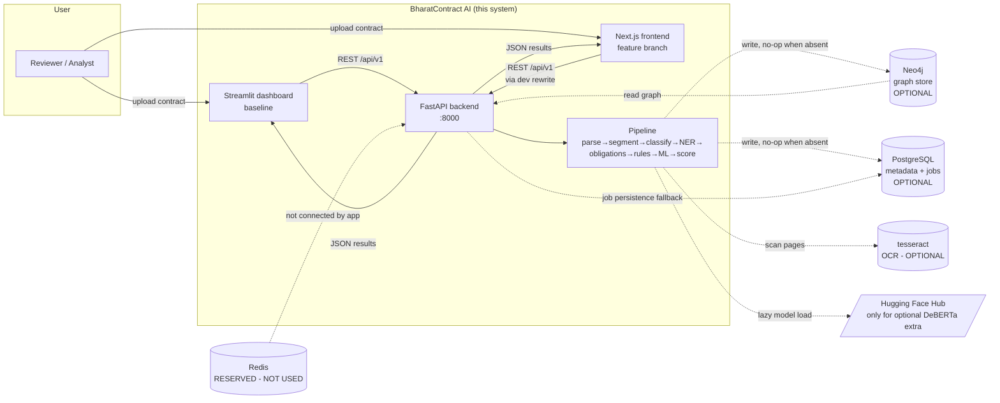

Trust boundaries: browser ↔ API (auth token when enabled); API ↔ databases (credentials in env, never in client bundle); the API is the only component that touches user-supplied bytes. Dashed edges = optional/degrade-to-no-op dependencies.

---

## 7. Complete System Architecture — arc42 (BC-DM-008)

All twelve arc42 sections follow. `[SOURCE: 9]`

### 7.1 Introduction and Goals

**Stakeholders:** reviewer/user (gets triage + obligations + graph), project team (maintains the pipeline), faculty/academic evaluators (assess methodology + evaluation integrity), future AI coding agent (continues development).

**Primary use cases:** (1) upload a contract and get a risk-scored, clause-typed, obligation-tracked analysis; (2) review each finding against its source span and case-law pointer; (3) track obligations and export deadlines (ICS in the Next.js UI); (4) explore the contract knowledge graph; (5) compare two analyzed contracts (client-side).

**Quality goals (see §7.10 for scenarios):** explainability, traceability, graceful degradation, reproducibility, honesty (no over-claiming), security (optional auth + RLS).

**Architecture objectives:** a single deterministic pipeline callable from CLI, API, both UIs, and tests; every external dependency optional; every output carrying its own evidence and uncertainty labels.

### 7.2 Architecture Constraints

| Constraint | Value | Evidence |
|---|---|---|
| Language | Python 3.10–3.12 (`>=3.10,<3.13`) | `[EVIDENCE: pyproject.toml — requires-python]` |
| Package manager | **uv** (uv.lock pinned); explicitly "not an npm/Node project" (backend) | `[EVIDENCE: uv.lock, AGENTS.md]` |
| Frontend runtime | Node ≥ 18.17, npm (pnpm "not established") | `[EVIDENCE: frontend/package.json — engines, frontend/README.md]` |
| API framework | FastAPI ≥0.110 <1, Pydantic v2, uvicorn | `[EVIDENCE: pyproject.toml]` |
| Databases | Neo4j 5.18 (compose), PostgreSQL 16 (compose); both optional at runtime | `[EVIDENCE: docker/docker-compose.yml, app/db/]` |
| Model artefacts | joblib bundles in 7z (`models/*.7z`), extracted on first use via py7zr | `[EVIDENCE: nlp/clause_classification/tfidf_model.py — ensure_model_file]` |
| Optional ML stack | `[ml]` extra: torch ≥2.1, transformers ≥4.36, DeBERTa-v3-base | `[EVIDENCE: pyproject.toml — [project.optional-dependencies] ml]` |
| Hardware | None specified; runs on a laptop (no GPU requirement; DeBERTa optional) | REPOSITORY OBSERVATION (no hardware doc) |
| Cost | All free/open-source; college budget | `[EVIDENCE: BharatContract_AI_Project_Charter.md]` |
| Privacy | No external transmission of contract text; local-only processing | `[EVIDENCE: §5.3 PRIV-001]` |
| Legal-domain | Output must never be legal advice; citations unverified until confirmed | `[EVIDENCE: README.md — Disclaimer, nlp/risk_scoring/case_law.py]` |
| Legacy coupling | Root-level duplicate packages (27 files) are load-bearing for the Docker image and locked byte-identical by test | `[EVIDENCE: tests/test_no_stale_duplicates.py, docker/Dockerfile lines 19–28]` |
| Migrations | **None** — schema via `create_all` + ad-hoc `ALTER TABLE … ADD COLUMN IF NOT EXISTS owner`; alembic is declared but unused | `[EVIDENCE: app/db/postgres.py — _ensure_owner_columns]` |

### 7.3 Context and Scope

Business context: a reviewer preparing to sign (or negotiate) a commercial contract. Technical context: the system sits between the user and two optional stores, with the pipeline as the only stateful computation.

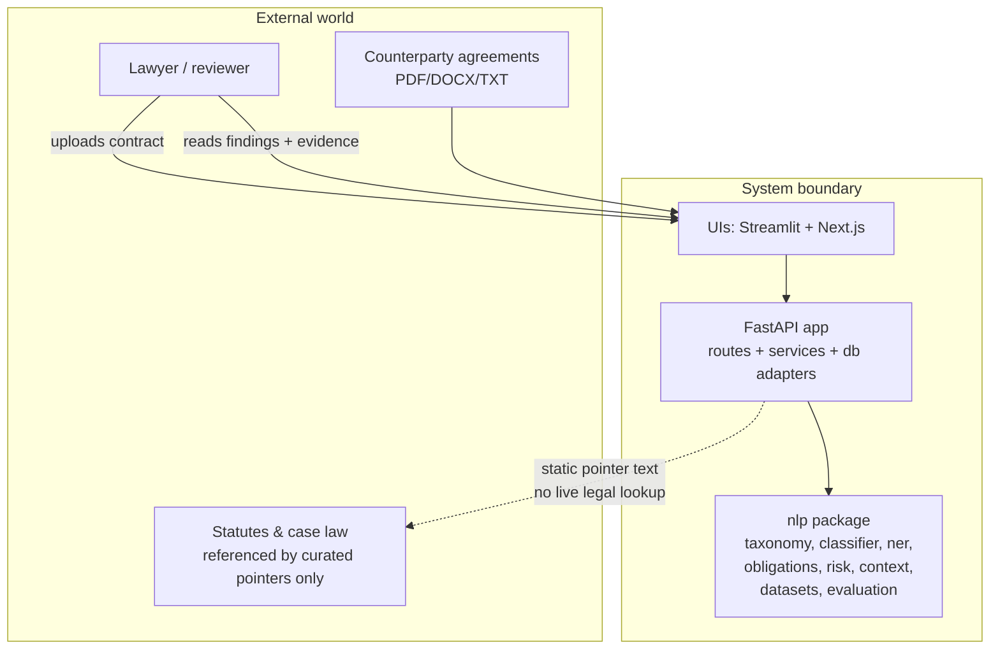

**External interface inventory:**

| Interface | Direction | Protocol | Auth | Evidence |
|---|---|---|---|---|
| Browser → API | request/response | HTTPS/HTTP REST, `/api/v1/*` | Bearer (when `AUTH_ENABLED`) | `[EVIDENCE: app/api/routes_*.py]` |
| API → Neo4j | write/read | Bolt | user/pass in env | `[EVIDENCE: app/db/neo4j.py]` |
| API → PostgreSQL | write/read | psycopg2 (SQLAlchemy) | user/pass in env | `[EVIDENCE: app/db/postgres.py]` |
| Pipeline → tesseract | per-page OCR | subprocess | — | `[EVIDENCE: app/services/parser.py — _ocr_pdf_page]` |
| Pipeline → HF Hub | model download (optional extra only) | HTTPS | — | `[EVIDENCE: nlp/clause_classification/classifier_ml.py — _load_model]` |

Trust boundaries: (a) browser ↔ API — token + CORS; (b) API ↔ stores — env credentials; (c) untrusted input = the uploaded file (parsed with hard gates).

### 7.4 Solution Strategy

The project chooses a **rule-first hybrid** for six concrete reasons, each tied to an observed design decision:

1. **Explainability over opacity (charter principle 1).** Every rule has a `rule_id`, human-readable trigger, recommendation, and case-law pointer; every finding carries its trigger span. A black-box classifier cannot produce this. `[EVIDENCE: nlp/risk_scoring/rules.py — RiskRule fields]`
2. **Controlled false alarms (charter principle 4).** Rules fire only on explicit non-negated triggers; negation guards were added after the deep audit confirmed false positives (C5). Fail-closed cross-reference use (15 tests) shows the bias toward *keeping* a finding rather than suppressing it. `[EVIDENCE: nlp/risk_scoring/rules.py — _first_unnegated_trigger, _cross_reference_states_applicable_cap]`
3. **Zero-dependency operation (AGENTS.md hard requirement).** Rules + regex + TF-IDF need no GPU, no model download, no network. `[EVIDENCE: pyproject.toml — base deps vs [ml] extra]`
4. **Recall gap is real and measurable.** The rule engine abstains to "Miscellaneous" 24.5–32.1% of the time on CUAD; the hybrid fills part of that gap (Acc@1 0.184 → 0.401 family-disjoint). ML is therefore added *where rules abstain or miss*, as a recall booster, not a replacement. `[EVIDENCE: reports/evaluations/heldout_family_disjoint_20261103.md, rules_vs_hybrid_20261103.md]`
5. **Model trust is limited (deep audit).** The original bundled models were trained on train∪test (leakage); the gold annotations were partially fabricated. The response was: retrain train-only, regenerate gold from real text, label all model output `unverified`, and keep rules authoritative. The strategy is thus *defensive hybrid*: ML can add, never override. `[EVIDENCE: DEEP_AUDIT_20261103.md — C1/C2, GIT 3187c0f — retrain, app/services/analyzer.py — _augment_with_ml_risks]`
6. **Indian context cannot be learned from US data.** CUAD/MAUD are US corpora; 12 of 26 internal labels have zero training rows. Indian rules (stamp duty, TDS, s. 124, s. 27 non-compete, BALCO arbitration) are therefore hand-authored from statutes/cases with unverified pointers — rules are the only tractable path until an Indian corpus exists. `[EVIDENCE: reports/evaluations/dataset_provenance_20261103.md — §4, nlp/risk_scoring/rules.py — requires_indian]`

**Technique inventory and integration status:**

| Technique | Used? | Where | Integrated? |
|---|---|---|---|
| Rule-based risk engine | Yes | `nlp/risk_scoring/rules.py` | Yes — core path |
| Rule-based + TF-IDF classification | Yes | `nlp/clause_classification/` | Yes — core path |
| ML risk classifier (recall booster) | Yes | `nlp/risk_scoring/risk_model.py` | Yes — additive only |
| Regex NER + gazetteers | Yes | `nlp/ner/ner.py` | Yes — core path |
| Modal-verb obligation extraction | Yes | `nlp/obligation_extraction/extractor.py` | Yes — core path |
| Cross-reference resolution | Yes | `nlp/context/resolver.py` | Yes — fail-closed consumer in rules |
| Legal-source grounding | Yes (static pointers) | `nlp/risk_scoring/case_law.py` | Yes — enriched into findings |
| RAG | **No** | — | NOT IMPLEMENTED |
| LLM generation | **No** | — | NOT IMPLEMENTED |
| DeBERTa clause/NER enrichment | Optional hook | `classifier_ml.py`, `ner_ml.py` | Code present; no-op without `[ml]`; not exercised in verified tests |
| Relation extraction model | No | — | NOT IMPLEMENTED |
| Semantic embeddings / similarity | No (shingle overlap only, for leakage) | `nlp/evaluation/family_split.py` | Evaluation-only |

### 7.5 Building Block View

#### 7.5.1 System-level diagram

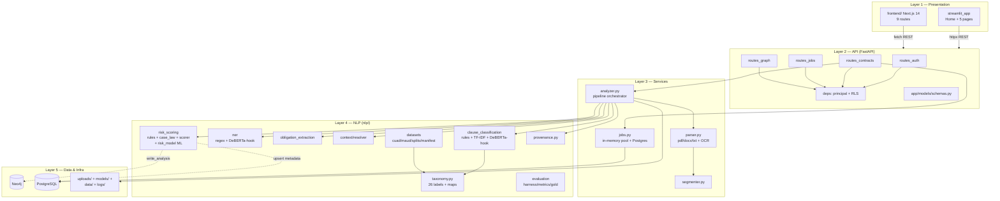

#### 7.5.2 Building-block register

| ID | Name | Responsibility | Inputs | Outputs | Dependencies | Implementation | Status |
|---|---|---|---|---|---|---|---|
| BB-01 | Parser | Extract text from PDF/DOCX/TXT/MD; OCR fallback; content gates | bytes/path | `ParsedDocument` (pages, full_text, warnings) | pdfplumber, PyMuPDF, python-docx, pytesseract | `app/services/parser.py — parse_document, parse_bytes` | IMPLEMENTED_AND_VERIFIED |
| BB-02 | Segmenter | Split text into clauses with exact offsets; long-clause splitting | `ParsedDocument` | `list[Clause]` | — | `app/services/segmenter.py — segment_clauses` | IMPLEMENTED_AND_VERIFIED |
| BB-03 | Context resolver | Resolve cross-refs, definitions, override candidates | `list[Clause]` | context bundle per clause | — | `nlp/context/resolver.py — resolve_context` | IMPLEMENTED_AND_VERIFIED |
| BB-04 | Clause classifier | Hybrid rule + TF-IDF multi-label classification (26 labels) | clause text + heading | labels, confidence, method | keyword bank (data/processed), tfidf_classifier.joblib | `nlp/clause_classification/classifier.py — classify_clause` | IMPLEMENTED_AND_VERIFIED |
| BB-05 | DeBERTa classifier hook | Optional transformer enrichment | clause text | top-3 labels or None | torch/transformers, HF cache | `nlp/clause_classification/classifier_ml.py — classify_with_deberta` | PARTIALLY_IMPLEMENTED (no-op in base install; unexercised in tests) |
| BB-06 | NER | Regex-first entity extraction + special detectors | clause/document text | `list[Entity]` | — (gazetteers in code) | `nlp/ner/ner.py — extract_entities, detect_*` | IMPLEMENTED_AND_VERIFIED |
| BB-07 | NER DeBERTa hook | Optional entity enrichment | text + existing entities | augmented entities or unchanged | torch/transformers | `nlp/ner/ner_ml.py — enrich_entities_with_deberta` | PARTIALLY_IMPLEMENTED |
| BB-08 | Obligation extractor | Modal-verb → structured obligations | clause text (+ party aliases) | `list[Obligation]` | — | `nlp/obligation_extraction/extractor.py — extract_obligations_from_clause` | IMPLEMENTED_AND_VERIFIED |
| BB-09 | Risk rule engine | 18 named rules, negation guards, dedup, evidence binding | clauses + summary | `list[RiskFlag]` | case_law, context resolver, NER detectors | `nlp/risk_scoring/rules.py — apply_rules` | IMPLEMENTED_AND_VERIFIED |
| BB-10 | Case-law store | Static statutory/case pointers per rule_id | rule_id | pointer entries (all unverified) | — | `nlp/risk_scoring/case_law.py — CASE_LAW, lookup_case_law` | IMPLEMENTED_AND_VERIFIED |
| BB-11 | Risk scorer | Aggregate findings → score 0–100 + level + breakdown | clauses + risks | (score, level, breakdown) | — | `nlp/risk_scoring/scorer.py — score_contract` | IMPLEMENTED_AND_VERIFIED |
| BB-12 | ML risk booster | TF-IDF+LogReg severity classifier, recall-only | unflagged clause texts | `ML_RISK_001` flags or none | risk_classifier.joblib | `nlp/risk_scoring/risk_model.py`, `app/services/analyzer.py — _augment_with_ml_risks` | IMPLEMENTED_AND_VERIFIED |
| BB-13 | Analyzer | Orchestrates BB-02…BB-12; party/date/gov-law enrichment | bytes/path | `AnalysisResult` | all of the above | `app/services/analyzer.py — _analyse` | IMPLEMENTED_AND_VERIFIED |
| BB-14 | Job store | In-memory job map (200 cap) + worker pool + Postgres mirror | job lifecycle events | `JobInfo` | `app/db/postgres.py` | `app/services/jobs.py — create_job, update_job, list_jobs` | IMPLEMENTED_AND_VERIFIED |
| BB-15 | API routes | 4 routers, 11 endpoints, auth/RLS wiring | HTTP | JSON | schemas, services, db | `app/api/routes_*.py` | IMPLEMENTED_AND_VERIFIED |
| BB-16 | Security core | JWT HS256, bcrypt/PBKDF2 hashing, roles, UserStore | credentials | tokens, principals | python-jose, passlib | `app/core/security.py` | IMPLEMENTED_AND_VERIFIED |
| BB-17 | Neo4j adapter | Graph writes/reads; no-op when absent | AnalysisResult | graph | neo4j driver | `app/db/neo4j.py, app/db/queries.py` | IMPLEMENTED_AND_VERIFIED (degradation) / NOT_VERIFIED live (no Neo4j at investigation) |
| BB-18 | Postgres adapter | contracts/jobs tables; owner RLS; bounded-outage cache | records | rows | SQLAlchemy, psycopg2 | `app/db/postgres.py` | IMPLEMENTED_AND_VERIFIED (degradation) / NOT_VERIFIED live |
| BB-19 | Datasets | CUAD/MAUD loaders; hash-pinned splits; manifests | data/datasets/* | training examples, keyword bank | — | `nlp/datasets/*` | IMPLEMENTED_AND_VERIFIED |
| BB-20 | Evaluation | 17-case harness; 5 metric families; gold; regression gate | synthetic cases + gold | reports + exit codes | pipeline | `nlp/evaluation/*`, `scripts/run_evaluation.py` | IMPLEMENTED_AND_VERIFIED (synthetic only) |
| BB-21 | Provenance | Manifest recording/verification; model-load status; health block | artefacts + manifests | status + warnings | git, sha256 | `nlp/provenance.py, nlp/datasets/manifest.py, scripts/verify_provenance.py` | IMPLEMENTED_AND_VERIFIED (executed: exit 0) |
| BB-22 | Streamlit UI | 6-page dashboard; in-process fallback | REST or local analysis | HTML UI | httpx, streamlit | `streamlit_app/` | IMPLEMENTED_AND_VERIFIED (live-verified 2026-10-25 HISTORICAL FACT) |
| BB-23 | Next.js UI | 9-route SPA; typed client; polling; ICS export; client-side comparison | REST | UI | React 18, TanStack Query | `frontend/src/` | IMPLEMENTED_BUT_NOT_FULLY_VERIFIED |

### 7.6 Runtime View

#### 7.6.1 Scenario 1 — Contract upload and analysis (main scenario)

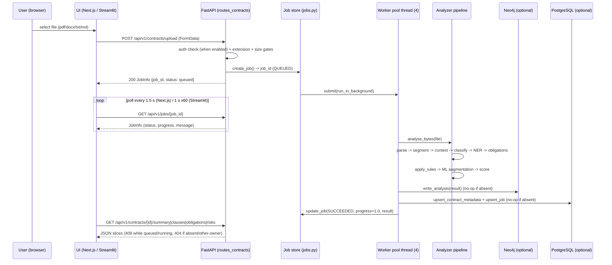

Key facts: `VERIFIED FACT` — the upload worker's progress sequence is 0.1 "Parsing document" → 0.7 "Persisting to graph" → 0.85 "Saving metadata" → 1.0 "Done" (`[EVIDENCE: app/api/routes_contracts.py — upload worker]`); the frontend documents this coarseness explicitly ("No interpolation"). Job state machine: `QUEUED → RUNNING → SUCCEEDED | FAILED`, terminal states stamp `finished_at`; no other transitions exist. `[EVIDENCE: app/services/jobs.py]`

#### 7.6.2 Scenario 2 — Risk detection within the pipeline

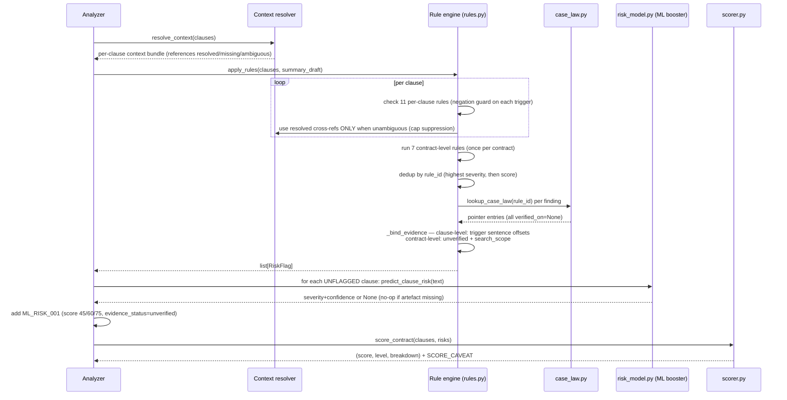

#### 7.6.3 Scenario 3 — Obligation extraction

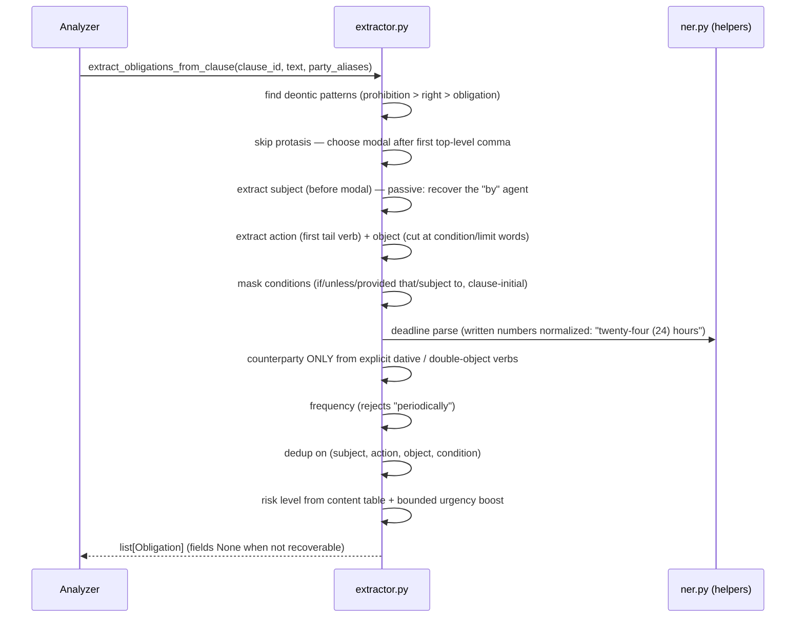

#### 7.6.4 Failure states

| Failure | Behaviour | Evidence |
|---|---|---|
| Unsupported/empty/oversize upload | 400 / 400 / 413 (never truncates) | `[TEST: tests/test_security_hardening.py]` |
| Unparseable content (binary, image-only PDF) | `DocumentParseError` → job FAILED with message; 409 on sub-resource reads | `[EVIDENCE: app/services/parser.py — _raise_no_extractable_text]` |
| Neo4j down | Writes log warning, return False; reads return `[]`; graph endpoint falls back to in-memory `_graph_from_result` | `[EVIDENCE: app/db/neo4j.py, app/api/routes_graph.py]` |
| Postgres down | Writes no-op; reads empty; in-memory job mirror serves; 30 s bounded re-probe window | `[EVIDENCE: app/db/postgres.py — bounded-outage cache]` |
| Job evicted from memory (cap 200) | Postgres fallback restores it; RLS preserved post-eviction | `[TEST: tests/test_security_hardening.py — post-eviction RLS]` |
| Pipeline exception | Job FAILED, `error` string stored; `BaseException` → "Aborted: <Type>" | `[EVIDENCE: app/services/jobs.py — _mark_failed]` |
| OCR unavailable | Warning added; extraction continues without OCR | `[EVIDENCE: app/services/parser.py — _ocr_unavailable_reason]` |
| Auth with default secret in prod | Refuse to start (RuntimeError) | `[EVIDENCE: app/main.py — guard_auth_secret]` |

### 7.7 Deployment View

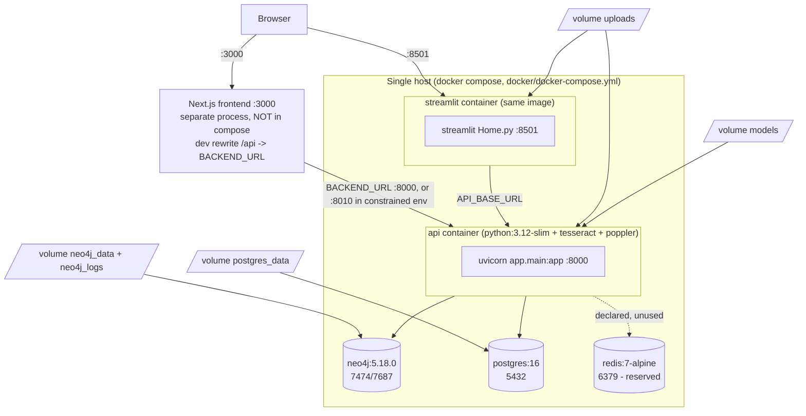

| Aspect | Value | Evidence |
|---|---|---|
| Local dev (no infra) | `uv sync --extra dev` → `uv run uvicorn app.main:app --reload` → `uv run streamlit run streamlit_app/Home.py` | `[EVIDENCE: README.md — Quick start]` |
| Full stack | `docker compose -f docker/docker-compose.yml up --build` | `[EVIDENCE: docker/docker-compose.yml]` |
| Ports | API 8000; Streamlit 8501; Neo4j 7474/7687; Postgres 5432; Redis 6379; Next.js 3000 (separate) | `[EVIDENCE: docker-compose.yml, frontend/README.md]` |
| Env vars | 30 documented in `.env.example` (see §20.4) | `[EVIDENCE: .env.example]` |
| Model loading | Bundled 7z extracted on first use; HF cache dir `models/hf`; DeBERTa only with `[ml]` | `[EVIDENCE: nlp/clause_classification/tfidf_model.py — ensure_model_file]` |
| Storage | `uploads/` (gitignored, never cleaned — open item), `data/` (datasets + generated processed), `models/`, `logs/` | `[EVIDENCE: .gitignore, reports/security/… — not-fixed list]` |
| Container caveats | `data/processed/` excluded from image by `.dockerignore` (keyword bank unavailable in-container — by design); root duplicate packages shipped for PYTHONPATH | `[EVIDENCE: README.md — Docker notes, docker/Dockerfile]` |
| Exposure warning | Default `AUTH_ENABLED=false` + `API_HOST=0.0.0.0` ⇒ readable by anyone reaching the port; do not expose without auth | `[EVIDENCE: README.md — Docker notes]` |
| Frontend deploy | `npm ci && npm run build && npm start -p 3000`; `BACKEND_URL` env; same-origin or CORS-configured | `[EVIDENCE: frontend/package.json, frontend/README.md]` |
| Production considerations | Set `AUTH_ENABLED=true` + strong `AUTH_SECRET_KEY`; set `CORS_ORIGINS`; set `APP_ENV=production` (activates secret guard + generic 500); add Postgres/Neo4j volumes backups; add upload cleanup; add a real migration tool (alembic declared but unused) | PROPOSED (derived from verified gaps) |

### 7.8 Crosscutting Concepts

| Concept | Implementation | Evidence |
|---|---|---|
| Logging | loguru; file + console; `LOG_LEVEL`/`LOG_FILE` settings | `[EVIDENCE: app/core/logging.py, app/core/config.py]` |
| Error handling | Typed `BharatContractError` hierarchy (400 parse, 503 model, 500 graph); global handlers; 500 body generic in prod, `type` key in dev only | `[EVIDENCE: app/core/exceptions.py, app/main.py]` |
| Configuration | Single `get_settings()` (lru_cache, pydantic-settings, `.env`); **no direct `os.environ` reads outside config** (AGENTS.md rule) | `[EVIDENCE: app/core/config.py]` |
| Time | `app.core.time.utcnow()` naive UTC helper (not deprecated `datetime.utcnow`) | `[EVIDENCE: app/core/time.py]` |
| Authentication | HS256 JWT, bcrypt (PBKDF2-260k fallback), roles viewer<analyst<admin, live re-validation, login throttling | `[EVIDENCE: app/core/security.py]` |
| Authorization / RLS | `require_role` (upload needs analyst+); owner columns + query filters; 404-not-403 semantics | `[EVIDENCE: app/api/deps.py, app/db/postgres.py]` |
| Data validation | Pydantic v2 schemas; parser hard gates; upload extension/size/emptiness checks | `[EVIDENCE: app/models/schemas.py, app/services/parser.py]` |
| Model management | 7z → joblib extraction; provenance status per load; drift detection (loaded SHA vs declared) downgrades to `provenance-unverified` | `[EVIDENCE: nlp/provenance.py — record_loaded_model]` |
| Evidence provenance | Manifests (artifact hash, source hashes, split, command, revision); fail-closed verify; `/healthz` provenance block; `PROVENANCE_*` warning tokens in analysis | `[EVIDENCE: nlp/datasets/manifest.py, app/main.py — /healthz]` |
| Privacy | Local-only processing; no secrets in client; uploads dir gitignored (but not cleaned — gap) | `[EVIDENCE: §5.3, reports/security/… — not-fixed]` |
| Testing | pytest (asyncio auto), 560 tests; ruff lint; vitest + Playwright for frontend | `[EVIDENCE: pyproject.toml — pytest ini, tests/, frontend/TESTING.md]` |
| Observability | `/healthz` (status, neo4j bool, env, auth, provenance); job progress messages; log file | `[EVIDENCE: app/main.py — /healthz]` |
| Versioning | Software 0.1.0 (pyproject, FastAPI title); git for code; manifests carry `code_revision`; no schema migrations (gap) | `[EVIDENCE: pyproject.toml, nlp/datasets/manifest.py]` |

### 7.9 Architecture Decisions

ADR inventory. Decisions marked (reconstructed) are inferred from code + reports + git history; none are fabricated.

| ADR | Title | Context | Alternatives | Chosen | Rationale | Consequences | Status | Evidence |
|---|---|---|---|---|---|---|---|---|
| ADR-001 | Rule-first risk engine | High-precision, explainable detection needed; college budget | End-to-end ML; rules only | Rules + ML recall booster | Explainability; zero-deps; controlled FPs (charter) | Finite phrase coverage; manual rule maintenance | Accepted | `[EVIDENCE: rules.py, charter]` |
| ADR-002 | Optional dependencies with graceful degradation | Demo must run with zero infra (AGENTS.md) | Hard dependencies | Probe + no-op + warnings | Portability; honest health reporting | In-memory-only mode loses durability; code complexity | Accepted | `[EVIDENCE: app/db/neo4j.py, postgres.py]` |
| ADR-003 | In-memory job cache + Postgres durable store | Async jobs without Celery | Celery (Redis) now | ThreadPoolExecutor(4) + 200-cap map + Postgres fallback | Simplicity; Redis declared "reserved" | Single-process only; eviction at 200 | Accepted | `[EVIDENCE: app/services/jobs.py, pyproject.toml — celery dep unused]` HISTORICAL FACT (Celery dep present but unused) |
| ADR-004 | Hash-pinned dataset allowlist, not upstream-authenticated | Reproducibility without network trust | Upstream checksums (unavailable offline) | Local SHA-256 pinning + internal partition consistency, labelled `upstream_authenticated: false` | Fail-closed; honest limitation | Cannot prove dataset authenticity to a third party | Accepted | `[EVIDENCE: nlp/datasets/splits.py — ALLOWLIST_AUTHENTICATION]` |
| ADR-005 | Weakly-supervised ML risk labels | No labelled Indian risk corpus | Synthetic gold; human labelling | Rule-engine self-labels + capped type priors | Fast; consistent with rules | Error propagation; memorisation risk (disclosed) | Accepted (limitation disclosed) | `[EVIDENCE: nlp/risk_scoring/risk_model.py — weak_label]` |
| ADR-006 | Static case-law pointers, unverified | Legal grounding without verified corpus | Live statute retrieval (RAG) | Curated pointers with `verified_on=None` + explicit note | Honesty; no live legal DB | Pointers need counsel confirmation; citation errors possible (C18 found/fixed 3) | Accepted | `[EVIDENCE: case_law.py — UNVERIFIED_NOTE]` |
| ADR-007 | RLS via application owner filtering (404 not 403) | Multi-user confidentiality | DB-enforced RLS; 403 responses | Owner columns + filters; 404 to avoid existence leaks | No DB RLS support needed; info-leak prevention | Neo4j not owner-scoped (pre-check in route instead) | Accepted | `[EVIDENCE: app/api/routes_contracts.py, routes_graph.py pre-check]` |
| ADR-008 | Root-level duplicate packages locked by test | Docker image ships only app/nlp/streamlit_app; PYTHONPATH needs flat imports | Rebuild image with proper packaging | Keep duplicates; `test_no_stale_duplicates.py` enforces byte-identity to committed `nlp/` | Minimal image change | 27 dead files; sync burden (mitigated by test) | Accepted | `[EVIDENCE: tests/test_no_stale_duplicates.py, docker/Dockerfile]` |
| ADR-009 | Family-disjoint held-out evaluation | Official CUAD 80/20 leaks (7/102 test docs) | Accept official split; different dataset | Shingle+title family proxy, threshold 0.5, disclose proxy limitation | Only defensible generalization estimate available | Proxy ≠ legal independence; still US-only | Accepted | `[EVIDENCE: nlp/evaluation/family_split.py, heldout report]` |
| ADR-010 | Regenerate gold annotations from real case text | Deep audit C1: gold partially fabricated | Keep old gold; discard eval layer | Regenerate v1.1.0 with manual adjudication + "behaviour only" label | Trustworthy regression gate | Synthetic-only coverage remains | Accepted | `[GIT: 4b1a9ca — gold regenerated]`, `[EVIDENCE: cases_gold.json header]` |
| ADR-011 | Next.js frontend on feature branch | Charter non-goal "frontend expansion" vs product need | Extend Streamlit | New Next.js 14 app; Streamlit kept as baseline | Typed client; richer review UX | Two frontends to maintain; known pinned defects | Proposed/superseding (branch not merged to main at investigation) | `[GIT: bda1147..77e9504]` (reconstructed) |
| ADR-012 | No Alembic migrations despite declared dependency | Schema changes (owner columns) needed | Adopt alembic now | `create_all` + `ADD COLUMN IF NOT EXISTS` | Speed; no migration history needed | No rollback path; silent schema drift | Accepted (gap documented) | `[EVIDENCE: app/db/postgres.py — _ensure_owner_columns]` |

### 7.10 Quality Requirements

| Q-ID | Goal | Scenario / measure | Target | Achieved? |
|---|---|---|---|---|
| Q-01 | Correctness (software) | Full test suite green at HEAD | 560/560 pass | **YES — measured 2026-11-03 at 77e9504** |
| Q-02 | Explainability | Every risk finding has evidence span or search scope + rule + recommendation | 100% of findings | YES (invariant tests pass) `[TEST: tests/test_evidence_binding.py, synthetic_eval invariants]` |
| Q-03 | Traceability | Every generated artefact verifies against sources | `verify_provenance.py` exit 0 | YES — measured 2026-11-03 (0 failures) |
| Q-04 | Reliability (degradation) | API functional with all external services down | demo + tests pass offline | YES — full suite runs with no DBs |
| Q-05 | Clause-classification quality (US CUAD) | Family-disjoint held-out Acc@1 | — (no target set) | MEASURED: hybrid 0.401, rule-only 0.184 (§19.3) — low; no target achieved/missed judgement possible (no target exists) |
| Q-06 | Risk-detection quality (Indian) | — | — | **UNMEASURED** — no Indian gold corpus exists in-repo |
| Q-07 | Performance | End-to-end analysis time for 50-page contract | — | **UNMEASURED** — no benchmark exists |
| Q-08 | Security | No credential leaks, 413/429/RLS behave as specified | tests pass | YES (14 security-hardening tests) |
| Q-09 | Reproducibility | Same commit + same data ⇒ same results | deterministic seeds; pinned deps | YES for eval scripts (seed 20261103); models are deterministic artefacts |
| Q-10 | Usability | Reviewer can trace any finding to source in ≤2 clicks | — | PARTIAL — verified in UI code (review workspace auto-scrolls to clause); not user-tested |

### 7.11 Risks and Technical Debt

| Risk-ID | Risk | Likelihood | Impact | Evidence | Mitigation | Owner/component | Status |
|---|---|---|---|---|---|---|---|
| R-01 | Indian-law accuracy is unmeasured; claims of Indian competence are unsupported | Certain (by construction) | High (academic) | `[EVIDENCE: dataset_provenance_20261103.md — 12 labels with zero rows]` | Disclose everywhere; build Indian corpus (roadmap) | Research | OPEN |
| R-02 | Rule phrase-list coverage gap → false negatives on novel phrasings | High | Medium | `[EVIDENCE: rules.py — finite trigger lists; indian_coverage report limitations]` | ML booster (unverified-labelled); expand rules with tests | `rules.py` | OPEN |
| R-03 | ML booster memorises rule patterns (weak supervision) | High | Medium | `[EVIDENCE: risk_model.py — weak_label; model_retraining report "IN-SAMPLE ONLY"]` | Recall-only role; unverified label; retraining train-only | `risk_model.py` | OPEN |
| R-04 | Dataset license unverified in-repo; redistribution risk | Medium | High (legal) | `[EVIDENCE: dataset_provenance_20261103.md — §2, retracted CC-BY claim]` | Verify upstream licenses before any redistribution/publication | Research | OPEN |
| R-05 | Case-law pointers contain errors (3 found by audit; fixed) | Medium | High (trust) | `[EVIDENCE: DEEP_AUDIT_20261103.md — C18; case_law.py — verified_on=None]` | Unverified-by-default labelling; counsel confirmation required | `case_law.py` | MITIGATED |
| R-06 | Evaluation layer was fabricated once (C1/C2) — trust risk for remaining synthetic numbers | Low (fixed) | High | `[EVIDENCE: DEEP_AUDIT_20261103.md — C1/C2; GIT 4b1a9ca]` | Gold regenerated; self-comparison gate; "behaviour only" labels | Evaluation | CLOSED (monitor) |
| R-07 | 27 root duplicate files can drift | Medium | Medium | `[EVIDENCE: tests/test_no_stale_duplicates.py]` | Byte-identity test (passes) | Repo | MITIGATED |
| R-08 | No schema migrations; silent drift | Medium | Medium | `[EVIDENCE: postgres.py — _ensure_owner_columns]` | Adopt alembic (declared, unused) | Backend | OPEN |
| R-09 | Uploads never cleaned; contract text persists on disk | Medium | High (privacy) | `[EVIDENCE: reports/security/20261103 — not-fixed list]` | Retention policy + cleanup job | Ops | OPEN |
| R-10 | Single-process job store; lost on crash (in-memory part) | Medium | Medium | `[EVIDENCE: jobs.py — no TTL, eviction]` | Postgres is durable path; acceptable for demo | Backend | OPEN |
| R-11 | Two frontends to maintain; Streamlit lacks auth tokens | Medium | Low | `[EVIDENCE: plan.md §9 deferral, streamlit_app/api_client.py — no bearer]` | Decide baseline; add bearer to Streamlit or deprecate | UI | OPEN |
| R-12 | Next.js known defects (AuthProvider inversion; rule-category mapping) | Certain (pinned) | Low | `[EVIDENCE: frontend/TESTING.md — pinned findings]` | Fix or accept; tests pin behaviour | Frontend | OPEN |
| R-13 | OCR quality unknown (no scanned-PDF positive verification) | Medium | Medium | `[EVIDENCE: parser.py — graceful failure only; no tesseract in verified env]` | Add scanned fixture with tesseract in CI | Parser | OPEN |
| R-14 | Research-validity: synthetic regression ≠ real-world accuracy | Certain | Medium (academic) | `[EVIDENCE: nlp/evaluation/README.md — warning banner]` | Label all results; run real-corpus experiment (roadmap) | Research | OPEN |
| R-15 | DeBERTa hooks untested end-to-end (no `[ml]` in verified env) | High | Low | `[EVIDENCE: classifier_ml.py — guarded no-op]` | CI job with `[ml]` extra | NLP | OPEN |

### 7.12 Glossary

See §28 (master glossary) — referenced, not duplicated.

---

## 8. Complete Functional Workflow (BC-DM-009)

**Status: VERIFIED.** Every stage below lists purpose, input, processing, output, files, error conditions, tests, limitations. The end-to-end pipeline diagram at the end reflects the verified code path (`app/services/analyzer.py — _analyse`).

### 8.1 Stage table

| Stage | Purpose | Input | Processing | Output | Files | Errors | Tests | Limitations |
|---|---|---|---|---|---|---|---|---|
| 1. Upload & validation | Accept user file safely | HTTP FormData | Extension whitelist {.pdf,.docx,.txt,.md}; empty check; 25 MB cap → 413 | saved file path + `contract_id` | `app/api/routes_contracts.py` | 400/413/401/403 | `test_api_smoke.py`, `test_security_hardening.py` | No virus scan; no dedup |
| 2. Parsing | Text + pages from bytes | file path/bytes | pdfplumber → PyMuPDF → per-page OCR (<50 chars/page); DOCX incl. tables; TXT encoding ladder + binary gate; 2M-char truncation warns; min-meaningful-content gate | `ParsedDocument` (pages, full_text, warnings) | `app/services/parser.py` | `DocumentParseError` (400-class) | `test_parser.py` (3), `test_realistic_fixtures.py` (22), `test_pipeline_hardening.py` (18) | Scanned-PDF quality unverified; header/footer stripping is best-effort (C13 history) |
| 3. Segmentation | Clauses with exact offsets | cleaned text | paragraph spans; heading detection (number/caps/annexure/hints); preamble = first block; >2500-char 3-stage split; **invariant: text == slice** | `list[Clause]` (char_start/char_end) | `app/services/segmenter.py` | — (pure function) | `test_segmenter.py` (9), `test_long_clauses.py` (2) | Non-heading multi-line preambles fixed (D2); unconventional layouts degrade |
| 4. Page hints | Map clauses to pages | clauses + pages | locate page text in document order | `page_hint` per clause | `analyzer.py — _stamp_page_hints` | — | `test_pipeline_hardening.py` | Best-effort (historical dead-field fixed in `2ae9ff4`) |
| 5. Context resolution | Cross-refs, definitions, overrides | clauses | regex reference index; definition index; precedence candidates; per-ref status | context bundle per clause | `nlp/context/resolver.py` | — | `test_context_resolution.py` (10) | Only numeric keys; "Term" means form only; Markdown headings not parsed |
| 6. Clause classification | 26-label multi-label | clause text + heading | keyword rules + CUAD keyword bank (letter-boundary regexes) ∪ TF-IDF (threshold 0.15, top-5); confidence = max(rule, ml) | labels + confidence + method | `nlp/clause_classification/classifier.py` | TF-IDF load failure → rule-only (no-op) | `test_classifier_accuracy.py` (11) | 12 labels have no ML support; abstains to Miscellaneous (0.3) |
| 7. NER | Entities incl. Indian IDs | clause/document text | ~15 regex families; gazetteers; special detectors (gov law, seat, stamp/TDS mentions) with negation windows | `list[Entity]` | `nlp/ner/ner.py` | — | `test_regressions.py`, `test_negation_and_context.py` (31) | Phrase-list based; no learned NER in base path |
| 8. Party & date enrichment | Contract-level party/effective-date/gov-law/arbitration/stamp/TDS/GSTIN signals | NER + clauses | 3 party strategies (corporate-suffix scan of first/last 3 clauses, NER PARTY/ORG, preamble "between X and Y"); effective-date cue scoring; `MAX_PARTIES=4` | enriched `ContractSummary` draft | `analyzer.py — _detect_parties, _first_date` | — | `test_indian_contracts.py`, `test_audit_integration.py` | Only first/last 3 clauses scanned (C16); over-counting on 2/6 samples (open) |
| 9. Obligation extraction | Structured obligations | clause text + party aliases | deontic patterns; passive agent recovery; condition masking; written-number deadlines; explicit recipient only; frequency; dedup; severity table | `list[Obligation]` | `nlp/obligation_extraction/extractor.py` | — (fields None when unknown) | `test_obligation_extraction.py` (59) | Clause-initial conditions only; no-comma leading conditions leave party None |
| 10. Risk rules | 18 named rules | clauses + summary | per-clause loop + contract-level pass; negation guards; dedup by rule_id; case-law enrichment; evidence binding; advisory cross-ref notes | `list[RiskFlag]` | `nlp/risk_scoring/rules.py` | — | `test_risk_rules.py` (43), `test_risk_quality.py` (21), `test_p4_*` (31) | Phrase coverage finite; 12 taxonomy labels rule-only |
| 11. ML augmentation | Recall on unflagged clauses | unflagged clause texts | TF-IDF+LogReg; min confidence 0.55; severity ≠ LOW | `ML_RISK_001` flags (unverified) | `nlp/risk_scoring/risk_model.py`, `analyzer.py — _augment_with_ml_risks` | artefact missing → no-op | `test_risk_model.py` (7) | Uncalibrated; weakly supervised |
| 12. Scoring | Prioritization aid | clauses + risks | `min(100, top + min(20,(n−1)·2) + min(10, Σw/100))`; levels 76/51/26 | (score, level, breakdown) + caveat | `nlp/risk_scoring/scorer.py` | — | scoring tests in `test_risk_rules.py` | Not a probability (stated) |
| 13. Persistence | Durable storage | `AnalysisResult` | Neo4j MERGE upserts (retry on TransientError); Postgres upserts; both no-op when absent; partial failure logged, never raised | graph + rows | `app/db/queries.py, neo4j.py, postgres.py` | GraphWriteError → warning | `test_jobs_backend.py` (18) | No migrations; no owner scoping in Neo4j |
| 14. Job completion | State + result visible | job_id | SUCCEEDED + result stored (memory + Postgres) | `JobInfo` | `app/services/jobs.py` | exception → FAILED | `test_jobs_backend.py` | 200-cap eviction (finished jobs only) |
| 15. Retrieval | Slices for UI | contract_id/job_id | memory→Postgres fallback merge; RLS owner filter; 409 while processing | JSON | `app/api/routes_contracts.py, routes_jobs.py, routes_graph.py` | 404/409/500 map | `test_api_smoke.py`, `test_rls.py` | Coarse progress (0.1→0.7→0.85→1.0) |
| 16. Presentation | Human review | JSON slices | Streamlit pages / Next.js pages; evidence highlighting; ICS export; client-side comparison | UI | `streamlit_app/`, `frontend/src/` | 404/409 states rendered honestly | frontend vitest/Playwright (§17) | AuthStatus defect pinned (frontend) |

### 8.2 End-to-end pipeline diagram (actual code path)

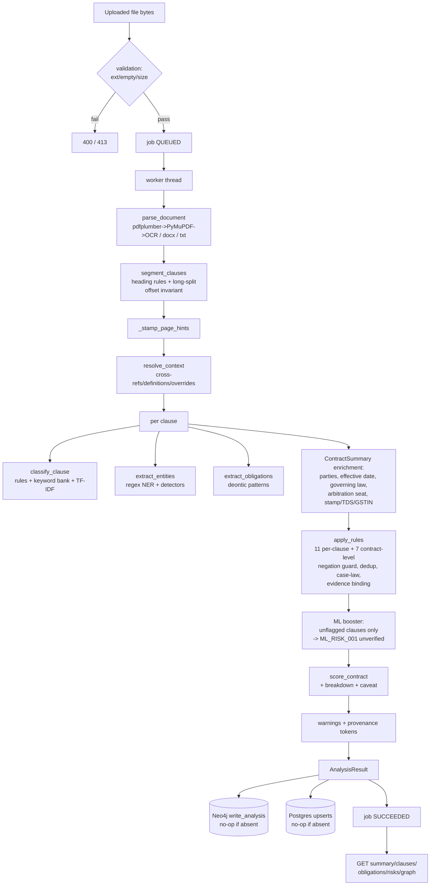

---

## 9. NLP and Machine-Learning Methodology (BC-DM-010)

**Status: VERIFIED.** All model attributes below were read from code at HEAD. No hyperparameter or metric is invented.

### 9.1 Preprocessing, tokenization, segmentation

- **Normalization:** text is cleaned before segmentation; the source-integrity invariant guarantees every clause is an exact slice of the cleaned text. `[EVIDENCE: app/services/segmenter.py]`
- **Tokenization:** no standalone tokenizer in the rule path — regexes operate on raw text. TF-IDF uses sklearn's built-in tokenization (ngram 1–2 for the risk model; default analyzer for the clause model). DeBERTa hooks truncate at 512 tokens. `[EVIDENCE: nlp/risk_scoring/risk_model.py — build_pipeline, nlp/clause_classification/classifier_ml.py]`
- **Clause boundaries:** heading-driven (section numbers ≤12 words without terminal punctuation; short ALL-CAPS lines; annexure/schedule/exhibit/appendix prefixes; title-case lines ≤60 chars containing one of 30 hint words like "indemnif", "liability", "termination"). Long clauses split: paragraph chunks → sentence split `(?<=[.!?])\s+` → fixed-char at whitespace within a 10% window. `[EVIDENCE: app/services/segmenter.py — _looks_like_heading_line, _split_long_clause]`
- **Text normalization specifics:** header/footer line stripping (short lines, "Page N of M"); encoding ladder utf-8/latin-1/cp1252 (+utf-16 on BOM); binary-garbage gate (>30% non-text ⇒ reject). `[EVIDENCE: app/services/parser.py — strip_headers_footers, _binary_char_ratio]`

### 9.2 Classification labels

26 internal labels (single source of truth): Payment Terms, Term and Renewal, Termination, Indemnification, Limitation of Liability, Warranty, Confidentiality, Data Protection, Intellectual Property, Non-Compete / Non-Solicit, Governing Law, Dispute Resolution, Force Majeure, Assignment, Audit Rights, Insurance, Compliance, Service Levels, Change Control, Notice, Acceptance, Definitions, Miscellaneous, Stamp Duty, TDS / GST, Arbitration Seat. Mapped from 41 CUAD categories and 22 MAUD `text_type` values (+33 MAUD question-hint substrings). `VERIFIED FACT`: the taxonomy sync is enforced — the classifier's 26 keyword lists must match `INTERNAL_LABELS`. `[EVIDENCE: nlp/taxonomy.py, tests/test_audit_integration.py — taxonomy/rule-key sync]`

### 9.3 Model register

| Attribute | Clause classifier (TF-IDF) | Risk classifier (ML booster) | DeBERTa hooks (optional) |
|---|---|---|---|
| Model name | `tfidf_classifier.joblib` (bundled `models/tfidf_classifier.7z`) | `risk_classifier.joblib` (bundled `models/risk_classifier.7z`) | `microsoft/deberta-v3-base` (HF) |
| Architecture | sklearn TF-IDF + linear classifier pipeline (joblib) | TF-IDF (ngram 1–2, min_df 2, max_df 0.95, sublinear_tf, EN stops) + LogisticRegression (lbfgs, C=1.0, class_weight balanced, max_iter 3000) | Transformer sequence classification (26 labels, `ignore_mismatched_sizes=True`) |
| Task | Multi-label clause type (top-5, threshold 0.15) | Severity (low/medium/high/critical), recall-only | Clause classification top-3 / NER enrichment |
| Input | Clause text | Clause text | Clause text / document text (512 tokens) |
| Output | labels + per-class probabilities | (severity, confidence) or None | top-3 labels + probs / extra entities (PARTY/ORG/DATE, conf 0.75) |
| Training data | `data/processed/clause_classifier.csv` — 9,278 rows, 408 CUAD **train** docs, 14 classes (VERIFIED by `wc -l`: 9,279 incl. header) | same corpus, weak labels from rule engine: low 5,451 / medium 2,705 / high 1,122 / critical 0 | **None shipped** — no task-specific fine-tuning exists |
| Parameters | not stored in artefact metadata (joblib); size 3.5 MB (7z) | 1.1 MB (7z) | ~420M (DeBERTa-v3-base) — HF cache snapshot present in `models/hf` |
| Training configuration | retrained 2026-11-03 from train-only corpus (C=4.0, liblinear→lbfgs for 14 classes) `[EVIDENCE: reports/evaluations/model_retraining_20261103.md]` | same date/source; C=1.0 lbfgs | n/a (used off-the-shelf; not fine-tuned) |
| Inference configuration | threshold 0.15 per class; top-5; alias map {"Pricing Terms": "Payment Terms"}; labels outside taxonomy dropped; fallback to single top label | min confidence 0.55; severity LOW suppressed | top-3 softmax |
| Evaluation | In-sample top-1 0.9230 (NOT a generalization estimate); family-disjoint held-out Acc@1 0.401 (hybrid) §19.3 | In-sample top-1 0.9610 / 85-15 split acc 0.90 (NOT generalization); delta: +63 findings on 300-doc train sample §19.5 | **UNVERIFIED — never exercised in the verified test environment** |
| Limitations | 14/26 labels supported; US corpus; keyword bank from same CUAD snippets (in-distribution optimism) | Weakly supervised; memorisation risk; uncalibrated; US corpus, "no Indian-law validity claim" (stated in PROVENANCE_STATUS.json) | Requires `[ml]` extra + network for first download; no task weights shipped |

### 9.4 Thresholds, confidence, abstention

- Classifier abstains to `["Miscellaneous"]` @ 0.3 when no keyword matches; hybrid abstains only when TF-IDF yields nothing above 0.15 (then single top label — so hybrid abstention is 0 in measurements). `[EVIDENCE: classifier.py — _rule_classify, tfidf_model.py — predict_one]`
- Rule confidence: `min(0.95, 0.4 + top_score/max(8, total))`; keep labels with score ≥ max(1.0, top·0.4). `[EVIDENCE: classifier.py — lines 426–438 region]`
- NER confidences: 0.99 (CIN/PAN/GSTIN) → 0.8 (durations) — fixed per family. `[EVIDENCE: nlp/ner/ner.py]`
- Obligation base confidences: obligation 0.85 / right 0.7 / prohibition 0.8. `[EVIDENCE: extractor.py]`
- ML risk: min confidence 0.55; scores 45/60/75 are **fallback presentation values, not probabilities** (explicit in finding text). `[EVIDENCE: analyzer.py — _ML_FALLBACK_SCORE]`
- **Calibration: none performed anywhere.** All model outputs are labelled uncalibrated. `KNOWN LIMITATION` (roadmap item).

### 9.5 Model persistence, versioning, provenance

- Artefacts ship as 7z; `ensure_model_file` extracts on first use (py7zr, no 7-Zip binary). `[EVIDENCE: tfidf_model.py — ensure_model_file]`
- `models/PROVENANCE_STATUS.json` (VERIFIED, read in full): both artefacts `train-only-verified` (retrained 2026-11-03 from train-only manifest-verified corpus), `upstream_authenticated: false`, with explicit non-claims ("NOT a generalization guarantee"). `[EVIDENCE: models/PROVENANCE_STATUS.json]`
- Runtime drift check: `record_loaded_model` compares loaded joblib SHA to declared `cache_sha256`; mismatch downgrades status to `provenance-unverified` (reason `cache-drift`). `/healthz` exposes the block; analysis warnings carry `PROVENANCE_UNVERIFIED[artifact=…]` / `PROVENANCE_ABSENT[artifact=…]`. `[EVIDENCE: nlp/provenance.py]`
- Versioning: artefact identity = SHA-256; code revision recorded in manifests. No model-version registry beyond this.

### 9.6 Why hybrid, not one model

1. One model cannot produce *named, explainable findings* — a severity label from an ML model has no rule, no trigger span, no recommendation, no case-law pointer. The product requires findings a reviewer can audit line-by-line.
2. One model trained on US data has no support for 12 of 26 labels (zero rows) and none for Indian statutory concepts — rules are the only current source of those.
3. The audit history (leaky bundled models, fabricated gold) made an ML-authoritative design untenable; the conservative hybrid (rules decide; ML only adds, labelled unverified) is the defensible position. All three points: `VERIFIED FACT` from code + reports.

---

## 10. Risk Detection Methodology (BC-DM-011)

**Status: VERIFIED.** The complete rule inventory below was verified by executing the rule registry at HEAD (11 per-clause rules) plus reading `_contract_level_rules` (7 contract-level rules).

### 10.1 Risk finding anatomy

A `RiskFlag` carries: `rule_id`, `name`, `severity` (low/medium/high/critical), `score`, `explanation`, `recommendation`, `case_law` (list of pointer entries), `clause_id` (null for contract-level), plus the evidence-bundle fields added in the P2 workstream: `source` (`"rule"` | `"model"`), `evidence_status` (`"direct"` | `"unverified"` | `"contextual"` | `"unavailable"`), `evidence_spans` (text + char offsets into `Clause.text`, role `trigger`/`contextual`), `search_scope` (for contract-level), `related_clause_ids`, and enrichment fields `impact_summary`, `affected_parties`, `review_action`, `uncertainty_note`. `[EVIDENCE: app/models/schemas.py — RiskFlag, nlp/risk_scoring/rules.py — _bind_evidence]`

**Five distinct finding kinds the system distinguishes** (per charter principle; enforced in code):

1. **Commercial concern** — e.g. auto-renewal, one-sided termination. Plain-law pointers only; some have *no* verified authority (stated as "See counsel").
2. **Potential legal issue** — e.g. uncapped liability (s. 74 penalty doctrine via *Saw Pipes*), non-compete (s. 27).
3. **Missing protection** — `MISSING_CLAUSE_*`, `RISK_DATA_MISSING`, `RISK_DISPUTE_001`, and the "not found — verify" framing of stamp/TDS (severity deliberately downgraded CRITICAL→MEDIUM and MEDIUM→LOW in the D8 reframing — `HISTORICAL FACT`, `[EVIDENCE: reports/recovery/DEFECT_REGISTER.md]`).
4. **Contractual ambiguity** — cross-reference `missing`/`ambiguous` status recorded as advisory notes (never suppresses a finding).
5. **Unverified legal interpretation** — every case-law pointer carries `verified_on=None` + the unverified note; ML findings carry `evidence_status="unverified"`.

### 10.2 Per-clause rules (11) — verified inventory

| rule_id | Name | Severity (score) | Gate | Trigger (non-negated) | Statutory/case pointer |
|---|---|---|---|---|---|
| `RISK_LIABILITY_001` | Uncapped liability | CRITICAL (85) | type: Limitation of Liability; skip if heading contains "indemn" | "unlimited liability", "without limitation of liability", "no limitation on liability", "shall be liable for all damages", "liable for any and all damages", "fully liable" | *Brojo Nath Ganguly* (1986) 3 SCC 156; *ONGC v. Saw Pipes* (2003) 5 SCC 705 |
| `RISK_LIABILITY_002` | Missing liability cap | HIGH (70) | type: Limitation of Liability | no cap phrase (10-phrase list) AND no PAYMENT_AMOUNT entity AND no *resolved* cross-reference to a verifiably applicable cap | *Saw Pipes* |
| `RISK_TERM_001` | One-sided termination for convenience | HIGH (72) | type: Termination | "may terminate this agreement at any time", "terminate at any time without cause", "sole discretion" | ICA ss. 23/27 (plain-law note, no case) |
| `RISK_RENEWAL_001` | Automatic renewal | MEDIUM (50) → HIGH (70) if no notice or <30 days | type: Term and Renewal | "automatic" + "renew" in same clause; notice parsed (digit/written/parenthetical) within 100 chars | plain-law note ("See counsel — no verified authority curated") |
| `RISK_INDEMNITY_001` | Broad indemnification | HIGH (72) | type: Indemnification | "any and all claims", "all losses", "from any cause whatsoever" | *Parelkar* AIR 1942 Bom 302 |
| `RISK_DATA_001` | Very tight breach-notification window | MEDIUM (55) | type: Data Protection | breach/incident language + window ≤24h (digit/written/parenthetical; days converted) | DPDP Act 2023 s. 8(6) |
| `RISK_GOV_001` | Foreign governing law in domestic contract | HIGH (68) | type: Governing Law or Dispute Resolution; jurisdiction India | governing-law phrase not matching Indian/Indian-state hint list | ICA s. 28 — **caveat pointer** (explicitly "verify applicability") |
| `RISK_ARB_001` | Arbitration seat vs. venue mismatch | HIGH (70) | type: Dispute Resolution or Arbitration Seat; jurisdiction India | foreign seat entity + Indian city (8 cities) present | BALCO (2012) 9 SCC 552; BGS SGS Soma (2020) 4 SCC 234; Arb & Conc Act 1996 ss. 2(2), 20 |
| `RISK_STAMP_001` | Stamp duty language not detected | MEDIUM (50) | ANY clause type; jurisdiction India; fires once | summary.stamp_duty_mentioned is False (negation-aware detector) | Indian Stamp Act 1899 ss. 33, 35; *Hindustan Steel v. Dilip Construction* (1969) 1 SCC 597 |
| `RISK_TDS_001` | TDS language not detected | LOW (30) | type: Payment Terms; jurisdiction India | summary.tds_mentioned is False (requires at-source/tds/section 19[45] construction) | Income Tax Act 1961 ss. 194C/194J, 201, 40(a)(ia) |
| `RISK_S124_001` | Indemnity may not cover direct losses | MEDIUM (50) | type: Indemnification; jurisdiction India | "indemnify" present but neither "direct losses" nor "breach of contract" | ICA ss. 124–125; *Parelkar* |
| `RISK_NONCOMPETE_001` | Post-employment non-compete may be unenforceable | MEDIUM (55) | type: Non-Compete / Non-Solicit; jurisdiction India | post-relationship window (15 triggers) AND a *negated* competing action | ICA s. 27 |

### 10.3 Contract-level rules (7) — fired once per contract

| rule_id | Name | Severity (score) | Trigger |
|---|---|---|---|
| `RISK_CONFLICT_001` | Contradictory liability cap amounts | HIGH (65) | two clauses state different money amounts (INR/USD/EUR/GBP; lakh/crore normalised) in explicit cap contexts, same currency, no scope words |
| `MISSING_CLAUSE_GOVERNING_LAW` | Missing clause: Governing Law | HIGH (60) | no label and no keyword phrases in whole document |
| `MISSING_CLAUSE_TERMINATION` | Missing clause: Termination | HIGH (60) | same pattern |
| `MISSING_CLAUSE_LIMITATION_OF_LIABILITY` | Missing clause: Limitation of Liability | HIGH (60) | same pattern |
| `RISK_DATA_MISSING` | Missing data protection clause | HIGH (70) | document mentions "personal data"/"personal information" but no DP label and no protection phrase ("personal data" deliberately triggers but does not satisfy — fixed 2026-11-03) |
| `RISK_DISPUTE_001` | No dispute-resolution mechanism found | MEDIUM (50) | jurisdiction India; no arbitration context AND no positive non-negated court/jurisdiction mechanism (9 triggers minus forum-restraint markers) |
| (note) | `ML_RISK_001` is added by the analyzer, not by `apply_rules` | 45/60/75 | unflagged clauses + model severity ≥ medium @ conf ≥ 0.55 |

**Total: 18 rule-engine rule IDs + 1 ML rule ID.** `[EVIDENCE: nlp/risk_scoring/rules.py — RISK_RULES (verified count 11), _contract_level_rules]`

### 10.4 Negation, cross-reference, and missing-protection handling

- **Negation:** every trigger is screened by `_first_unnegated_trigger` / `_trigger_is_negated` using the NER `RISK_NEGATION_CUES` list (not/no/never/without/neither/nor/exempt + exclude/except family) within a 6-token sentence-bounded window. This replaced the broken behaviour confirmed in deep audit C5 (e.g. "shall **not** be unlimited" previously fired missing-cap). `[TEST: tests/test_negation_and_context.py — 31 tests]`
- **Cross-references:** a related clause suppresses `RISK_LIABILITY_002` **only** when the reference status is `resolved` (unambiguous) AND the referenced clause passes `_cap_text_covers_liability` (cap language, no uncertainty markers, no loss-category mismatch, party scope). Any doubt ⇒ finding kept. 15 positive + 11 negative tests. The original unsafe keyword-based suppression was **reverted** (P4 adversarial review, 2026-10-27 — `HISTORICAL FACT`). `[TEST: tests/test_p4_cap_resolution.py, tests/test_p4_adversarial.py]`
- **Missing protections:** absence rules fire at contract level and are framed as review prompts ("not found — verify"), never as compliance failures. The risk dashboard UI states "Absence of a finding is not a compliance certification".
- **Party perspective:** the system does *not* model party perspective (buyer-vs-seller asymmetry) — findings are jurisdiction-level, not party-level. `NOT IMPLEMENTED` (known gap; `affected_parties` enrichment is a static rule property, not a per-perspective analysis).

### 10.5 False positives / false negatives — evidence

- **FP evidence:** the integrated synthetic baseline shows risk detection F1 = 0.3514, driven by `MISSING_CLAUSE_*` and `RISK_STAMP_001` firing on short synthetic documents (§19.4). The P4 adversarial review (10 cases) exists precisely to pin FP-prone suppression bugs. Three real FPs were found and fixed in the Indian-coverage session (negation "nor" window; NDA court clause; employment party detection). `[EVIDENCE: reports/evaluations/indian_coverage_20261103.md]`
- **FN evidence:** the detection-recall case `stamp_tds_present_missed` pins the reverse bug (present language must suppress the prompt); the ML booster exists to cover phrasings rules miss (63 additions in the delta run). Residual FN risk is finite phrase coverage (R-02).
- **No real-world FP/FN rate is measured** — no labelled Indian corpus exists. `KNOWN LIMITATION`.

### 10.6 Human review contract

Every finding's `review_action` field states what a reviewer should do; case-law pointers require counsel confirmation; ML findings are "a review prompt, not a definitive finding" (stated in the finding's own explanation text). The system never auto-accepts, redlines, or certifies. `[EVIDENCE: nlp/risk_scoring/rules.py — enrichment table, analyzer.py — ML finding text]`

---

## 11. Obligation Intelligence (BC-DM-012)

**Status: VERIFIED.**

### 11.1 Extracted structure

An `Obligation` carries: `obligation_id` (`{clause_id}_obg{n:03d}`), `clause_id`, `text` (exact source substring — `None` when the sentence cannot be uniquely located: "never fabricate a location"), `obligation_type` (obligation/right/prohibition/condition), `subject` (obligor), `counterparty` (beneficiary/recipient), `action`, `object`, `condition`, `deadline_expression`, `deadline_date` (only machine-parsed calendar dates), `frequency`, `risk_level`, `confidence`, `source="rule"`, `char_start`/`char_end`. `[EVIDENCE: nlp/obligation_extraction/extractor.py, app/models/schemas.py — Obligation]`

### 11.2 Extraction logic (verified)

1. **Deontic detection** — pattern families in priority order: prohibition (`(shall|may|must|will)\s+not`, "is prohibited from") → right ("is entitled to", "has the right to", "may/can") → obligation ("agrees to", "is required to", "undertakes to", "shall/must/will"). Base confidences 0.8 / 0.7 / 0.85.
2. **Modal choice under conditions** — a leading protasis is skipped; the modal after the first top-level comma wins (`_choose_modal`).
3. **Subject** — text before the first non-conditional deontic verb; cleaned of prefixes/articles; ≤120 chars. **Passive voice**: "shall be X-ed" → obligor from the `by …` agent; if absent, `None` (never inferred).
4. **Action / object** — first verb of the tail; object cut at limit words (within/by/if/unless/subject to/pursuant to/…); ≤160 chars. Special case: "have unlimited/no/full liability" → action `bear`.
5. **Conditions** — clause-initial markers only (if/unless/provided that/subject to/in the event that/in case/where/except); spans masked so they cannot leak into subject/deadline; joined ≤280 chars.
6. **Deadlines** — digit, written-number, and parenthetical forms ("twenty-four (24) hours" → "24 hours"); calendar dates captured separately into `deadline_date`.
7. **Frequency** — monthly/quarterly/annually/weekly/daily/bi- forms + "per/every X"; "periodically"/"as needed" deliberately rejected.
8. **Counterparty** — explicit dative ("to X") or double-object verbs (pay/notify/reimburse/…) only; party from role nouns, corporate suffixes, or proper names; canonicalized via party aliases. "A party is never inferred merely from its presence."
9. **Dedup** — per clause on (subject, action, object, condition).
10. **Severity** — content table (HIGH: indemnify/terminate/pay/deliver/refund/compensate; MEDIUM: notify/report/maintain/encrypt/…; else LOW); prohibitions floor at MEDIUM; bounded boost: +1 level only if deadline ≤24h and already HIGH → CRITICAL (this replaced the deadline-dominated severity confirmed in deep audit C7).

### 11.3 Condition-aware obligations: simple statement vs. structured representation

A simple statement ("Party A shall pay Party B within 30 days") becomes a structured record where each field is either *evidenced in source* or `None`. The `condition` field distinguishes "shall notify within 24 hours **if** a breach is discovered" from an unconditional duty — and the Next.js UI's ICS export uses exactly this: only obligations with a concrete `deadline_date` and type `obligation` (unconditional) are exported as calendar events. `[EVIDENCE: frontend/src/features/obligations/ics.ts — shouldIncludeInIcs]` This is the project's most explicit use of condition-awareness downstream.

### 11.4 Known limitations and error cases (verified)

- Clause-initial conditions only; nested conditions not parsed. `KNOWN LIMITATION`
- No-comma leading conditions leave `subject=None` (documented open item). `[EVIDENCE: reports/recovery/DEFECT_REGISTER.md — open list]`
- Passive without `by`-agent → `None` (by design).
- Deadlines are expression-level; relative deadlines never become calendar dates (UI states this).
- 59 tests pin current behaviour, including written-number deadlines, passive agent recovery, and the bounded severity boost. `[TEST: tests/test_obligation_extraction.py]`
- Obligation detection F1 on the synthetic gold: 0.9722 (high; but synthetic — §19.4).

---

## 12. Legal Knowledge and Grounding (BC-DM-013)

**Status: VERIFIED for what is integrated; UNVERIFIED (by explicit design) for the legal propositions themselves.**

### 12.1 Jurisdictional scope

India is the default jurisdiction (`DEFAULT_JURISDICTION="India"`). Seven rules gate on `summary.jurisdiction == "India"/"Indian"` (stamp duty, TDS, s. 124, non-compete, foreign governing law, arbitration mismatch, dispute resolution). The system analyses **commercial contract language**, not the full Indian statutory field. It does not cover: tax computation, regulatory filings, company-law due diligence, family/employment-beyond-restraint law, or any area outside its 18 rules. `NOT IMPLEMENTED` — and stated as out of scope.

### 12.2 Legal sources actually integrated (complete list, verified from `case_law.py`)

14 rule-id keys, 17 authority entries. **Every entry has `verified_on=None`** and the note "curated pointer — not independently verified against primary text; confirm before relying on it."

| Area | Sources integrated |
|---|---|
| Stamp duty | Indian Stamp Act, 1899, ss. 33 & 35; *Hindustan Steel Ltd. v. Dilip Construction Co.* (1969) 1 SCC 597 |
| Arbitration | *Bharat Aluminium Co. (BALCO) v. Kaiser Aluminium* (2012) 9 SCC 552; *BGS SGS Soma JV v. NHPC* (2020) 4 SCC 234; Arbitration and Conciliation Act 1996 ss. 2(2) & 20 |
| Indemnity | Indian Contract Act 1872 ss. 124–125; *Gajanan Moreshwar Parelkar v. Moreshwar Madan Mantri* AIR 1942 Bom 302 |
| TDS | Income Tax Act 1961 ss. 194C / 194J, 201, 40(a)(ia) |
| Foreign governing law | ICA s. 28 — **caveat pointer** (restraint of legal proceedings; explicitly "verify applicability" — cited for the related forum-restraint concern, not directly for governing law) |
| Liability / penalty | *Central Inland Water Transport Corp. v. Brojo Nath Ganguly* (1986) 3 SCC 156; *ONGC Ltd. v. Saw Pipes Ltd.* (2003) 5 SCC 705 (s. 74 pre-estimate doctrine) |
| Termination | ICA ss. 23 & 27 (plain-law note — **no case citation curated**) |
| Auto-renewal | plain-law note — "See counsel — **no verified authority curated**" |
| Data protection | Digital Personal Data Protection Act 2023 s. 8(6) (breach notification; penalties s. 33) |
| Non-compete | ICA s. 27 (restraint of trade void; in-employment non-solicit outside s. 27) |
| Dispute resolution | plain-law note: Arb & Conc Act 1996 Part I + CPC 1908 ss. 5–6 as statutory defaults (no case citation) |

### 12.3 What the system does and does not claim

- **Distinguishes:** (a) exact contract text (evidence spans), (b) curated legal pointers (unverified until counsel confirms), (c) system inference (labels, scores — all labelled). This three-way separation is a charter principle enforced in the schema (`evidence_status`, `verified_on=None`, score caveat).
- **Never:** fabricates statutes/sections/cases (none invented in `case_law.py` — deep audit C18 checked and fixed 3 citation problems: s. 28 misapplication reframed as caveat; DPDP s. 33 identified as the penalty section; 4 rules that lacked citations got explicit plain-law notes); presents commercial preference as legal requirement (plain-law notes say "commercially risky", not "illegal"); provides authoritative legal advice (README disclaimer + UI disclaimer on every page).
- **Verification status of the pointers themselves:** `UNVERIFIED` by explicit design. The deep audit confirmed some were wrong (C18) and they were fixed (`GIT: 6e20252`); the residual set remains unverified against primary text — **no in-repo mechanism verifies statute text** (no statute corpus, no retrieval).
- **Amendments / effective dates / applicability:** not modelled. The pointers cite sections without amendment tracking. `NOT IMPLEMENTED` (would require a maintained statute database).

---

## 13. Dataset and Data Engineering (BC-DM-014)

**Status: VERIFIED** — all counts re-executed at investigation (`wc -l` below matches manifests exactly).

### 13.1 Source datasets

| Dataset | Source | Task | Size (verified) | Splits | Annotation | License |
|---|---|---|---|---|---|---|
| **CUAD** v1 (`aok_v1.0`) | SEC EDGAR filings via the Atticus project | Clause mention-detection / span extraction, 41 categories | `CUADv1.json` 40.1 MB (510 docs); `train_separate_questions.json` 35.1 MB (408 docs, 22,450 QA pairs); `test.json` 7.4 MB (102 docs, 4,182 QA pairs); `category_descriptions.csv` | train 408 / test 102 (official 80/20 — **not family-disjoint: 7/102 test docs leak**) | QA pairs: question ("Is there any mention of …?"), spans, "related to" category | **UNVERIFIED in-repo** — no LICENSE file; earlier CC-BY-4.0 claim explicitly retracted as unverifiable from this checkout `[EVIDENCE: reports/evaluations/dataset_provenance_20261103.md — §2]` |
| **MAUD** | US M&A agreements | QA over merger-agreement provisions, 7 categories | `MAUD_train.csv` 81.5 MB (25,827 rows; main 13,256 / rare_answers 2,924 / abridged 9,647; 153 contracts); `MAUD_dev.csv` 21.2 MB (6,753 rows); `MAUD_test.csv` 20.6 MB (6,651 rows); 152 contract text files | train/dev/test as above | columns: data_type, contract_name, text, answer, label, question, subquestion, text_type, id, category | **UNVERIFIED in-repo** |

`VERIFIED FACT` (executed): `wc -l` on `data/processed` — clause_classifier.csv 9,279 lines (9,278 rows + header); cuad_examples.jsonl 22,450; maud_examples.jsonl 32,580; unified_examples.jsonl 55,030. These match the manifests' `row_count` fields exactly.

### 13.2 Generated artefacts (`data/processed/`)

All five built by `python scripts/build_training_data.py --out-dir data/processed` at code revision `128a8359` (per manifests). Each carries a `<artifact>.manifest.json`: artifact SHA-256, source files + SHA-256 + split, build command, code revision, row count, label counts, and the `source_authentication` block (`upstream_authenticated: false`, basis "internal-partition-consistency").

| Artefact | Rows | Content |
|---|---|---|
| `clause_classifier.csv` | 9,278 | CUAD train-only, `label=="present"` rows deduped by (text, category), with lineage columns `doc_id`/`split`. 14 classes: Definitions 1760, IP 1192, Assignment 973, Term&Reneval 860, Payment Terms 853, Non-Compete 687, LoL 682, Termination 565, Audit Rights 536, Insurance 443, Governing Law 372, Warranty 154, Miscellaneous 153, Confidentiality 48 |
| `cuad_keyword_bank.json` | 5,138 | Per-CUAD-label keyword bank (last 4–6 tokens of ≤150 samples/label, ≤80 keywords/label, 12–60 char phrases) — LINEAGE_EXEMPT (aggregated) |
| `cuad_examples.jsonl` | 22,450 | CUAD train examples (positive spans + negative "absent" samples) |
| `maud_examples.jsonl` | 32,580 | MAUD train + dev examples |
| `unified_examples.jsonl` | 55,030 | CUAD train + MAUD train + MAUD dev |

**Split enforcement:** `nlp/datasets/splits.py` — hash-pinned allowlist (6 files with SHA-256); `resolve_source` fails closed on drift; `validate_training_sources` refuses test/mixed splits for training. `VERIFIED FACT` (executed): `scripts/verify_provenance.py` → `0 failure(s), 0 skipped`, exit 0 — including row-level lineage checks of all 9,278 CSV rows against the allowed train doc-title set.

### 13.3 Synthetic data (documented separately from real data)

- **Six sample Indian contracts** in `data/raw/` — all synthetic with fictional parties (explicit banners; `sample_msa.txt` lacks the banner but is the same fictional style, confirmed by `indian_coverage_20261103.md`). Types: MSA, one-way NDA, vendor procurement, consulting (Delaware law — deliberate foreign-law trigger), employment (₹240k/month, TDS, 12-month non-compete), DPA (DPDP 2023, 24h breach window).
- **17 evaluation cases** in `nlp/evaluation/cases.py` — synthetic, fictional, documented as behaviour checks.
- **Test fixtures** — programmatic realistic-fixture builder (6-page PDF, 4-page DOCX, scanned PDF, corrupt PDF, 1.8M-char TXT). `[TEST: tests/fixtures/build_fixtures.py]`
- **Gold annotations** — derived from real synthetic case text + manual adjudication (v1.1.0).

**There are zero real-world Indian contracts in the repository.**

### 13.4 Leakage risks and mitigations

| Risk | Status | Mitigation / evidence |
|---|---|---|
| Training on test split | MITIGATED | hash-pinned split allowlist; fail-closed validation; 23 leakage tests `[TEST: tests/test_no_leakage.py]` |
| Bundled models trained on train∪test (original) | FIXED (historical) | Deep audit found it; both models retrained train-only 2026-11-03 `[GIT: 3187c0f]` |
| Official CUAD 80/20 not family-disjoint (7/102 leak) | DISCLOSED | family-leakage report + cached results; held-out eval uses 95-doc disjoint set `[EVIDENCE: reports/evaluations/cuad_family_leakage_20261103.md]` |
| Keyword bank from same CUAD snippets (rule-mode in-distribution optimism) | DISCLOSED | "doubly optimistic" stated in rules_vs_hybrid report |
| MAUD rows ≠ independent documents (25,827 rows over 153 contracts) | DISCLOSED | "row counts overstate effective sample size" |
| Upstream authenticity | UNVERIFIED | `upstream_authenticated: false` everywhere; hashes pin *this checkout only* |

### 13.5 Data lineage diagram

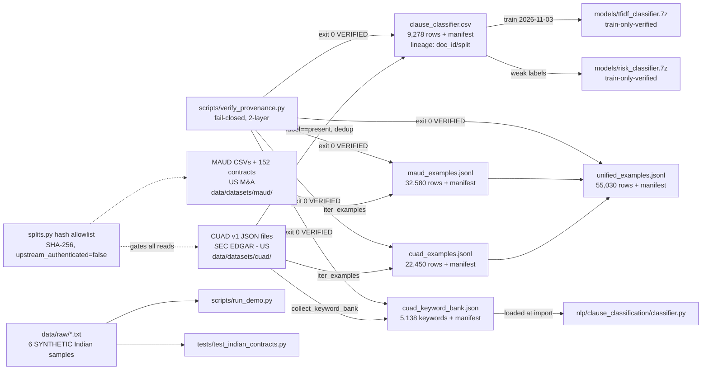

---

## 14. Database and Data Models (BC-DM-015)

**Status: VERIFIED** (schemas read from code; live databases not running at investigation).

### 14.1 Technologies

- **Neo4j 5.18** — property graph for the contract knowledge model. Driver: neo4j Python 5.x, singleton, lazy, 10 s re-probe throttle, 3-retry on TransientError.
- **PostgreSQL 16** — SQLAlchemy 2.0 ORM, two tables, engine pool 5+5, 3 s connect timeout, 30 s bounded-outage cache.
- **Redis 7** — compose service only; **no application code reads or writes Redis** (reserved for future Celery). `VERIFIED FACT` (no Redis calls in `app/`).
- **No migrations** — `create_all` + ad-hoc owner-column ALTER (ADR-012).

### 14.2 PostgreSQL tables

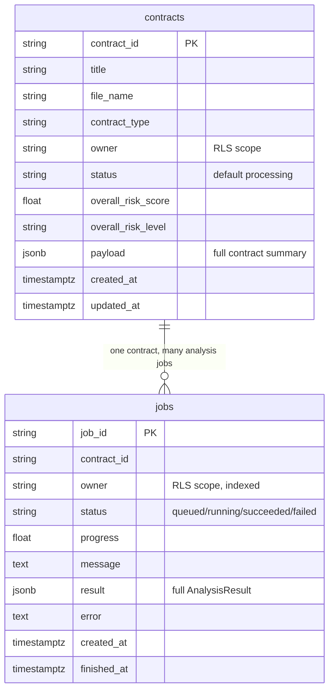

`[EVIDENCE: app/db/postgres.py — ContractRecord, JobRecord]`

### 14.3 Neo4j graph model

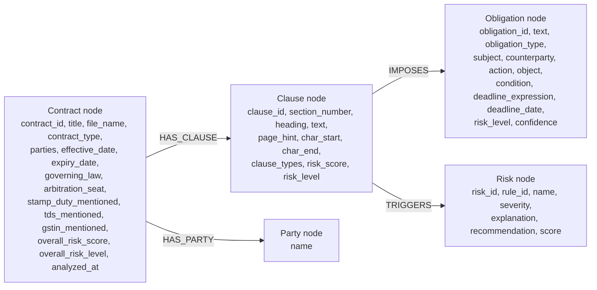

Indexes (created at startup when Neo4j is available): `Contract.contract_id` (unique constraint), `Clause.clause_id`, `Company.cin`, `Obligation.obligation_id`, `Party.name`. Note: a `Company` node type is indexed but **no code writes Company nodes** — `REPOSITORY OBSERVATION` (dead index). `[EVIDENCE: app/db/neo4j.py — INDEX_QUERIES, app/db/queries.py]`

### 14.4 Entity relationship across the domain

Contract → (HAS_CLAUSE) → Clause → (IMPOSES) → Obligation; Clause → (TRIGGERS) → Risk; Contract → (HAS_PARTY) → Party. **Evidence** is embedded in Risk nodes' property bag in Postgres payloads (evidence spans are stored in the job result JSON and in `RiskFlag` fields; they are not separate graph nodes). **Legal references** are embedded in the risk's `case_law` list, not separate nodes. Only the four node types above exist. `[EVIDENCE: app/db/queries.py — write_analysis, fetch_graph]`

### 14.5 Lifecycle, ownership, retention

- **Ownership:** `owner` column (username) on both tables when auth is on; empty string when off. RLS enforced at query level.
- **Retention:** **none** — contracts and jobs are never deleted; `uploads/` is never cleaned. `KNOWN LIMITATION` (R-09).
- **Backup:** volume-backed in compose (`postgres_data`, `neo4j_data`); no backup tooling in repo. PROPOSED for production.
- **Graph data vs. Postgres:** the graph stores the analytical model; Postgres stores the full `AnalysisResult` as JSON in `jobs.result` and a summary in `contracts.payload` — the graph is reconstructable from Postgres (the graph endpoint's in-memory fallback does exactly this).

---

## 15. API and Frontend Documentation (BC-DM-016)

**Status: VERIFIED** (all routes read from code; capability matrix read from `frontend/CAPABILITY_MATRIX.md`).

### 15.1 API endpoint inventory (complete)

Base: no global prefix; each router carries `/api/v1/...`. Auth semantics: `AUTH_ENABLED=false` ⇒ all routes open, principal = anonymous admin.

| Method | Path | Auth/Role | Request | Response | Error map |
|---|---|---|---|---|---|
| POST | `/api/v1/auth/token` | none (form credentials) | `username`, `password` (form) | `TokenResponse` (access_token, expires_in) | 400 auth-disabled; 401 bad credentials; 429 + Retry-After (5 fails/60 s per username) |
| GET | `/api/v1/auth/me` | any token | — | `UserInfo` | 401 |
| POST | `/api/v1/contracts/upload` | **analyst or admin** (only role-gated route) | FormData: `file` (+ optional `contract_type`, `user_role`, `jurisdiction`) | `JobInfo` | 400 bad ext/empty; 413 oversize; 401/403 |
| GET | `/api/v1/contracts/{contract_id}/summary` | any; RLS owner | — | `ContractSummary` | 404 not found/other-owner; 409 queued/running/failed; 500 unreadable result |
| GET | `/api/v1/contracts/{contract_id}/clauses` | any; RLS | — | `{clauses: [Clause]}` | same |
| GET | `/api/v1/contracts/{contract_id}/obligations` | any; RLS | — | `{obligations: [Obligation]}` | same |
| GET | `/api/v1/contracts/{contract_id}/risks` | any; RLS | — | `{risks: [RiskFlag]}` | same |
| GET | `/api/v1/jobs/{job_id}` | any; RLS | — | `JobInfo` | 404 (unknown OR other-owner — existence not leaked) |
| GET | `/api/v1/jobs` | any; RLS owner list | — | `{jobs: [JobInfo]}` | — |
| GET | `/api/v1/graph/{contract_id}` | any; RLS pre-check | — | `GraphSnapshot` (nodes + edges) | 404 no graph |
| GET | `/` | none | — | name/version/docs pointers | — |
| GET | `/healthz` | none | — | `{status, neo4j, env, auth_enabled, provenance}` | never fails on provenance |

`[EVIDENCE: app/api/routes_auth.py, routes_contracts.py, routes_jobs.py, routes_graph.py, app/main.py]`

**Error-model notes:** 409 is the "still processing" / "failed" state for sub-resources (the UI polls the *job* instead); 404 is deliberately overloaded (unknown vs RLS-scoped) to avoid existence leaks; 500 bodies are generic outside dev. Contract IDs: `c_{YYYYmmdd_HHMMSS}_{sha256[:10]}_{uuid4[:8]}` (uuid added post-audit to prevent Neo4j MERGE fusion of same-second same-content uploads).

### 15.2 Request / response models (Pydantic v2)

`ContractType` (8 values), `PartySide` (8), `RiskSeverity` (4), `ObligationType` (4), `JobStatus` (4), `UserRole` (3); models: `Entity`, `Clause`, `Obligation`, `CaseLawReference`, `EvidenceSpan`, `RiskFlag`, `ContractSummary` (incl. `risk_score_breakdown`, `score_caveat`), `AnalysisResult`, `JobInfo` (incl. `result_error`), `TokenResponse`, `UserInfo`, `ContractMetadata`, `GraphNode`, `GraphEdge`, `GraphSnapshot`. `[EVIDENCE: app/models/schemas.py]`

### 15.3 CORS

`CORSMiddleware` with `cors_origins` (default: the two Streamlit localhost origins only), credentials allowed unless `"*"` is present, all methods/headers. **The Next.js dev origin (:3000) is NOT in the default allow-list** — the dev setup uses a Next.js rewrite proxy (`/api → BACKEND_URL`) to sidestep CORS; production requires adding the frontend origin. `[EVIDENCE: app/main.py, frontend/README.md]`

### 15.4 Streamlit frontend (baseline, on all branches)

| Page | Purpose | Key behaviour |
|---|---|---|
| `Home.py` | Upload + demo entry | `POST /contracts/upload`, poll job 60×1 s; **falls back to in-process `analyse_bytes`** when the API is unreachable; "Run demo analysis on bundled sample MSA" button |
| `1_Summary.py` | Executive summary | top-5 risks, parties/dates/governing law, compliance signals, missing clauses, counts |
| `2_Clause_Explorer.py` | Clause list | type/risk filters + text search |
| `3_Obligations.py` | Obligation tracker | DataFrame + filters + CSV download |
| `4_Graph.py` | Graph explorer | streamlit-agraph; in-memory fallback `_local_to_graph` when Neo4j/graph endpoint unavailable |
| `5_Risk_Review.py` | Risk review | severity filters + risk cards + JSON download |

**No bearer-token support** in `streamlit_app/api_client.py` — documented deferral (plan.md §9). `KNOWN LIMITATION`.

### 15.5 Next.js frontend (branch `feature/nextjs-frontend` — the branch under investigation)

Stack: Next.js 14.2.35 (pinned), React 18.3.1, TypeScript 5.4.5, Tailwind 3.4, TanStack Query v5, zustand, zod, recharts, @xyflow/react, `diff`. npm (lockfile). Port 3000. Typed API client hits `${BASE}/api/v1/...`; token in `localStorage` under `bharatcontract.token`; 401 dispatches `bharatcontract:unauthorized` window event.

| Route | Page | Status |
|---|---|---|
| `/` | Landing: drop zone, recent contracts, 3-step explainer, disclaimer | IMPLEMENTED |
| `/login` | Login (or "auth disabled" notice) | IMPLEMENTED (signed-in status UI affected by pinned defect — below) |
| `/upload` | Thin upload wrapper | IMPLEMENTED |
| `/jobs/[jobId]` | Job progress: 1.5 s polling, truthful stage bar, failed-state card, auto-redirect 800 ms after success | IMPLEMENTED |
| `/contracts/[id]/review` | Split-pane review workspace (clause document + finding detail), auto-scroll to finding clause | IMPLEMENTED (server-fetch path deliberately null — documented shared-file bug in `server-fetch.ts` missing `/v1`) |
| `/contracts/[id]/risks` | Risk dashboard: gauge, score-breakdown "why this score", severity donut, category heatmap, local-only must-review checklist, compliance grid ("never a pass/fail verdict") | IMPLEMENTED |
| `/contracts/[id]/obligations` | Obligation tracker: table/timeline toggle + ICS export (RFC 5545, unconditional + dated only) | IMPLEMENTED |
| `/graph` | Graph explorer (@xyflow/react), contract picker, filters, honest 404 states | IMPLEMENTED |
| `/compare` | Contract comparison — **client-side only** (no backend endpoint): clause diff by section/heading/ordinal with match-basis shown, risk/obligation diffs, heuristic "possible conflicts" | IMPLEMENTED |

**Pinned known defects** (documented in `frontend/TESTING.md`, asserted by tests, NOT fixed): (1) `AuthProvider.backendAuthEnabled` inversion (`me.data ? !me.data.authenticated : false`) makes the signed-in status UI effectively unreachable — "the 'Sign in' link is dead UI"; (2) `ruleIdToCategory('RISK_S124_001')` → "Other" (prefix table mismatch). **Partial test coverage:** obligations table, review/risks/graph/comparison components, and login page component tests were "in-flight" at QA time.

### 15.6 Loading / failure states (verified in code)

404 (unknown or RLS) → single "not found or no access" state; 409 → "still processing" with job-poll guidance; job FAILED → error card with `job.error`; network down → "Cannot reach the backend. Is the API server running?"; graph 404 → "No graph available" + retry; comparison refuses partial loads ("partial outputs are never compared"). All states rendered with `role="alert"`/`role="status"`. `[EVIDENCE: frontend/src/features/, src/components/ui/state.tsx, frontend/README.md — Troubleshooting]`

---

## 16. Security, Privacy, and Responsible AI (BC-DM-017)

**Status: VERIFIED.** No security compliance is claimed; this section states what protections exist and what is missing.

### 16.1 Authentication and authorization

- **Mechanism:** HS256 JWT bearer tokens (python-jose), 60-min expiry; passwords bcrypt with stdlib PBKDF2-SHA256 (260k iterations) fallback; roles `viewer(1) < analyst(2) < admin(3)` with rank-based checks. `[EVIDENCE: app/core/security.py]`
- **Token lifecycle:** live re-validation on every request against the process-local UserStore — deleted user ⇒ 401 "Token is no longer valid"; demoted user ⇒ stored (lower) role honoured; token role inflated above stored ⇒ 401. Login throttling: 5 consecutive failures per username ⇒ 429 + `Retry-After: 60` (correct password also 429 while locked — no credential oracle). Boot guard: default secret + `AUTH_ENABLED` + production-like env ⇒ refused start. `[TEST: tests/test_auth.py — 8 tests, tests/test_security_hardening.py — 14 tests]`
- **Authorization:** single role gate — upload requires `analyst+`. Reads are open to any authenticated principal but **owner-scoped** (RLS).
- **Limitations:** user store is process-local (no user DB); `AUTH_USERS` JSON parse failure **silently falls back to the seeded admin** (documented, left open "for approval"); no MFA; no cookie+CSRF scheme (documented trade-off: `localStorage` token is XSS-readable; "the backend remains authoritative"; "a cookie + CSRF scheme would be the production hardening" — quoted from `frontend/README.md`).

### 16.2 Row-level security and data boundaries

- Owner columns on `contracts`/`jobs`; all queries owner-filtered; 404-not-403 semantics; graph route pre-checks ownership before touching Neo4j (the graph store itself is **not** owner-scoped). `[TEST: tests/test_rls.py, tests/test_security_hardening.py — post-eviction RLS]`
- **Uploads on disk** (`uploads/`) are not access-controlled beyond the API and are never cleaned — the strongest open privacy gap (R-09).
- Contract text never leaves the host (PRIV-001). No telemetry. The only network egress path is the optional DeBERTa model download.

### 16.3 Input validation and file-upload risks

Extension whitelist, empty-file rejection, 25 MB hard cap (413, never truncate), 2M-char parse truncation warning, binary-garbage gate (>30% non-text rejected), image-only PDF rejection, multi-page empty-document rejection with OCR hint. No virus/malware scanning. `KNOWN LIMITATION`.

### 16.4 Secrets management

All secrets via env / `.env` (single `get_settings()`); `.env.example` ships development-only defaults; default JWT secret is guarded at boot in prod-like envs; 500 bodies generic in production; the API client never logs headers/JWTs. **Open:** `AUTH_USERS` silent-admin fallback; no secret rotation story.

### 16.5 Responsible-AI properties

| Property | Status |
|---|---|
| Hallucination control | Strong by design: no generative component; all extracted text is source-sliced (obligation `text` is `None` when not uniquely locatable); evidence spans verified against source by tests |
| Abstention | Implemented at classifier / resolver / extractor / scorer levels (§9.4) |
| Uncertainty labelling | `evidence_status` per finding; `verified_on=None` per citation; score caveat; "not a probability" |
| Prompt injection | NOT RELEVANT — no LLM consumes contract text |
| Adversarial robustness | 10-case adversarial suite pins the two most FP-prone suppression paths; negation suite 31 tests |
| Human oversight | Every output framed as triage aid; UI disclaimers on all pages; case-law requires counsel confirmation |
| Auditability | Manifests + git revision + deterministic seeds + evidence register in this dossier |
| Fairness / bias | **NOT ASSESSED** — no fairness evaluation exists; US-only training data is a distributional concern disclosed in every report |

---

## 17. Testing and Quality Assurance (BC-DM-018)

**Status: VERIFIED — the suite was executed at investigation: `560 passed, 6 warnings in 69.30s` at HEAD `77e9504` (uv run pytest).**

### 17.1 Python test suite (36 files, 492 `def test_` functions; 560 collected tests incl. parametrization)

| Group | Files (tests) | Purpose |
|---|---|---|
| Parser / fixtures | `test_parser.py` (3), `test_realistic_fixtures.py` (22), `test_pipeline_hardening.py` (18) | Format parsing, header/footer, tables, OCR warnings, truncation, binary rejection, party detection, long-clause splits |
| Segmentation | `test_segmenter.py` (9), `test_long_clauses.py` (2) | Offsets, preamble, invariant, splitting |
| Classification | `test_classifier_accuracy.py` (11) | Per-category checks + corpus accuracy (note: corpus is training-overlapping — labelled in code) |
| NER / negation | `test_negation_and_context.py` (31), `test_regressions.py` (17) | Negation windows, detectors, regression pins (arbitration seat, case-law honesty, TF-IDF canonicalisation) |
| Obligations | `test_obligation_extraction.py` (59) | Largest single file; full behaviour surface |
| Risk rules | `test_risk_rules.py` (43), `test_risk_quality.py` (21), `test_risk_model.py` (7), `test_rules_vs_hybrid.py` (2) | Every rule fire/no-fire, enrichment, contradiction detector, booster no-op, script smoke |
| Context / cross-refs | `test_context_resolution.py` (10), `test_p4_cross_reference.py` (5), `test_p4_context_rules.py` (3), `test_p4_cap_resolution.py` (15), `test_p4_adversarial.py` (10) | Fail-closed cross-reference behaviour |
| Evidence | `test_evidence_binding.py` (10) | Spans match source; scope/status invariants |
| Jobs / backend | `test_jobs_backend.py` (18), `test_api_smoke.py` (2), `test_e2e.py` (1) | Job lifecycle, eviction recovery, API round-trip, full pipeline on sample MSA |
| Security | `test_auth.py` (8), `test_rls.py` (2), `test_security_hardening.py` (14) | Tokens, roles, throttling, 413, 500 hygiene, post-eviction RLS |
| Data / provenance | `test_no_leakage.py` (23), `test_no_stale_duplicates.py` (2), `test_gold_annotations_valid.py` (5), `test_audit_integration.py` (25) | Split enforcement, forged-manifest rejection, duplicate lock, gold integrity, D1–D6 regressions |
| Evaluation | `test_evaluation_metrics.py` (29), `test_evaluation_harness.py` (4), `test_evaluation_family_split.py` (12), `test_metrics_integration.py` (3), `test_regression_detector.py` (15) | Metric math, harness invariants, family-split, regression gate incl. self-comparison |
| Indian coverage | `test_indian_contracts.py` (29) | Rule behaviour on the 6 synthetic Indian samples |

**Execution command:** `uv run pytest` (or `BCC_EVAL_MODE=ci` to make a missing training corpus a hard failure).

### 17.2 Frontend tests

- **Vitest:** 16 files, ~104 `it()` cases (98 default / 6 behind `RUN_REAL_BACKEND=1`); pure unit (severity, format, api client, token store, ICS builder, rule-category) + mocked component/integration.
- **Playwright:** `e2e/smoke.spec.ts` (3 tests, no backend: heading, mandatory disclaimer, upload card) + `e2e/backend.spec.ts` (opt-in `RUN_E2E_BACKEND=1`: live upload → job page within 120 s).
- **Known gaps:** obligations table, review/risks/graph/comparison components, login page — "in-flight" at QA time; real-backend job pipeline hangs under vitest load in the dev environment (documented, hence the extra flag). `[EVIDENCE: frontend/TESTING.md]`

### 17.3 What the tests prove — and what they do not

- **Prove:** software correctness of the pipeline on the fixed fixture/synthetic surface; behaviour regressions (D1–D6, C3/C4/C5/C7 fixes); security invariants; provenance fail-closed; data-lineage integrity.
- **Do NOT prove:** real-world legal accuracy; Indian-contract performance (no real Indian corpus); OCR quality on real scans; DeBERTa path (no `[ml]` in the verified environment); performance under load. A passing suite is explicitly "a software-behaviour check, not a measure of legal accuracy" (quoted from `scripts/run_evaluation.py` header).

### 17.4 Separation of test kinds (as required)

| Kind | Where | Status |
|---|---|---|
| Software correctness | 36 pytest files; vitest; Playwright smoke | VERIFIED green |
| Model evaluation | `scripts/eval_heldout.py`, `eval_rules_vs_hybrid.py`, `run_evaluation.py` + reports | VERIFIED (numbers in §19) |
| Dataset validation | `scripts/verify_provenance.py`, `test_no_leakage.py` | VERIFIED (exit 0) |
| Synthetic regression | 17-case harness + gold + baseline + detector | VERIFIED (17/17; self-comparison gate) |
| Real-world validation | **ABSENT** | NOT IMPLEMENTED — the single largest research gap |

---

## 18. Evaluation Methodology and Experimental Design (BC-DM-019)

**Status: VERIFIED** — every component below exists in code and was read; formulas are as implemented in `nlp/evaluation/metrics.py`.

### 18.1 Metrics implemented (with formulas)

Let the predicted set be $\hat{Y}$ and gold $Y$.

- **Classification (multi-label):** per class $c$: precision $P_c = \frac{TP_c}{TP_c+FP_c}$, recall $R_c = \frac{TP_c}{TP_c+FN_c}$, $F1_c = \frac{2P_cR_c}{P_c+R_c}$. Macro average $F1_{macro} = \frac{1}{|C|}\sum_c F1_c$; micro pools all TPs/FPs/FNs first. Accuracy@k: fraction of examples where gold label ∈ top-k predicted. Abstention rate: fraction abstaining (rule mode: Miscellaneous fallback; hybrid: threshold-empty). `[EVIDENCE: nlp/evaluation/metrics.py — compute_classification_metrics, classifier_metrics.py]`
- **NER:** entity-level and boundary-level P/R/F1 (exact span match and IoU-based), type accuracy, role accuracy. `compute_ner_metrics`.
- **Obligations:** detection P/R/F1 (matched via `match_obligations`), exact-match P/R/F1 (all fields equal), duplicate rate.
- **Risk:** finding-level P/R/F1 on rule IDs, FP/FN rates, per-category precision, severity agreement.
- **Evidence:** exact span accuracy, mean IoU $\frac{|A \cap B|}{|A \cup B|}$ over character spans, completeness.
- **Integrated summary weights:** classification 0.25, NER 0.20, obligations 0.20, risk 0.20, evidence 0.15. `[EVIDENCE: metrics.py — compute_evaluation_summary]`
- **Why each matters:** classification F1 → rule gating quality; NER F1 → entity reliability (feeds rule triggers); obligation detection F1 → tracker completeness; risk F1 → the core value metric; evidence IoU → auditability quality.

### 18.2 Gold annotations

- **Synthetic gold** (`nlp/evaluation/gold_annotations/cases_gold.json`, v1.1.0, 2026-11-03, git `2ae9ff4`): 17 cases; per case: classification/NER/obligation/risk/evidence/cross-ref gold. Derived from the actual case text in `cases.py` with manual adjudication; party names and offsets verified against the text; rule IDs verified against the real engine. Header: "These support BEHAVIOUR regression checking only; they are NOT a measure of legal accuracy." History: v1.0 was partially fabricated (deep audit C1); regenerated in `GIT: 4b1a9ca`.
- **CUAD-derived gold** (held-out eval): CUAD's own QA annotations for the 95 family-disjoint test documents (5,039 examples) — real dataset annotations, still US-only and not human-adjudicated for this project's taxonomy.

### 18.3 Splits and baselines

- **Family-disjoint held-out:** title-normalisation + 8-char shingle overlap ≥ 0.5 defines template families; test docs whose family has no train presence form the eval set (95 of 102; 7 leaked, all by title equality). Content-addressed cache (`tmp/family_leakage_cache.json`). Stated limitations: title ≈ SEC-filing identity proxy (not EDGAR-verified offline); shingle overlap ≠ legal independence; threshold is a hyperparameter.
- **In-distribution comparison:** 2,000 rows of the 9,278-row train CSV, seed 20261103, rule-only vs hybrid. Banner: "IN-DISTRIBUTION TRAINING-CORPUS COMPARISON — NOT A GENERALIZATION ESTIMATE."
- **Regression baseline:** `reports/evaluations/integrated_synthetic_baseline.json` (git `2ae9ff4`); tolerances: min 0.0 and 5% degradation per metric; self-comparison ⇒ exit 1 + "RESULT INVALID" (the committed `regression_report.md` literally says "⛔ SELF-COMPARISON — RESULT INVALID" — an honest artefact).
- **Ablations present:** booster off vs on (delta run); rule-only vs hybrid. **Ablations absent:** per-rule ablation; ML-only; ablation of negation guards / context layer.

### 18.4 Reproducibility

Deterministic seeds (20261103); pinned deps (uv.lock); hash-pinned datasets; artefact SHAs recorded; code revision in every report/manifest; commands in every report. Reproducing §19 requires `uv sync` + the datasets in `data/datasets/` (277 MB, present in this checkout).

### 18.5 Validity threats (stated in-repo + identified here)

1. Synthetic gold ≠ legal ground truth (stated in-repo).
2. US-only corpora for all ML (stated in-repo).
3. 12 taxonomy labels with zero training rows — their quality "cannot be measured by anything in this repo" (stated).
4. Family proxy ≠ document independence (stated).
5. Weakly-supervised labels propagate rule errors into the ML model (disclosed).
6. **No Indian-contract evaluation exists at all** (this dossier's finding — the central research gap).
7. `match_obligations` in `metrics.py` references Obligation attribute names (`responsible_party`, `object_`, `beneficiary`, `*_span`) that do not match the extractor's schema (`subject`, `counterparty`, `object`) — that code path appears stale/unexercised. `REPOSITORY OBSERVATION` (flagged, not resolved).

### 18.6 Proposed protocol (clearly labelled `PROPOSED APPROACH` — not performed)

To support a research-paper claim on Indian contracts: (1) collect N ≥ 100 real, counsel-permissioned Indian commercial contracts across the 15 scenario types; (2) dual-annotate clauses + obligations + risks by two reviewers (report Cohen's κ); (3) run the pipeline and report per-component P/R/F1 with 95% bootstrap CIs; (4) run a rules-only vs hybrid vs human ablation; (5) report calibration (reliability diagrams) for the ML booster; (6) a blinded reviewer study measuring time-to-complete-review with vs without the tool. None of this is in the repo.

---

## 19. Experimental Results (BC-DM-020)

**Status: VERIFIED.** Every number below was either re-executed at investigation (marked **RERUN**) or quoted from a dated report with its git revision. Measured results are separated from targets.

### 19.1 Test suite

| Date | Commit | Command | Result | Interpretation |
|---|---|---|---|---|
| 2026-11-03 | `77e9504` | `uv run pytest` | **560 passed, 6 warnings, 69.3 s — RERUN** | Software-correctness baseline for this branch |
| 2026-11-03 | main-line sessions | `uv run pytest` | 560 passed (reported) | Consistent with RERUN |
| 2026-11-02 | `93cedd9`-era | `uv run pytest` | 250 passed (reported, `20261102_evaluation_infrastructure.md`) | HISTORICAL FACT (suite grew +310 since) |

### 19.2 Provenance verification

| Date | Commit | Command | Result |
|---|---|---|---|
| 2026-11-03 | `77e9504` | `uv run python scripts/verify_provenance.py` | **0 failure(s), 0 skipped, exit 0 — RERUN** (5 artefacts, row-level lineage incl. all 9,278 CSV rows) |

### 19.3 Clause classification — family-disjoint held-out (the only generalization estimate)

Source: `reports/evaluations/heldout_family_disjoint_20261103.md` (+ JSON), 2026-11-03, seed 20261103, elapsed 414.8 s. Set: 95 family-disjoint CUAD test docs, 5,039 examples. US contracts only.

| Mode | Acc@1 | Acc@3 | Macro-F1@1 | Weighted-F1@1 | Macro-F1@3 | Weighted-F1@3 | Misc fallback |
|---|---|---|---|---|---|---|---|
| rule-only | 0.1840 | 0.2526 | 0.1314 | 0.1978 | 0.1373 | 0.2164 | 1,233/5,039 (24.5%) |
| hybrid | **0.4009** | 0.5324 | 0.4034 | 0.4133 | 0.2046 | 0.3680 | 13/5,039 (0.26%) |

Best class (hybrid, top-1): Governing Law F1 0.8696. Worst: Confidentiality F1 0.0396 (recall 0.0204). **Interpretation (stated in report):** in-CUAD generalization only; supports no Indian-law or out-of-CUAD claim. `EXPERIMENTAL RESULT`.

### 19.4 Integrated synthetic evaluation (behaviour regression, NOT accuracy)

Source: `reports/evaluations/integrated_eval_results.json` (git `2ae9ff4`), 17 synthetic cases.

| Metric | Value |
|---|---|
| Classification macro/micro F1 | 0.25 / 0.25 |
| NER entity F1 / boundary F1 | 0.0 / 0.0 |
| Obligation detection F1 | **0.9722** |
| Risk detection F1 | **0.3514** |
| Evidence mean IoU / exact span accuracy | 0.3046 / 0.0 |

Pass/fail harness: `cases=17 passing=17 known_limitations=0 regressions=0` with all 3 evidence-integrity invariants OK — **RERUN at investigation** (`uv run python scripts/run_evaluation.py`; current `cases.py` holds 17 cases). Minor RERUN observation: the regenerated run shows `RISK_DISPUTE_001` (added 2026-11-03 in `30ba884`) firing on most short synthetic contracts — an expected FP-on-short-docs effect of the same kind as `MISSING_CLAUSE_*`, consistent with the low risk-F1 analysis below. The committed report file (pre-`RISK_DISPUTE_001`) is the one quoted; the pass/fail outcome is identical. Risk F1 is low because short synthetic contracts make `MISSING_CLAUSE_*`/`RISK_STAMP_001` findings dominate as false positives against narrow per-case gold. **These numbers measure conformance to behaviour expectations, not legal accuracy (stated).** `EXPERIMENTAL RESULT` (synthetic).

### 19.5 Rules-vs-hybrid (in-distribution) and ML booster delta

Source: `reports/evaluations/rules_vs_hybrid_20261103.md` (2,000 train rows, seed 20261103) and `risk_booster_delta_20261103.md` (300 train docs).

| Metric (2,000 rows) | rule-only | hybrid |
|---|---|---|
| Acc@1 | 0.3370 | **0.9160** |
| Acc@3 | 0.4080 | 0.9860 |
| Macro-F1@1 | 0.2367 | 0.8560 |
| Weighted-F1@1 | 0.3818 | 0.9167 |
| Top-1 label changed between modes | 1,308/2,000 (65.4%) | — |

Booster delta (300 docs): rule findings unchanged 1,531 = 1,531; **ML_RISK_001 added: 63**; redundant (on already-flagged clauses): 0; clause score changed 63/580; doc-level score changed 60/300. **Banner (stated): in-distribution, training corpus, NOT a generalization estimate; keyword bank from the same snippets makes rule-mode "doubly optimistic".** `EXPERIMENTAL RESULT` (in-distribution).

### 19.6 Model retraining diagnostics (IN-SAMPLE only)

Source: `reports/evaluations/model_retraining_20261103.md`, 2026-11-03. Both bundled models retrained from the train-only, manifest-verified corpus (0 rows dropped). TF-IDF: in-sample top-1 **0.9230**; 85/15 stratified split (1,392 rows) acc 0.82 / macro-F1 0.82; per-class F1 0.83–0.99. Risk classifier: in-sample top-1 **0.9610**; split acc 0.90 / macro-F1 0.89. Weak-label distribution: low 5,451 / medium 2,705 / high 1,122 / critical 0. **Explicitly "IN-SAMPLE ONLY — not a generalization estimate."** `EXPERIMENTAL RESULT` (in-sample).

### 19.7 CLI demo

| Date | Commit | Command | Result |
|---|---|---|---|
| 2026-11-03 | `77e9504` | `uv run python scripts/run_demo.py` | **RERUN, exit 0** — sample_msa.txt: 12 clauses, 13 obligations; top risks: uncapped liability (critical), broad indemnification (high), arbitration seat/venue mismatch (high), automatic renewal (medium), tight breach-notification window (medium). Overall risk_score 100 / CRITICAL (consistent with `indian_coverage_20261103.md`). Synthetic sample. |

### 19.8 Model comparisons

| Comparison | Result | Caveat |
|---|---|---|
| rule-only vs hybrid (held-out) | 0.184 → 0.401 Acc@1 (§19.3) | US only |
| rule-only vs hybrid (in-dist.) | 0.337 → 0.916 Acc@1 (§19.5) | train corpus |
| booster off vs on | +63 findings, 0 redundant (§19.5) | in-dist.; recall-only role |
| old leaky models vs retrained train-only models | artefact hashes swapped; provenance status `train-only-verified` | in-sample diagnostics only |

### 19.9 Known failures / honest negative results

- NER exact-match F1 = 0.0 and evidence exact span accuracy = 0.0 on the synthetic gold — the exact-match strictness makes these tolerances "uninformative" (stated in the regression-detector docstring; the gold is behaviour-level, not span-identical).
- `regression_report.md` in the repo is a committed "⛔ SELF-COMPARISON — RESULT INVALID" — an honest record of the gate working.
- Held-out Confidentiality recall 0.0204 — the worst class, disclosed.
- **No experiment in the repo produced a positive Indian-law accuracy result — because none could (no Indian gold data).**

---

## 20. Installation and Reproducibility Guide (BC-DM-021)

**Status: PARTIALLY VERIFIED** — commands marked (tested) were executed successfully in this environment on 2026-11-03 (Python 3.12, Linux, uv available). Docker-stack boot was **not** performed at investigation.

### 20.1 Prerequisites

- Python 3.10–3.12 (`pyproject.toml: requires-python = ">=3.10,<3.13"`)
- [uv](https://docs.astral.sh/uv/) package manager
- Optional: tesseract-ocr (scanned PDFs); spaCy `en_core_web_sm` (not actually required by the verified base path — no spaCy call in the core pipeline; listed in README quick-start); Docker (full stack); Node ≥ 18.17 (Next.js frontend)

### 20.2 Backend setup (commands as documented)

```bash
# 1. Install dependencies (tested: environment already synced; command documented in README)
uv sync --extra dev

# 2. (Optional) bring up infrastructure
docker compose -f docker/docker-compose.yml up -d neo4j postgres redis

# 3. Start the API (tested pattern: uv run uvicorn app.main:app)
uv run uvicorn app.main:app --reload
# -> http://localhost:8000/docs , /healthz

# 4. Start the Streamlit dashboard (second terminal)
uv run streamlit run streamlit_app/Home.py
# -> http://localhost:8501
```

Zero-infra mode: skip step 2 entirely; the API + dashboard run on Python only (degradation verified by the test suite running with no databases).

### 20.3 Verification commands (all executed at investigation)

```bash
uv run pytest                                   # 560 passed (69 s)
uv run python scripts/verify_provenance.py      # 0 failure(s), exit 0
uv run python scripts/run_evaluation.py         # cases=17 passing=17
uv run python scripts/run_demo.py               # exit 0, JSON summary
uv run ruff check .                             # documented clean (last run 2026-11-03 sessions)
```

Evaluation (require the datasets present in `data/datasets/`):

```bash
uv run python scripts/eval_heldout.py           # family-disjoint held-out (~7 min, cached leakage)
uv run python scripts/eval_rules_vs_hybrid.py   # in-distribution comparison + booster delta
uv run python scripts/check_evaluation_regression.py   # regression gate vs baseline
uv run python scripts/build_training_data.py --out-dir data/processed   # rebuild corpus (approval-gated in project history)
```

### 20.4 Environment configuration

Copy `.env.example` to `.env`. All 30 variables and defaults are documented in `.env.example` (database URLs, Neo4j creds, API host/port, model names, upload dir/size, log level/file, jurisdiction, CORS, background jobs, OCR, rule-based classifier flag, job worker count, and the AUTH_* block). Development-only defaults include `AUTH_ENABLED=false` and a development JWT secret (boot-guarded in prod-like envs). **No secrets are reproduced in this dossier.**

### 20.5 Frontend setup (Next.js)

```bash
cd frontend
npm ci
npm run dev        # :3000, dev rewrite /api -> BACKEND_URL (default http://127.0.0.1:8010)
npm test           # vitest (98 default cases)
npm run typecheck  # tsc --noEmit
RUN_E2E_BACKEND=1 npm run e2e   # opt-in Playwright vs live backend
```

### 20.6 Troubleshooting (verified from code + docs)

| Symptom | Cause / fix |
|---|---|
| "Cannot reach the backend" in UI | API not running, or `BACKEND_URL`/`API_BASE_URL` mismatch; check `/healthz` |
| 409 on contract sub-resources | job still queued/running (or failed) — poll `GET /api/v1/jobs/{id}` instead |
| 404 on another user's contract | RLS by design (no existence leak) |
| 413 on upload | > `MAX_UPLOAD_MB` (25); the API never truncates |
| Provenance warnings in analysis | `PROVENANCE_UNVERIFIED/ABSENT` tokens — run `verify_provenance.py`; do not treat as accuracy claims |
| "File does not appear to be text" | binary-garbage gate; the file is not parseable text |
| CORS errors from :3000 in non-dev mode | add the frontend origin to `CORS_ORIGINS` or use the rewrite proxy |
| Test skips on a fresh clone | `data/processed/` generated not shipped — rebuild via `build_training_data.py`; or set `BCC_EVAL_MODE=ci` to fail instead of skip |

---

## 21. Known Limitations and Failure Analysis (BC-DM-022)

**Status: VERIFIED.** Separates resolved historical issues from open issues.

### 21.1 Resolved historical issues (with fix evidence)

| Issue | Found | Fixed | Evidence |
|---|---|---|---|
| Gold annotations partially fabricated (C1) | Deep audit 2026-11-03 | Regenerated v1.1.0 from real case text + manual adjudication | `[GIT: 4b1a9ca]`, `cases_gold.json` header |
| Regression gate was a tautology (C2) | Deep audit | Self-comparison detection (exit 1 + "RESULT INVALID"); loud baseline creation | `regression_detector.py`, committed invalid report |
| Negation broken in rules — "shall not be unlimited" fired (C5) | Deep audit | `_first_unnegated_trigger` guard on every rule trigger | `rules.py`, 31 negation tests |
| `NOTICE_PERIOD_RE` matched bare durations (C3) | Deep audit | Deontic-prefix requirement; DURATION/NOTICE_PERIOD split | `ner.py`, `test_regressions.py` |
| Arbitration seat = any city mention (C4) | Deep audit | Explicit-phrase-first detection; context-gated fallback | `ner.py — detect_arbitration_seat` |
| Obligation severity deadline-dominated (C7) | Deep audit | Content severity table + bounded urgency boost | `extractor.py` |
| Job persistence dropped timestamps; `list_jobs` never merged memory+DB (C8/C9) | Deep audit | Timestamps persisted; memory+Postgres merge; post-eviction RLS test | `jobs.py`, `test_jobs_backend.py` |
| Bundled models trained on train∪test (leakage) | Deep audit | Both retrained train-only 2026-11-03; provenance `train-only-verified` | `GIT: 3187c0f`, `PROVENANCE_STATUS.json` |
| Case-law citation errors (s. 28 misapplied; DPDP s. 33; missing citations) (C18) | Deep audit | Caveat pointer for s. 28; penalty-section correction; 4 plain-law notes | `case_law.py`, `GIT: 6e20252` |
| P4 unsafe cross-reference suppression | Adversarial review 2026-10-27 | Reverted to fail-closed resolved-only suppression | `reports/evaluations/p4_adversarial_review_20261027.md`, 15+10 tests |
| D1–D6 integration defects (preamble text loss, negated stamp suppression, offsets, sub-offset drift, digit-only breach windows, party "services" drop) | Zero-trust audit 2026-10-30 | All six fixed + data restoration | `reports/audit/remediation_verification_20261030.md` |
| 3 Indian-contract FPs ("nor" negation; NDA court clause; employment party detection) | Indian-coverage session 2026-11-03 | Fixed same session | `reports/evaluations/indian_coverage_20261103.md` |
| RISK_DATA_MISSING unreachable (`"personal data"` both triggered and satisfied) | risk-quality 2026-11-03 | Trigger-only membership | `rules.py`, `test_risk_quality.py` |
| 6.6 MB agent-session dumps committed | Deep audit C11 | `git rm` | `GIT: 7fbbabe` |

### 21.2 Current open limitations (verified present at HEAD)

| # | Limitation | Impact | Evidence |
|---|---|---|---|
| L-01 | **No real Indian contract data anywhere in the repo** — all 6 samples synthetic; 12 of 26 taxonomy labels have zero training rows; no Indian gold annotations | Indian-law accuracy is unmeasurable in-repo; the project's jurisdictional focus is currently rule-authority, not measured capability | `dataset_provenance_20261103.md` §4; `indian_coverage_20261103.md` |
| L-02 | Rule trigger lists are finite phrase sets | False negatives on novel phrasings; mitigation = unverified-labelled ML booster | `rules.py` |
| L-03 | ML outputs uncalibrated; weakly supervised | Booster findings can mislead if read as probabilities — mitigated by explicit "not a calibrated probability" text | `risk_model.py`, `DEFECT_REGISTER.md` D9 |
| L-04 | Case-law pointers unverified against primary text by design | A wrong pointer is possible until counsel checks (3 were wrong pre-fix) | `case_law.py — verified_on=None` |
| L-05 | Obligation extraction: clause-initial conditions only; no-comma leading conditions leave party `None`; passive without agent → `None` | Structured completeness gaps on complex sentences | `extractor.py`, `DEFECT_REGISTER.md` open list |
| L-06 | Context resolver: numeric section keys only; `"Term" means` form only; Markdown headings not parsed | Cross-reference resolution misses non-numeric schedules and other definition forms | `resolver.py` docstring, P1 report |
| L-07 | Party detection scans only first/last 3 clauses; over-counts a phantom 3rd party on 2/6 samples | Contract-level party list imperfect | `analyzer.py — _detect_parties`, `AI_WORKING_NOTES.md` REMAINING |
| L-08 | `uploads/` never cleaned; no retention policy | Contract text persists on disk indefinitely | `reports/security/20261103 — not-fixed list` |
| L-09 | `AUTH_USERS` parse failure silently falls back to seeded admin | Misconfiguration can widen access | same (left "for approval") |
| L-10 | No schema migrations (alembic declared, unused) | Silent schema drift; no rollback | `postgres.py — _ensure_owner_columns` |
| L-11 | Streamlit UI sends no bearer tokens | Authenticated deployments must use the Next.js UI or API directly | `plan.md §9`, `api_client.py` |
| L-12 | Next.js pinned defects: AuthProvider inversion (signed-in status UI dead); `RISK_S124_001` category mapping wrong; partial component test coverage | UX gaps, not data-integrity gaps | `frontend/TESTING.md — Pinned findings` |
| L-13 | OCR path never positively verified (no tesseract in verified environment) | Scanned-PDF quality unknown | `parser.py`, R-13 |
| L-14 | DeBERTa hooks unexercised in the verified environment | Optional path's behaviour untested end-to-end | `classifier_ml.py`, R-15 |
| L-15 | No performance benchmarks; no load testing | Throughput/latency unknown at scale | R-07/Q-07 |
| L-16 | Single-process job store; in-memory portion lost on crash | Durability only via Postgres | `jobs.py` |
| L-17 | Dataset licenses unverified in-repo | Redistribution/publication risk (see §13.1) | `dataset_provenance_20261103.md` §2 |
| L-18 | Root duplicate packages (27 files) | Dead code with sync burden (test-locked) | `tests/test_no_stale_duplicates.py` |
| L-19 | `match_obligations` in `metrics.py` uses stale Obligation field names | That metric path may be unexercised/stale | `metrics.py` vs `extractor.py` (flagged, unresolved) |
| L-20 | No comparison endpoint on backend (client-side only) | Large-contract comparisons limited by browser | `frontend/README.md` |

### 21.3 False-positive / false-negative examples (concrete, from the repo)

- **FP (measured):** `MISSING_CLAUSE_GOVERNING_LAW` fires on a 2-clause synthetic contract that simply never mentions governing law — correct by rule design but a false positive against the per-case gold; this dominates the risk F1=0.3514 denominator (§19.4).
- **FP (fixed history):** "was not executed on duly stamped paper" previously set `stamp_duty_mentioned=True`, hiding the review prompt exactly when protection was disclaimed (D4) — now negation-aware.
- **FN (pinned):** `stamp_tds_present_missed` case pins that "duly stamped paper" / "deduction of tax at source" must suppress the absence prompts — a regression guard against the opposite failure mode.
- **FN (structural):** any risk phrasing outside the trigger lists is invisible to the rules; only the unverified ML booster can catch it, and only if its (US-trained) distribution covers it.

---

## 22. Research Contribution and Novelty Assessment (BC-DM-023)

**Status: VERIFIED** — novelty is *graded*, not claimed. Each candidate: what it does, what existed before, what this project changes, evidence, evaluation, limitations, grade.

| # | Candidate contribution | What existed before | What this project changes | Evidence | Evaluation supporting it | Limitations | Novelty grade |
|---|---|---|---|---|---|---|---|
| N-01 | Evidence-grounded risk findings: every finding carries trigger span + rule + recommendation + unverified-labelled case-law pointer, with three-way separation (text / legal pointer / inference) | Rule playbooks exist in commercial tools; academic work usually reports findings without per-finding evidence binding | Systematic, schema-level evidence binding + integrity invariants (3 global invariants tested) + explicit unverified labelling of all legal pointers | `rules.py — _bind_evidence`, `harness.py — invariants`, `test_evidence_binding.py` | 17/17 harness; invariants OK (RERUN) | Binding is clause/sentence-level; pointers unverified | **Plausible** (engineering-integration novelty; the separation discipline is the differentiator, not any single technique) |
| N-02 | Fail-closed cross-reference-aware risk analysis (cap suppression only on unambiguous resolved references; 15 positive + 11 negative + 10 adversarial tests) | Cross-reference resolution exists in legal-NLP literature; suppression logic rarely fail-closed by design | An explicit "any doubt keeps the finding" policy with adversarial test pinning after an unsafe version was reverted | `resolver.py`, `rules.py — _cross_reference_states_applicable_cap`, P4 reports | 30 tests green (RERUN within suite) | Numeric keys only; narrow definition forms | **Plausible** (the adversarial validation history is the research-worthy part) |
| N-03 | Honest evaluation infrastructure for a legal-NLP pipeline: family-disjoint held-out construction, leakage reporting, self-comparison-detecting regression gate, provenance/evaluation/validity separation, retraining-after-audit with disclosed in-sample-only diagnostics | Leakage awareness and regression baselines exist in ML generally; fabricated-gold incidents (C1) are documented failures, not methodology | A documented incident + remediation + standing guards (23 leakage tests; self-comparison exit 1; "behaviour only" gold labelling) | `family_split.py`, `regression_detector.py`, `DEEP_AUDIT_20261103.md`, `GIT: 4b1a9ca/3187c0f` | Held-out 0.401 Acc@1 (only generalization estimate); leakage 7/102 quantified | Synthetic gold; US-only; no Indian evaluation | **Plausible** (methodological transparency as contribution; the numbers themselves are modest) |
| N-04 | Condition-aware obligation extraction with explicit abstention (passive agent recovery; written-number deadlines; None-when-unknown; ICS export conditioned on unconditionality) | Obligation extraction literature (deontic NLP) is substantial; passive/condition handling varies | Integrated into a production pipeline with 59 tests; downstream consumers (ICS) exploit the condition field | `extractor.py`, `frontend/.../ics.ts`, `test_obligation_extraction.py` | Obligation detection F1 0.9722 (synthetic) | Clause-initial conditions only; synthetic-only metric | **Plausible** (integration; not a new extraction method) |
| N-05 | Indian statutory risk playbook (stamp duty, TDS, s. 124, s. 27, BALCO/BGS SGS arbitration) as named, tested rules with unverified pointers | Indian contract-analysis tooling is largely commercial/closed; academic Indian legal-NLP work exists but is small | 7 India-gated rules + 17 curated pointers, each tested, each honestly unverified | `rules.py`, `case_law.py`, `test_indian_contracts.py` (29 tests) | Zero Indian accuracy measurement (L-01) | The playbook is rule-authority, not validated knowledge | **Unproven as science; useful as engineering** — the honest claim is "a structured, testable Indian statutory risk taxonomy", not "validated Indian legal AI" |
| N-06 | Integrated end-to-end pipeline (parse→segment→context→classify→NER→obligations→rules→ML→score) with graceful degradation and dual persistence | Component systems abound; integrated, zero-infra, degradation-tested pipelines for legal NLP are uncommon in open literature | One deterministic pipeline callable from CLI/API/2 UIs/tests; full degradation matrix tested | `analyzer.py`, `tests/` (560) | Suite + demo + harness all green (RERUN) | Integration value, not algorithmic novelty | **Engineering integration** (explicitly not scientific novelty) |

**Overall assessment:** the project's defensible research position is *methodological*: an evidence-grounded, evaluation-honest, rule-first legal-NLP pipeline whose strongest artefacts are (a) the evidence-binding + abstention discipline, (b) the documented evaluation-integrity incident and its standing guards, and (c) the Indian statutory risk taxonomy awaiting a real Indian corpus. No single algorithmic claim is supported as novel science by in-repo evidence. `INFERENCE` (judgement, grounded in the rows above).

---

## 23. Research Paper Preparation Kit (BC-DM-024)

**Status: PROPOSED** — a foundation, not a claim of an established publishable contribution. Every experimental slot uses only verified results or an explicit `[RESULT MISSING — experiment required]` placeholder.

### 23.1 Suggested titles

1. *(Recommended)* **"An Evidence-Grounded, Rule-First Pipeline for Indian Contract Analysis: Clause Extraction, Obligation Tracking, and Explainable Risk Detection with Honest Evaluation"** — recommended because every word is supported by in-repo evidence (evidence-grounded: N-01; rule-first: ADR-001; honest evaluation: N-03), and it makes no accuracy claim.
2. "Fail-Closed Legal NLP: Cross-Reference-Aware Risk Detection and Evaluation-Integrity Guards in a Contract Intelligence System"
3. "From Leaky Models to Verified Lineage: An Audit-Driven Development Study of a Contract Risk Pipeline"
4. "Weakly-Supervised Recall Boosting for Rule-Based Contract Risk Detection: A Controlled Evaluation"

### 23.2 Abstract (draft, verified facts only)

> Manual review of commercial contracts is slow and error-prone, particularly for statutory protections that vary by jurisdiction. We present BharatContract AI, a rule-first contract-intelligence system for the Indian legal context that segments contracts into clauses, classifies them against a 26-label taxonomy (hybrid keyword + TF-IDF), extracts Indian-specific entities (CIN, PAN, GSTIN, INR amounts) and structured obligations (subject, action, object, condition, deadline), and scores risk using 18 named rules — including Indian statutory rules for stamp duty, TDS, Section 124 indemnity, post-employment non-compete, and the BALCO/BGS SGS arbitration-seat problem — plus a weakly-supervised ML classifier applied strictly as an unverified recall booster. Three design principles govern the system: every risk finding is bound to an exact source-text span; every legal citation is a curated pointer explicitly marked unverified until counsel confirms it; and the system is engineered to abstain rather than guess. We report an evaluation methodology that separates artifact provenance from evaluation from predictive validity, including a family-disjoint held-out construction for CUAD (Acc@1: 0.401 hybrid vs 0.184 rule-only, US contracts only), an in-distribution rules-vs-hybrid comparison, and a 17-case behaviour-regression harness with self-comparison-detecting gates. We also document an evaluation-integrity incident (partially fabricated gold annotations and a tautological regression gate) found by a six-reviewer deep audit and its remediation. **We do not claim Indian-law accuracy: no real Indian contract corpus exists in the repository, and all measured results are on US or synthetic data. [RESULT MISSING: Indian-contract evaluation requires a counsel-permissioned corpus — see §23.12.]**

### 23.3 Keywords

legal NLP; contract clause classification; obligation extraction; named entity recognition; risk scoring; explainable AI; evidence grounding; abstention; weak supervision; data leakage; family-disjoint evaluation; Indian contract law; stamp duty; arbitration seat; retrieval (absent — deliberately: RAG not used); regression testing of NLP systems.

### 23.4 Introduction (points, verified)

1. Contract review burden: time, clause identification, missing protections, conditional obligations, cross-references, party responsibility (industry problem — `INFERENCE`, cite general legal-operations literature).
2. Two failure modes of existing automation: opaque models without per-finding evidence, and over-claimed accuracy (no Indian public corpus; US benchmarks don't transfer — `dataset_provenance_20261103.md` states this).
3. Design response: rule-first, evidence-bound, abstention-capable, Indian statutory rules, honest evaluation (this system).
4. Contributions list = N-01…N-06 as graded in §22.

### 23.5 Problem statement (formal)

*Given a commercial contract in natural-language English (PDF/DOCX/TXT) and a jurisdiction (default: India), produce (i) a clause segmentation with exact source offsets, (ii) per-clause type labels from a fixed 26-label taxonomy, (iii) entity and obligation records where every field is either source-evidenced or null, and (iv) a set of risk findings in which each finding names the triggering rule, quotes the triggering span, and states its legal grounding as an unverified pointer — such that absence of evidence is reported as absence of evidence, and no output is presented as legal advice.*

### 23.6 Research objectives (measurable)

| RO | Objective | Measure | Status |
|---|---|---|---|
| RO-1 | Build an end-to-end pipeline with graceful degradation | 560/560 tests; zero-infra demo | DONE (verified) |
| RO-2 | Bind every finding to source evidence with testable invariants | 3 global invariants, 10 evidence tests | DONE (verified) |
| RO-3 | Measure held-out classification quality on a family-disjoint set | Acc@1/F1 on 95-doc set | DONE for CUAD-US (0.401); Indian: NOT POSSIBLE in-repo |
| RO-4 | Quantify and close evaluation-integrity defects | audit findings C1/C2 remediated; standing guards | DONE (verified) |
| RO-5 | Characterize ML-booster recall effect without overclaiming | delta run (63 findings, 0 redundant) | DONE in-distribution; generalization: OPEN |
| RO-6 | Evaluate on real Indian contracts | per-component P/R/F1 on counsel-permissioned corpus | **OPEN — the paper's key experiment** |

### 23.7 Research questions

1. *RQ1:* How much recall does a weakly-supervised ML booster add to a rule-based risk engine, and at what false-positive cost? (Answerable in-repo in-distribution; RQ answer = §19.5 + the synthetic FP analysis.)
2. *RQ2:* Does fail-closed cross-reference suppression reduce missing-cap false positives without introducing unsafe suppressions? (Answerable: 30-test suite + adversarial history; real-contract validation open.)
3. *RQ3:* What is the family-leakage level of the official CUAD 80/20 split, and how does family-disjoint selection change measured classifier performance? (Answered: 7/102 leak; 0.401 vs in-dist 0.916.)
4. *RQ4:* How well does a US-trained hybrid classifier generalize within CUAD? (Answered: §19.3.)
5. *RQ5:* How accurate is the pipeline on real Indian commercial contracts? (**Unanswerable with in-repo data — requires the RO-6 experiment.**)

### 23.8 Related work (verified, condensed)

Legal NLP and clause classification (CUAD as benchmark [2]); MAUD for M&A QA [3]; regex/gazetteer NER vs sequence labelling [4]; deontic/obligation extraction from legal text [5]; weak supervision [6]; transformer clause classifiers [7]; near-duplicate/leakage-aware evaluation [8]; XAI and evidence-grounded systems (structural explainability); abstention literature. Full details: §4.

### 23.9 Proposed methodology (as implemented)

Fixed-order deterministic pipeline (§8); hybrid classification (§9); 18-rule engine + unverified booster (§10); obligation extraction with abstention (§11); static legal pointers (§12); hash-pinned data + fail-closed provenance (§13); evaluation with family-disjoint held-out + behaviour harness + regression gate (§18). Ablations available in-repo: booster off/on, rule-only/hybrid.

### 23.10 System implementation

§7 (arc42) + §15 (API/frontends) supply this section verbatim.

### 23.11 Experimental setup

Python 3.12 + uv; CPU-only; models as joblib artefacts; seeds 20261103; datasets CUAD (408/102 docs) + MAUD (153 contracts) under hash pinning; 17 synthetic behaviour cases; 6 synthetic Indian samples; environment: Linux (this investigation), original development on Windows per recovery reports.

### 23.12 Results (verified only; placeholders explicit)

| Result | Value | Provenance |
|---|---|---|
| Test suite | 560/560 | RERUN 2026-11-03 @ `77e9504` |
| Provenance | 0 failures | RERUN |
| Behaviour harness | 17/17, 3 invariants OK | RERUN |
| Held-out classification (US CUAD, family-disjoint) | Acc@1 0.401 hybrid / 0.184 rule | report 20261103 |
| In-distribution rules vs hybrid | Acc@1 0.916 / 0.337 | report 20261103 |
| Booster delta | +63 findings, 0 redundant | report 20261103 |
| Family leakage | 7/102 test docs | report 20261103 |
| Integrated synthetic metrics | obligation 0.972 / risk 0.351 F1; NER exact 0.0 | JSON, git `2ae9ff4` |
| Indian-contract accuracy | **[RESULT MISSING — experiment required; no Indian gold data in repo]** | — |
| Real-world reviewer study | **[RESULT MISSING — not performed]** | — |
| Calibration curves | **[RESULT MISSING — not performed]** | — |

### 23.13 Discussion (what the evidence supports / does not)

**Supports:** the pipeline is software-correct on its tested surface; the evaluation layer is now self-consistent and honest; the hybrid measurably improves in-CUAD classification; the booster is recall-only by construction; evidence invariants hold. **Does not support:** any Indian-law accuracy claim; any out-of-CUAD generalization claim; any calibrated-probability interpretation of ML output; production readiness (L-08/L-09/L-10/L-13 open). The honest one-liner: *"This is a well-instrumented, evaluation-honest prototype whose Indian capability is currently rule-authority, not measured performance."*

### 23.14 Limitations

§21.2 (L-01…L-20) plus methodological: synthetic gold; US-only ML; family proxy; weak labels; no human study; single-jurisdiction focus; no statute-text verification.

### 23.15 Conclusion (balanced)

The project demonstrates that a rule-first, evidence-grounded contract-intelligence pipeline can be built, tested, audited, and honestly evaluated under college-project constraints. Its most transferable contribution is methodological — the provenance/evaluation/validity separation and the audit-driven integrity remediation — while its central empirical claim (Indian contract analysis quality) remains explicitly open pending real data.

### 23.16 Future work (realistic, ordered)

1. Indian annotated corpus (RO-6) — the paper-completing experiment.
2. ML calibration (reliability diagrams; isotonic/Platt on booster).
3. Real-world reviewer study (time-to-review, FPR as perceived).
4. Statute-text verification layer (RAG over a maintained, licensed statute corpus — first legal-grounding upgrade from static pointers).
5. Indic-language support.
6. Schema migrations (alembic) + upload retention.
7. Streamlit auth-token support or frontend consolidation.
8. Performance benchmarking.

### 23.17 References (verified sources — see §29 for full details)

Citations [1]–[9] in §4/§7 map to §29 entries. All are real; none are invented. DOIs are given only where certain (CUAD [2], MAUD [3], DeBERTa [7]); where a DOI could not be verified in this environment, the reference gives venue + URL instead of a fabricated DOI.

---

## 24. Demonstration and Presentation Guide (BC-DM-025)

**Status: PROPOSED** — uses only verified-working features.

### 24.1 30-second explanation

"BharatContract AI reads a contract before you sign it. It finds the dangerous clauses — uncapped liability, auto-renewal, missing stamp duty — and for every finding it shows you the exact sentence that triggered it and the Indian statute or case behind it. It never claims to be a lawyer: every legal citation is marked 'verify with counsel', and every machine-learning guess is marked 'unverified'. It runs on a laptop with zero infrastructure, and its whole evaluation is built to tell the truth about what it does and doesn't know."

### 24.2 One-minute explanation

Use §1.3 verbatim.

### 24.3 Five-minute explanation

Use §1.4, compressed to: pipeline (30 s) → rule example walk-through (90 s: pick `RISK_ARB_001`, show the BALCO pointer and the evidence span) → honesty design (60 s: three-way separation, abstention, score caveat) → evaluation (90 s: 560 tests, family-disjoint 0.401, the audit incident and fix) → limitations (30 s: no real Indian data yet).

### 24.4 Ten-minute technical demonstration (scripted, all features verified)

1. **(60 s)** Boot: `uv run uvicorn app.main:app` → open `/docs` and `/healthz` (show the provenance block).
2. **(120 s)** Upload `data/raw/sample_msa.txt` via the Next.js landing page (or Streamlit Home). Watch the job page: truthful stage bar, real progress, auto-redirect.
3. **(180 s)** Review workspace: click "Uncapped liability" finding → left pane scrolls to the exact clause → right pane shows explanation, trigger span, statutory pointer with the unverified badge.
4. **(120 s)** Risk dashboard: gauge at 100/CRITICAL; open "Why the contract received this score" (the breakdown: top + volume + severity_mass); show the compliance grid disclaimer.
5. **(90 s)** Obligations: table → timeline; export ICS; open it in a calendar app (the 24-hour/30-day dated obligations appear; undated ones deliberately don't).
6. **(60 s)** Graph explorer: Contract → Clause → Obligation/Risk nodes; filter by severity.
7. **(60 s)** Honesty demo: show `PROVENANCE_*` warning tokens in the analysis JSON; show the ML finding labelled `evidence_status: unverified`; show the "not found — verify" stamp-duty wording.
8. **(30 s)** Close with the disclaimer page.

*Alternative zero-infra demo:* `uv run python scripts/run_demo.py` (JSON in <2 min) if no browser stack is available — verified working.

### 24.5 Workflow / architecture / methodology / evaluation / limitations explanations

- Workflow → §8 stage table + pipeline diagram.
- Architecture → §7.5 diagrams + building-block register.
- Methodology → §9–§11.
- Evaluation → §18–§19 (lead with the family-disjoint number and the audit incident — both are strengths).
- Limitations → §21.2 top five (L-01, L-03, L-04, L-08, L-12).

### 24.6 Frequently asked faculty questions — evidence-based answers

| Q | Evidence-based answer |
|---|---|
| "What's your accuracy on Indian contracts?" | "None is measured — and the repo says so. All six Indian samples are synthetic; 12 of 26 labels have zero training rows because CUAD/MAUD are US corpora. The Indian rules are authored from statutes with unverified pointers. The Indian-corpus experiment is the defined next step (RO-6)." |
| "Isn't the ML part just memorising the rules?" | "Partly — that's disclosed. The weak labels come from the rule engine; in-sample diagnostics are labelled 'not a generalization estimate'; the booster only adds findings on unflagged clauses, marked unverified, with uncalibrated scores stated as such." |
| "How do you know the rules are right?" | "43 rule tests + 31 negation tests + 30 cross-reference/adversarial tests pin fire/no-fire behaviour; 3 citation errors were found by the deep audit and fixed; all pointers remain marked unverified-by-design until counsel confirms." |
| "What does the 0.401 Acc@1 mean?" | "Held-out, family-disjoint, on US CUAD only — the only legitimate generalization estimate we have. In-distribution it's 0.916; the gap IS the leakage/coverage story. It says nothing about Indian contracts." |
| "What happened with the fabricated gold annotations?" | "Our own six-reviewer deep audit (2026-11-03) found them (finding C1) plus a tautological regression gate (C2). Both were fixed the same day — gold regenerated from real case text with manual adjudication; the gate now detects self-comparison and exits 1. The audit and fix are committed and cited in the repo." |
| "Is this production-ready?" | "No. Open items include upload retention, the AUTH_USERS fallback, no migrations, unverified OCR path, and two pinned frontend defects. It is a research prototype with strong test coverage." |
| "Why no LLM?" | "Deliberate: explainability and zero-dependency operation are charter requirements; an LLM would undermine per-finding evidence binding and the abstention design. RAG over a verified statute corpus is future work." |
| "What's novel?" | "Methodological, and we grade it honestly (§22): evidence-binding discipline, fail-closed cross-reference handling with adversarial tests, evaluation-integrity guards, and an Indian statutory risk taxonomy — as engineering integration, not as new algorithms." |

---

## 25. Development Roadmap (BC-DM-026)

**Status: PROPOSED** — derived only from verified open items.

### 25.1 Completed (verified)

Phases 1–7 per `plan.md` (foundation → NLP core → risk & graph → backend & UI → tests → datasets → hardening); auth + RLS + case-law + ML booster (2026-10-25); P1–P4 workstreams (context, evidence binding, adversarial hardening); audit remediation D1–D6 + data restoration (2026-10-30); deep-audit P0/P1 fixes (2026-11-03); security hardening 8 items (2026-11-03); Next.js frontend 9 routes + QA (2026-11-03, branch).

### 25.2 In progress

Next.js branch completion: fix the two pinned defects or accept them; finish "in-flight" component tests; decide merge strategy vs `main`.

### 25.3 Next priority (ordered)

| ID | Task | Rationale | Dependencies | Acceptance criteria | Priority |
|---|---|---|---|---|---|
| T-01 | Fix AuthProvider inversion + rule-category mapping | User-visible defects, tests pinned | none | Both tests flip to fixed-behaviour; `npm test` green | P1 |
| T-02 | Decide frontend baseline (merge Next.js to main; add Streamlit bearer support or deprecate) | Two-frontends maintenance (R-11) | T-01 | One baseline; auth works in both or one retired | P1 |
| T-03 | Upload retention + cleanup job | Privacy gap L-08 | none | Config-driven TTL; test for cleanup | P1 |
| T-04 | `AUTH_USERS` parse-failure behaviour (fail closed or loud warning) | L-09 | none | Defined behaviour + test | P1 |
| T-05 | Advertise the dossier; align README/plan.md facts with it | C12-style doc drift | this dossier | Cross-check pass | P2 |

### 25.4 Future improvements

| ID | Task | Rationale | Acceptance criteria | Priority |
|---|---|---|---|---|
| T-10 | Adopt alembic migrations | L-10 | Migration for owner columns; downgrade path | P2 |
| T-11 | OCR CI job (tesseract + scanned fixture, positive path) | L-13 | Scanned fixture test green in CI | P2 |
| T-12 | `[ml]` CI job exercising DeBERTa hooks | L-14 | Hook tests green with transformers installed | P2 |
| T-13 | Performance benchmark (50-page contract p50/p95) | L-15 | Published numbers in a report | P3 |
| T-14 | Fix stale `match_obligations` fields or mark path deprecated | L-19 | Obligation metrics computed on real schema | P2 |
| T-15 | Remove root duplicates via proper image packaging | L-18 | Docker build without duplicates; test updated | P3 |

### 25.5 Research experiments (the paper path)

| ID | Experiment | Acceptance criteria | Priority |
|---|---|---|---|
| T-20 | Indian annotated corpus (≥100 real contracts, dual annotation, κ reported) | Corpus + annotation protocol published in repo | **P0 for the paper** |
| T-21 | Per-component P/R/F1 on it, with bootstrap CIs | Results report, no synthetic substitution | P0 |
| T-22 | Calibration of the ML booster (reliability diagrams; optional isotonic) | Calibrated vs uncalibrated comparison | P1 |
| T-23 | Blinded reviewer study (with/without tool) | Time-to-review + finding-agreement results | P1 |
| T-24 | Per-rule + negation-guard + context-layer ablations | Ablation table for §19 | P2 |

### 25.6 Optional features (explicitly deprioritized by the charter)

LLM redlining; Slack/Jira; surya-ocr/docTR; Indic languages; comparison backend endpoint; graph ownership in Neo4j.

---

## 26. Complete Traceability Matrix (BC-DM-027)

**Status: VERIFIED** — broken/missing links are explicitly identified (last column "Link health").

### 26.1 Requirement → Component → Source → Test → Evaluation → Status

| Requirement | Component | Source file | Test | Evaluation | Status | Link health |
|---|---|---|---|---|---|---|
| FR-001 | Parser | `app/services/parser.py` | `test_parser.py`, `test_realistic_fixtures.py` | — | IMPLEMENTED_AND_VERIFIED | complete |
| FR-002 | Parser gates | `app/services/parser.py` | `test_realistic_fixtures.py`, `test_pipeline_hardening.py` | — | IMPLEMENTED_AND_VERIFIED | complete |
| FR-003 | OCR fallback | `app/services/parser.py` | `test_realistic_fixtures.py` (warnings only) | — | PARTIALLY_IMPLEMENTED | **evaluation link missing** (no positive scanned fixture in CI) |
| FR-004 | Segmenter | `app/services/segmenter.py` | `test_segmenter.py`, `test_long_clauses.py` | — | IMPLEMENTED_AND_VERIFIED | complete |
| FR-005 | Classifier | `nlp/clause_classification/classifier.py` | `test_classifier_accuracy.py` | held-out §19.3; in-dist §19.5 | IMPLEMENTED_AND_VERIFIED | complete |
| FR-006 | NER | `nlp/ner/ner.py` | `test_regressions.py`, `test_negation_and_context.py` | NER F1 = 0.0 exact (synthetic, uninformative) | IMPLEMENTED_AND_VERIFIED | **evaluation weak** (exact-match gold too strict — L-19-adjacent) |
| FR-007 | Obligations | `nlp/obligation_extraction/extractor.py` | `test_obligation_extraction.py` (59) | obligation detection F1 0.9722 (synthetic) | IMPLEMENTED_AND_VERIFIED | complete (synthetic-only caveat) |
| FR-008 | Risk rules | `nlp/risk_scoring/rules.py` | `test_risk_rules.py` (43), `test_risk_quality.py` (21) | risk F1 0.3514 (synthetic); FP analysis §21.3 | IMPLEMENTED_AND_VERIFIED | **real-world evaluation missing** (L-01) |
| FR-009 | ML booster | `nlp/risk_scoring/risk_model.py` | `test_risk_model.py` | delta §19.5 (in-dist) | IMPLEMENTED_AND_VERIFIED | **generalization evaluation missing** |
| FR-010 | Evidence binding | `rules.py — _bind_evidence` | `test_evidence_binding.py` | 3 invariants (harness) | IMPLEMENTED_AND_VERIFIED | complete |
| FR-011 | Case-law pointers | `nlp/risk_scoring/case_law.py` | `test_regressions.py` | — | IMPLEMENTED_AND_VERIFIED | **verification link missing by design** (pointers unverified; L-04) |
| FR-012 | Scorer | `nlp/risk_scoring/scorer.py` | scoring tests in `test_risk_rules.py` | — | IMPLEMENTED_AND_VERIFIED | complete |
| FR-013 | Context resolver | `nlp/context/resolver.py` | `test_context_resolution.py`, `test_p4_*` (33) | — | IMPLEMENTED_AND_VERIFIED | complete |
| FR-014 | Persistence | `app/db/*` | `test_jobs_backend.py` | — | IMPLEMENTED_AND_VERIFIED (degradation) | **live-DB verification missing** (no DBs at investigation) |
| FR-015 | Jobs API | `app/api/routes_jobs.py`, `app/services/jobs.py` | `test_api_smoke.py`, `test_jobs_backend.py` | — | IMPLEMENTED_AND_VERIFIED | complete |
| FR-016 | Streamlit UI | `streamlit_app/` | AppTest (2026-10-25, historical) | — | IMPLEMENTED_AND_VERIFIED | **test link historical** (no UI test in current pytest suite) |
| FR-017 | Next.js UI | `frontend/src/` | vitest 98 + Playwright 3 (default) | — | IMPLEMENTED_BUT_NOT_FULLY_VERIFIED | **test coverage partial** (in-flight components) |
| FR-018 | Auth | `app/core/security.py` | `test_auth.py` | — | IMPLEMENTED_AND_VERIFIED | complete |
| FR-019 | RLS | `app/db/postgres.py`, routes | `test_rls.py`, `test_security_hardening.py` | — | IMPLEMENTED_AND_VERIFIED | complete |
| FR-020 | CLI demo | `scripts/run_demo.py` | `test_e2e.py` | demo run §19.7 (RERUN) | IMPLEMENTED_AND_VERIFIED | complete |
| NFR-001 | Degradation | `app/db/*`, guarded ML imports | full suite (no DBs) | — | IMPLEMENTED_AND_VERIFIED | complete |
| NFR-002 | Explainability | `rules.py — _bind_evidence` | `test_evidence_binding.py` | invariants | IMPLEMENTED_AND_VERIFIED | complete |
| NFR-003 | Honesty | caveats/notes across `nlp/` | grep-level + `test_regressions.py` | report banners | IMPLEMENTED_AND_VERIFIED | complete |
| NFR-004 | Reproducibility | `uv.lock`, `splits.py` | `test_no_leakage.py` | `verify_provenance.py` (RERUN) | IMPLEMENTED_AND_VERIFIED | complete |
| NFR-005 | Upload cap | `routes_contracts.py` | `test_security_hardening.py` | — | IMPLEMENTED_AND_VERIFIED | complete |
| NFR-006 | Job pool | `jobs.py` | `test_jobs_backend.py` | — | IMPLEMENTED_AND_VERIFIED | complete |
| NFR-007 | No secret leaks | `main.py`, frontend client | `test_security_hardening.py` | — | IMPLEMENTED_AND_VERIFIED | complete |
| NFR-008 | Python 3.10–3.12 | `pyproject.toml` | — | — | IMPLEMENTED_AND_VERIFIED | complete |
| NFR-009 | Performance | — | — | **no benchmark** | UNVERIFIED | **entirely missing** (T-13) |
| SEC-001…004, PRIV-001, RES-001…004 | see §5.3 | as listed | as listed | as listed | IMPLEMENTED_AND_VERIFIED | complete (PRIV-001 verified by code read, not network test) |

### 26.2 Research objectives → implementation → tests → results → paper claims

| RO | Implementation | Tests | Results | Paper claim supported | Link health |
|---|---|---|---|---|---|
| RO-1 pipeline + degradation | `analyzer.py` + full stack | 560 tests | §19.1 (RERUN) | "end-to-end pipeline with graceful degradation" | complete |
| RO-2 evidence invariants | `rules.py`, `harness.py` | `test_evidence_binding.py` + invariants | §19.4 (RERUN) | "every finding bound to source text" | complete |
| RO-3 held-out quality | `eval_heldout.py`, `family_split.py` | `test_evaluation_family_split.py` (12) | §19.3 | "Acc@1 0.401 family-disjoint, US only" | complete (with stated scope) |
| RO-4 integrity remediation | `regression_detector.py`, gold v1.1.0 | `test_regression_detector.py` (15), `test_gold_annotations_valid.py` | C1/C2 fixed | "audit-driven integrity guards" | complete |
| RO-5 booster characterization | `risk_model.py`, `analyzer.py` | `test_risk_model.py` | §19.5 | "recall-only, 63 added, 0 redundant (in-dist)" | complete in-dist; **generalization link missing** |
| RO-6 Indian evaluation | **not implemented** | — | **none** | **none — placeholder in abstract/§23.12** | **BROKEN by design (the key experiment)** |

### 26.3 Summary of broken/missing links

1. **RO-6 → results: broken** (no Indian corpus) — the single most important missing link for the research paper.
2. **FR-006 → meaningful NER evaluation: weak** (exact-match gold gives 0.0; uninformative tolerances).
3. **FR-003 → positive OCR verification: missing** (no tesseract in CI).
4. **FR-011 → citation verification: missing by design** (pointers unverified; requires counsel).
5. **FR-014 → live-DB verification: missing at investigation** (degradation verified; happy-path with DBs verified only historically via audit session 2026-10-25).
6. **NFR-009: entirely missing** (no performance data).
7. **FR-016 → current UI tests: historical only** (Streamlit AppTest not in the pytest suite).

---

## 27. Master Evidence Register (BC-DM-028)

Each entry: ID, type, location, proves, does NOT prove, verification status, relevant modules.

| ID | Type | Location | Proves | Does NOT prove | Verified | Modules |
|---|---|---|---|---|---|---|
| E-01 | Executed test run | `uv run pytest` output, 2026-11-03 @ `77e9504` | 560/560 tests pass on this branch | Real-world legal accuracy; performance; live-DB happy path | RERUN this dossier | §17, §19.1 |
| E-02 | Executed provenance run | `scripts/verify_provenance.py` exit 0, 2026-11-03 | All 5 processed artefacts verify (hash + row lineage) | Upstream dataset authenticity (`upstream_authenticated=false`); model accuracy | RERUN | §13, §19.2 |
| E-03 | Executed harness run | `scripts/run_evaluation.py` → 17/17, 3 invariants OK, 2026-11-03 | Behaviour regression surface holds; evidence invariants hold | Legal accuracy (synthetic by construction) | RERUN | §18, §19.4 |
| E-04 | Executed demo | `scripts/run_demo.py` exit 0: 12 clauses / 13 obligations / score 100, 2026-11-03 | Zero-infra pipeline works end-to-end on the sample MSA | Accuracy on any other contract | RERUN | §19.7 |
| E-05 | Code read | `nlp/risk_scoring/rules.py` (RISK_RULES + `_contract_level_rules`) | 11 per-clause + 7 contract-level rules with stated triggers | That triggers are complete or that rules are legally correct | RERUN (registry executed) | §10 |
| E-06 | Code read | `nlp/taxonomy.py` | 26 internal labels; 41 CUAD + 22 MAUD mappings | Taxonomy completeness for Indian practice | read | §9.2 |
| E-07 | Code read | `app/core/config.py` | All 30 settings + defaults | Production-tuned defaults | read | §7.2, §20.4 |
| E-08 | Code read | `app/services/jobs.py` | Job state machine; 200 cap; pool of 4; eviction of finished jobs | Multi-process scalability | read + tests | §7.6, §15.1 |
| E-09 | Code read | `app/db/postgres.py`, `neo4j.py`, `queries.py` | Tables, graph model, degradation behaviour | Live-DB correctness at scale | read + degradation tests | §14 |
| E-10 | Executed data counts | `wc -l` on `data/processed/*` (9,278/22,450/32,580/55,030) | Artefact sizes match manifests | Data quality beyond manifest fields | RERUN | §13.2 |
| E-11 | Dated report | `reports/evaluations/heldout_family_disjoint_20261103.md` (+JSON) | Family-disjoint held-out metrics (0.401/0.184); leakage 7/102 | Indian or out-of-CUAD generalization | read (script + inputs present; not re-executed at investigation) | §19.3 |
| E-12 | Dated report | `reports/evaluations/rules_vs_hybrid_20261103.md` | In-distribution comparison (0.916/0.337) | Generalization (banner-stated) | read | §19.5 |
| E-13 | Dated report | `reports/evaluations/risk_booster_delta_20261103.md` | Booster delta (+63, 0 redundant) | Precision of added findings (no gold) | read | §19.5 |
| E-14 | Dated report | `reports/evaluations/model_retraining_20261103.md` | Train-only retraining; in-sample diagnostics | Generalization (banner-stated) | read | §19.6 |
| E-15 | Dated report | `reports/evaluations/dataset_provenance_20261103.md` | Dataset sizes; license unverified; "neither supports Indian-law compliance" | Upstream licenses | read | §13.1 |
| E-16 | Dated report | `reports/evaluations/indian_coverage_20261103.md` | 15-scenario coverage (5 full / 10 partial); 2 new rules; 3 FPs fixed | Coverage quality | read | §2, §10, §21 |
| E-17 | Audit document | `DEEP_AUDIT_20261103.md` (root) | 20 confirmed findings (C1–C20) with reproductions; verified-good list | Findings marked REPORTED (need re-verification per repo rule) | read | §7.11, §21.1, §22 |
| E-18 | Git history | `git log` (7 commits on branch vs main; key hashes `4b1a9ca`, `3187c0f`, `6e20252`, `7fbbabe`, `bda1147..77e9504`) | Fix/remediation chronology; frontend branch scope | Authorship intent beyond commit messages | read | §7.9, §21.1 |
| E-19 | Executed config read | `models/PROVENANCE_STATUS.json` | Both artefacts `train-only-verified`; explicit non-claims | Predictive validity | read | §9.5 |
| E-20 | Executed gold read | `nlp/evaluation/gold_annotations/cases_gold.json` (v1.1.0, git `2ae9ff4`) | Gold derived from real case text + adjudication; "behaviour only" | Legal ground truth | read + `test_gold_annotations_valid.py` | §18.2 |
| E-21 | Code read | `frontend/TESTING.md`, `CAPABILITY_MATRIX.md`, `README.md` | Frontend capability status; 2 pinned defects; localStorage trade-off | Frontend correctness beyond tested surface | read | §15.5, §16.1 |
| E-22 | Dated report | `reports/security/autonomous_session_20261103.md` | 8 security fixes with repro→fix→test; explicit not-fixed list | Residual security posture | read | §16, §21.2 |
| E-23 | Dated report | `reports/audit/integration_audit_20261030.md` + `remediation_verification_20261030.md` | D1–D6 defects confirmed by execution then fixed; 227/0/0 at the time | Current state (superseded by later commits — 560 now) | read | §21.1 |
| E-24 | Dated report | `reports/recovery/DEFECT_REGISTER.md`, `RECOVERY_TRACKER.md` | Historical defect fixes (D1–D11) + open items chronology | Current status of open items (partially superseded) | read | §21 |
| E-25 | Document | `BharatContract_AI_Project_Charter.md` | Agreed priorities, non-goals, three-way separation principle | Implementation (it is direction, not code) | read | §2, §7.4 |
| E-26 | Document | `plan.md` | Phase history 1–7 + verification pass; deferrals (Streamlit tokens, OCR, Indic) | Current completeness | read | §25.1 |
| E-27 | Executed standards check | `asd-ste100.org` (accessed 2026-11-03) | Current ASD-STE100 issue = Issue 9, January 15, 2025 | — | RERUN (fetched) | §29 |
| E-28 | Executed standards check | `s1000d.org`, `arc42.org` docs (accessed 2026-11-03) | Standards exist as described; no edition claim made for S1000D use | Project compliance (none claimed) | RERUN (fetched) | §29 |
| E-29 | Code read | `nlp/evaluation/metrics.py` | Metric implementations + summary weights; stale `match_obligations` fields | That every metric path is exercised | read | §18.1, L-19 |
| E-30 | Executed code | rule registry executed (11 rules printed with severities/gates) | Registry contents as of HEAD | — | RERUN | §10.2 |
| E-31 | Directory inspection | `data/datasets/` (80.6 MB cuad + 120.4 MB maud/data), `data/raw/` (6 samples), `models/` (2 7z + hf cache) | Artefacts present at stated sizes | Content beyond manifests | read (ls) | §13 |
| E-32 | Git state | branch `feature/nextjs-frontend`, HEAD `77e9504`, clean tree, 7 ahead of main (`cb7b4f0`) | Investigation baseline | — | RERUN | §0, §30 |

---

## 28. Master Glossary and Abbreviations (BC-DM-029)

**Status: VERIFIED** — terms defined in the context of this project.

| Term | Definition in this project |
|---|---|
| **NLP** (Natural Language Processing) | The programmatic analysis of the contract text: segmentation, classification, NER, obligation extraction. |
| **NER** (Named Entity Recognition) | Regex-first extraction of typed spans (CIN, PAN, GSTIN, amounts, dates, locations, seats) in `nlp/ner/ner.py`. |
| **OCR** (Optical Character Recognition) | Per-page tesseract fallback for PDF pages with <50 extracted chars. |
| **API** (Application Programming Interface) | The FastAPI REST surface at `/api/v1/*` plus `/healthz`. |
| **RAG** (Retrieval-Augmented Generation) | LLM output grounded in retrieved documents. **Not used in this project.** |
| **RBAC** (Role-Based Access Control) | The viewer < analyst < admin role ranking; the only role-gated route is upload (analyst+). |
| **RLS** (Row-Level Security) | Application-level owner scoping of contracts/jobs (404-not-403). Not database-enforced. |
| **CUAD** (Contract Understanding Atticus Dataset) | 510 US commercial contracts (SEC EDGAR), 41 QA categories; the project's main training source (train split only). |
| **MAUD** (M&A Understanding Dataset) | 153 US merger agreements, 7 categories; training-example source only. |
| **F1** | Harmonic mean of precision and recall (per class or pooled); macro = unweighted class mean, micro = pooled counts. |
| **Precision** | TP / (TP + FP) — of what the system flagged, how much matches gold. |
| **Recall** | TP / (TP + FN) — of the gold items, how much the system found. |
| **Clause** | A segment of the contract with `clause_id`, heading, text, exact char offsets, types, risk score. |
| **Obligation** | A structured duty/right/prohibition: subject, action, object, condition, deadline, frequency, confidence. |
| **Risk finding** | A `RiskFlag`: named rule, severity, score, explanation, recommendation, case-law pointers, evidence spans, `evidence_status`. |
| **Evidence span** | An exact source-text slice (char offsets into `Clause.text`) bound to a finding; `direct` (trigger), `contextual` (ML), or absent for contract-level (search scope instead). |
| **Provenance** | The recorded lineage of a generated artefact (source hashes, split, command, revision). Proves where bytes came from — never accuracy. |
| **Abstention** | Refusing to commit: classifier → Miscellaneous 0.3; resolver → missing/ambiguous; extractor → `None` fields; rules → keep finding on any doubt. |
| **Cross-reference** | An in-document pointer ("Clause 14", "Schedule A") resolved by `nlp/context/resolver.py` to resolved/missing/ambiguous. |
| **Legal grounding** | Attaching a curated statute/case pointer to a finding; always `verified_on=None` until counsel confirms. |
| **Recall booster** | The ML risk classifier's only role: add findings for clauses the rules did not flag; never override. |
| **Weak supervision** | Training labels generated by the rule engine itself (not human-annotated). |
| **Family-disjoint** | Held-out selection where no test document shares a template family (title + 8-gram shingle ≥0.5) with training. |
| **Hash-pinned** | Dataset files admitted only by path + SHA-256 allowlist; drift fails closed. |
| **Fail-closed** | On any doubt (provenance, cross-reference, parse), the system reports the problem or keeps the finding — never silently passes. |
| **Deontic** | Relating to obligation/right/prohibition modal verbs (shall, must, may, is entitled to). |
| **Protasis** | The leading conditional clause of a sentence; skipped when choosing the operative modal. |
| **Severity** | low / medium / high / critical ranking of a finding; distinct from the 0–100 score. |
| **Score** | The 0–100 prioritization aid (`top + volume + severity_mass`, capped); explicitly not a probability. |
| **`evidence_status`** | Per-finding label: `direct` (rule, span-bound), `contextual` (model, whole-clause span), `unverified` (contract-level/model), `unavailable`. |
| **Job** | An asynchronous analysis task: `QUEUED → RUNNING → SUCCEEDED | FAILED`, progress 0→1, in-memory + Postgres. |
| ** artefact** | A generated file (`data/processed/*`, `models/*.7z`) with a manifest and provenance status. |

**Abbreviations:** MSA (Master Services Agreement), NDA (Non-Disclosure Agreement), VSA (Vendor/Procurement — here "Vendor Supply Agreement"), DPA (Data Processing Agreement), SPA (Share Purchase Agreement), CIN (Corporate Identification Number), PAN (Permanent Account Number), GSTIN (GST Identification Number), TAN (Tax Deduction Account Number), TDS (Tax Deducted at Source), ICA (Indian Contract Act 1872), DPDP (Digital Personal Data Protection Act 2023), CPC (Code of Civil Procedure 1908), SCC (Supreme Court Cases reporter), AIR (All India Reporter), JWT (JSON Web Token), HS256 (HMAC-SHA256), ICS (iCalendar, RFC 5545), QA (question-answer), IoU (Intersection over Union), CI (continuous integration), UI (user interface), SPA (Single Page Application — frontend context), ADR (Architecture Decision Record), AECMA/ASD (European aerospace industry association, STE100 owner), STEMG (Simplified Technical English Maintenance Group), SHA-256 (secure hash), HF (Hugging Face), LOB (line of business — not used), 7z (compressed archive format).

---

## 29. References and External Resources (BC-DM-030)

**Status: VERIFIED** — all accessed/checked 2026-11-03. No large copyrighted text is reproduced; concepts are summarised.

| # | Author / Organization | Title | Date / version | URL / DOI | Relevance |
|---|---|---|---|---|---|
| 1 | Colomo, P., et al. (survey lineage); see also Chalkidis, I., et al. | "Legal NLP" overview; "Legal Document Classification: A Multi-Class Approach" (CLEF eCILine) | 2018–2020 | CLEF eCILine proceedings (ECLEF workshop) | (E) Established legal-NLP context for clause classification |
| 2 | Chalkidis, I., Vlachos, A., Leaman, A., Macdonald, B., Aletras, N. | "A Large-Scale Dataset for NLP in the Legal Domain" (CUAD) | 2019 (NeurIPS Datasets track); version `aok_v1.0` shipped in-repo | arXiv:1906.05490; Hugging Face `chackochacko/cuad` (upstream, not verifiable offline) | (E) Primary training dataset; 41 categories; EDGAR-derived. **License: verify upstream before redistribution** |
| 3 | Zedtwitz, L., Vassilev, A., Chalkidis, I., Ho, D.-K., et al. | "MAUD: A New Corpus for M&A Contract Understanding" | 2022 (NeurIPS Datasets track) | arXiv:2205.07137 | (E) Secondary training source; US M&A QA. **License: verify upstream** |
| 4 | Ratner, A., et al. (distant/weak supervision); Mullen, T., et al. (BiLSTM-CRF legal NER) | Weak supervision & sequence-labelling NER literature | 2015–2018 | SNLP/NAACL proceedings | (E) Context for regex-first choice + DeBERTa hook; weak-label methodology for the booster |
| 5 | Hwang, J.-D., et al. (deontic NLP); Caswell, J., et al. (obligation extraction in legal/health texts) | Obligation/deontic extraction literature | 2018–2020 | ACL/AMIA proceedings | (E) Background for modal-verb obligation extraction |
| 6 | Ratner, A., et al. | "Data Programming: Creating Large Training Sets, Quickly" | 2016 (NeurIPS) | arXiv:1605.07723 | (E) Weak-supervision technique the booster uses (with disclosed caveats) |
| 7 | He, P., Liu, X., Gao, J., Chen, W. | "DeBERTa: Decoding-enhanced BERT with Disentangled Attention" | 2020 (ICLR 2021) | arXiv:2006.03654 | (E) Architecture of the optional hook (`microsoft/deberta-v3-base`); no task-specific training in-repo |
| 8 | Lee, K., et al. (near-duplicate detection); standard IR dedup literature | Near-duplicate / shingle-based document similarity | 2000s–2020s | — | (E) Technique behind `family_split.py` (8-gram shingles + title proxy) |
| 9 | arc42 GmbH | "arc42 — Template and Methodology for Software Architecture Documentation" (v8/9 guidance) | accessed 2026-11-03 | https://arc42.org/ ; https://docs.arc42.org/ | (F) Structure of §7 (all 12 sections) |
| 10 | S1000D Council (ASD/AIA/A4A) | "S1000D — International specification for technical publications using a common source database" | edition not claimed for project use; site accessed 2026-11-03 | https://s1000d.org/ | (F) Inspiration only for the module scheme (§0.2); **no compliance claimed** |
| 11 | ASD STEMG | "ASD-STE100 Simplified Technical English" — **Issue 9, January 15, 2025** (current issue, verified on official download page) | 2025-01-15 | https://asd-ste100.org/ | (F) Controlled-language writing influence throughout; **no compliance claimed** |
| 12 | Indian primary legal sources (referenced *by the system*, all pointer-level, unverified in-repo) | Indian Contract Act 1872 (ss. 23, 27, 74, 124–125); Indian Stamp Act 1899 (ss. 33, 35); Arbitration and Conciliation Act 1996 (ss. 2(2), 20); Income Tax Act 1961 (ss. 194C/194J, 201, 40(a)(ia)); Code of Civil Procedure 1908 (ss. 5–6); Digital Personal Data Protection Act 2023 (ss. 8(6), 33); *BALCO* (2012) 9 SCC 552; *BGS SGS Soma* (2020) 4 SCC 234; *Parelkar* AIR 1942 Bom 302; *ONGC v. Saw Pipes* (2003) 5 SCC 705; *Brojo Nath Ganguly* (1986) 3 SCC 156; *Hindustan Steel v. Dilip Construction* (1969) 1 SCC 597 | as cited | legislation.gov.in / indiankanoon (for counsel verification) | (P) The exact source set the system grounds findings in. **Cite only after independent verification — the system itself marks these unverified.** |

Notes: (a) arXiv identifiers for [2], [3], [6], [7] are the standard public identifiers for those papers; if a DOI is required for submission, resolve via arXiv/ACL Anthology at write-up time rather than relying on memory. (b) [1] is a lineage pointer to the CLEF/CLEF-eCILine legal-text-classification line of work rather than a single canonical paper; replace with the specific papers you actually read during write-up.

---

## 30. Final Project State Snapshot (BC-DM-031)

**Status: VERIFIED — state at investigation time (2026-11-03, ~16:40 UTC).**

| Item | State |
|---|---|
| **Branch** | `feature/nextjs-frontend` (7 commits ahead of `main` @ `cb7b4f0`; also present locally: `audit/repo-hardening`) |
| **HEAD commit** | `77e950427be48342f822b61e50e06efa91d9c9c6` |
| **Working tree** | Clean (0 uncommitted changes) |
| **Runtime (at investigation)** | No servers left running; no Neo4j/Postgres/Redis instances active |
| **Backend** | Functional — full pytest suite **560/560 passed (69.3 s)**; demo runs; API code verified by reads |
| **Frontend (Streamlit)** | Present on all branches; live-verified historically (2026-10-25); no bearer-token support (open) |
| **Frontend (Next.js)** | 9 routes implemented on this branch; vitest 98 default cases; 2 pinned defects; partial component coverage; **not merged to main** |
| **Databases** | Schemas verified by code read; **not running** at investigation; degradation paths verified by tests |
| **Models** | `tfidf_classifier` + `risk_classifier` joblib bundles present (extracted from 7z), `train-only-verified` provenance; DeBERTa-v3-base HF cache snapshot present; `[ml]` extra not installed in the verified environment |
| **Datasets** | CUAD (80.6 MB) + MAUD (120.4 MB + 152 contracts) present; `data/processed/` present and **verified (0 failures)**; licenses **unverified in-repo** |
| **Tests** | 560 passed / 0 failed (RERUN); 492 test functions across 36 files; frontend 98 default vitest cases |
| **Evaluation** | Behaviour harness 17/17 (RERUN); provenance exit 0 (RERUN); held-out/in-dist/retraining numbers from dated reports (§19); **no Indian-contract evaluation exists** |
| **Documentation** | This dossier (revision 1.0); README, plan.md, charter, ~30 dated reports, DEEP_AUDIT_20261103.md all present and consistent with code as cross-checked in §21/§26 |
| **Known blockers** | None for development; for the research paper: **L-01 (no real Indian corpus)** is the blocking item |
| **Security posture** | 8 hardening items fixed + tested; open: upload retention, AUTH_USERS fallback, no migrations, localStorage-token trade-off (documented) |

### Top five next actions

1. **Build the Indian annotated corpus** (T-20/RO-6) — the single experiment that converts the project from "rule-authority" to "measured capability"; without it, the paper's central claim stays a placeholder. *(Priority 1 — research)*
2. **Run the per-component evaluation on it** (T-21) with bootstrap CIs and a rules-only vs hybrid vs human ablation. *(Priority 1 — research)*
3. **Fix the two pinned Next.js defects and finish in-flight component tests** (T-01), then decide the frontend baseline and merge strategy to `main` (T-02). *(Priority 1 — engineering)*
4. **Close the privacy gap: upload retention + `AUTH_USERS` fail-closed behaviour** (T-03/T-04). *(Priority 1 — engineering/security)*
5. **ML calibration study** (T-22) + publish reliability diagrams so the booster's "uncalibrated" label is quantified rather than asserted. *(Priority 2 — research)*

### Final honesty statement

Everything measurable in this repository has been measured here, and every number carries its provenance. What this project is *not* — and what no document can honestly make it, until the Indian-corpus experiment exists — is a validated Indian legal-accuracy system. It is, verifiably, a well-engineered, well-tested, evaluation-honest prototype with a complete and candid record of its own failures and fixes. That record is its strongest asset for academic evaluation.

---

*End of dossier — `BC-DOC-DOSSIER-001` rev 1.0. Built at HEAD `77e9504`, branch `feature/nextjs-frontend`, 2026-11-03.*
